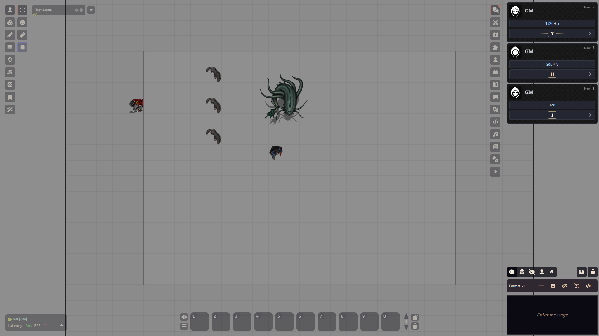
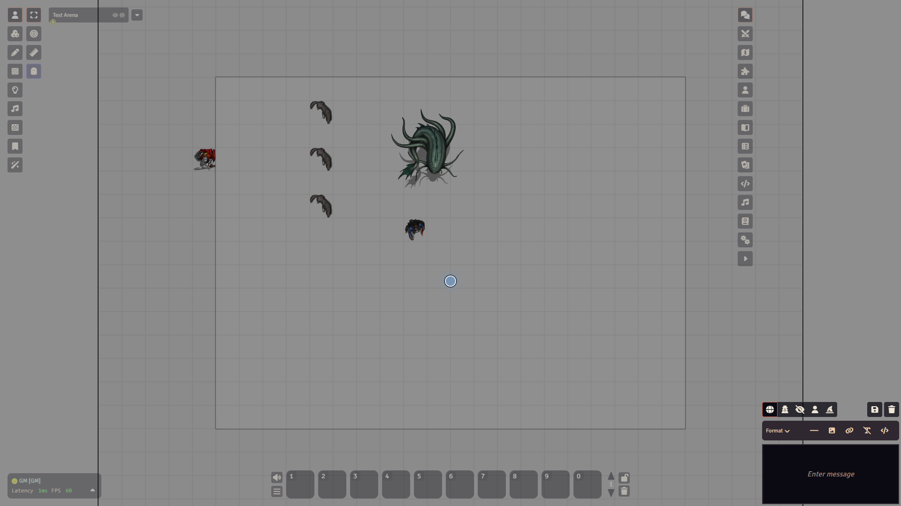

# Chat og terninger

## Hvad det er

Chatten er stedet, hvor alt, bordet siger og ruller, ender. Spillerne skriver dér, arkene sender deres rolls dér, og Foundry viser roll-kort dér. Terninger rulles ved at skrive en kort formel som `1d20+5`.

Åbn den med den første knap i sidebarens fanerække til højre, som hedder **Chat Messages**. Du kan også trykke Shift+C, som Foundry kalder **Focus Chat**.

## Send en besked eller et roll

1. Klik på beskedboksen nederst i chatfanen. Det er en lille teksteditor med en formateringsbar kaldet **Paragraph** øverst.
2. Skriv din tekst og tryk Enter.
3. For at rulle starter du med `/r` og en formel, for eksempel `/r 1d20+5`, og trykker Enter.

<video src="../../images/foundry/chat-roll.mp4" poster="../../images/foundry/chat-roll.png" autoplay loop muted playsinline aria-label="Man skriver /r 1d20+5 i chatboksen og sender det"></video>

Tryk pil op i beskedboksen for at hente det, du sendte før. Sæt en label efter et `#`, som `/r 1d20+5 # Perception`, så vises labelen på rollet.

Hvert roll viser formlen og totalen. Klik på den lille pil på et roll for at se de enkelte terninger.

## Terningformler

- `1d20+5`: en tyvesidet terning plus 5.
- `2d6`: to sekssidede terninger lagt sammen.
- `2d20kh`: rul to d20 og behold den højeste. Det er advantage. Brug `2d20kl` for at beholde den laveste (disadvantage). Læg en bonus på bagefter: `2d20kh+5`.
- `4d6kh3`: rul fire, behold de bedste tre.
- Procentterninger: skriv `1d100`. Genvejen `d%` accepteres ikke i Foundry 14.

## Hvem ser et roll

Under chatloggen er en række med fem små ikonknapper, og så to mere yderst til højre. De fem bestemmer, hvem der ser din næste besked eller dit næste roll. Hold musen over hver for at se dens navn.

- **Public as User**: alle ser det. Det er standarden.
- **Private to Gamemasters**: kun du og GM'erne ser det.
- **Blind to Gamemasters**: kun GM'erne ser det. En spiller, der ruller sådan, kan ikke selv se sit resultat.
- **Self Only**: kun du ser det.
- **Public as Character**: beskeden går ud som din karakter i stedet for som dig.

Indstillingen gælder også almindelig tekst, ikke kun rolls. Hvis dine beskeder ser ud til at forsvinde, så tjek, at den ikke står på **Self Only**.

Du kan også vælge synligheden for ét enkelt roll med en kommando:

- `/r`: et almindeligt roll.
- `/gmroll` (eller `/gmr`): privat til GM'erne.
- `/blindroll` (eller `/br`): blind for GM'erne.
- `/selfroll` (eller `/sr`): kun dig.
- `/publicroll` (eller `/pr`): alle.

## Hvisk til en

1. Skriv `/w` og spillerens navn og så din besked: `/w Alex meet me at the door`.
2. Til et navn med mellemrum eller flere personer bruger du firkantede parenteser: `/w [Alex Smith, Sam] hold still`.
3. Brug `/w gm` for at hviske til GM'erne, eller `/gm tekst` som genvej.

Kun dem, du nævner, kan se en hvisken.

## Roll fra arkene

På et dnd5e karakterark skriver du sjældent formler. Klik på en skill, et saving throw eller en attack, så lander rollet i chatten. Som regel spørger et lille vindue først. Det har knapperne **Advantage**, **Normal** og **Disadvantage** og et valg, **Roll Mode**. Hold Shift nede, mens du klikker, for at springe vinduet over og rulle normalt. Alt ruller med advantage. Ctrl ruller med disadvantage.

## Ryd chatten (GM)

Yderst til højre i rækken under chatloggen ser GM'en to ikonknapper: **Export Chat Log** (en diskette) og **Clear Chat Log** (en skraldespand). Clear åbner et vindue, **Flush Chat Log**, der spørger **Are You Sure?**. **Yes** sletter alle beskeder for altid.

For at fjerne én besked klikker du på skraldespand-ikonet i dens overskrift.

## Pas på

:::caution
**Clear Chat Log** med **Yes** kan ikke fortrydes. Skraldespand-ikonet på en enkelt besked sletter den med det samme, uden at spørge.
:::

- Hvis Foundry ikke accepterer en kommando, som `/r 1d%`, bliver der ikke sendt noget, og din tekst bliver stående i boksen.
- Et navn med mellemrum efter `/w` kræver firkantede parenteser. Uden dem går hviskningen ingen steder.
- `/save` og `/check` er ikke Foundry-chatkommandoer. Rul saves og checks fra arket.
