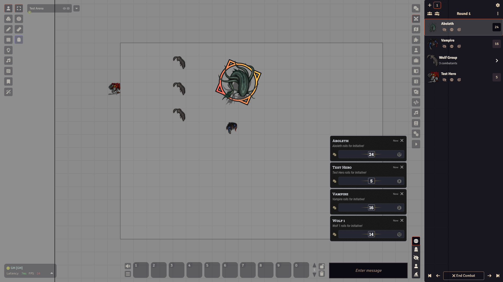
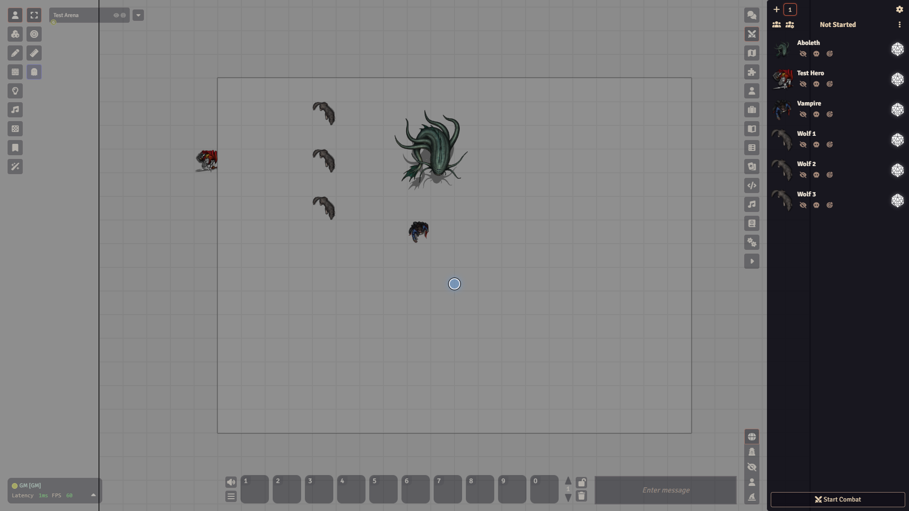

# Combat

## Hvad det er

En encounter er en liste over kæmpere i turorden, og den ligger i fanen **Combat Encounters** i sidebaren (ikonet med de krydsede sværd). GM'en bygger den, og alle kan se den. Når det er en kæmpers tur, er rækken markeret, og en markør drejer under tokenet.

## Start en kamp

<video src="../../images/foundry/combat-start.mp4" poster="../../images/foundry/combat-start.png" autoplay loop muted playsinline aria-label="Der rulles initiative, og en encounter startes"></video>

1. Skift til token controls til venstre og højreklik på et token på kortet. Token HUD'en åbner rundt om det.
2. Klik på knappen med de krydsede sværd, **Enter Combat**. Hvis der ikke er nogen encounter endnu, laver Foundry en. Du kan også åbne fanen **Combat Encounters** og klikke på **+** øverst, **Create Combat**.
3. For at tilføje flere på én gang skal du vælge dem alle (træk en boks, eller Shift+klik) og så gøre det samme på ét af dem. Alle de valgte tokens kommer med.
4. Åbn fanen **Combat Encounters**. Hvert token har en række. Før kampen starter, står der **Not Started** i toppen.
5. Rul initiative. Klik på d20-ikonet på en række, **Roll Initiative**, for at rulle for den kæmper. To ikonknapper øverst til venstre, **Roll All** og **Roll NPCs**, ruller for alle, der ikke har rullet, eller kun for de kæmpere, der ikke er spillere.
6. Klik på **Start Combat** nederst. Toppen skifter til **Round 1**, og øverste række har turen.

D20-ikonet åbner et rullevindue med knapperne **Advantage**, **Normal** og **Disadvantage** og et valg for **Roll Mode**. **Roll All** og **Roll NPCs** ruller uden vindue.

## Kør turene

Nederst har GM'en fem knapper. Hold musen over dem for at se navnene:

- **Previous Round** og **Previous Turn**: gå tilbage, hvis du gik for tidligt videre.
- **End Combat**: spørger "End this combat and empty the turn tracker?". **Yes** afslutter og fjerner encounteren.
- **Next Turn**: giv turen videre til næste række. Efter den sidste række starter næste round.
- **Next Round**: spring til næste round.

Hver round tæller som 6 sekunder på spilleuret i dnd5e.

## Ret en kæmper

Hver række har små knapper:

- **Hide** (det overstregede øje): skjuler kæmperen fra spillernes liste. Brug det til baghold.
- **Mark Defeated** (kraniet): sætter en Dead-markering på kæmperen. Klik igen for at fortryde.
- **Ping Token**: pinger tokenet på kortet.

Sæt initiative i hånden: klik på tallet i rækken, skriv en ny værdi og tryk Enter. `=15` sætter den til 15, og `+2` lægger 2 til.

Højreklik på en række for **Update Combatant**, **Clear Initiative**, **Re-roll Initiative** og **Remove Combatant**. Dobbeltklik på en række for at åbne actorens ark.

Ens monstre, for eksempel tre ulve, deler ét initiative-rul og vises som én række, for eksempel **Wolf Group** med "3 combatants". Klik på den for at åbne gruppen.

Knappen med tre prikker i toppen åbner encounter-menuen: **Edit Name**, **Reset Initiative**, **Clear Movement Histories**, **Link to Viewed Scene** og **End Combat**.

Tandhjulet øverst åbner **Combat Tracker Settings**. Her kan du slå markørerne for tokens' tur til eller fra, slå **Skip Defeated** til, så besejrede kæmpere mister deres turer, eller vælge en **Tracked Resource**, for eksempel hit points, som vises i hver række. Klik på **Save Tracker Settings** for at beholde ændringerne.

## Pas på

:::caution
**End Combat** fjerner encounteren, så en ny kræver, at du tilføjer tokens og ruller igen.
:::

- Når du markerer en karakter som defeated, sætter det Dead-markeringen på selve actoren. Fjern den igen, hvis karakteren kun var slået ud et øjeblik.
- Vinduet **End Combat** har **No** valgt fra start. Trykker du Enter der, beholder du kampen.
- Hvis du laver en ny encounter, så tjek, at du er på den rigtige. Nummererede knapper øverst skifter mellem encounters.
