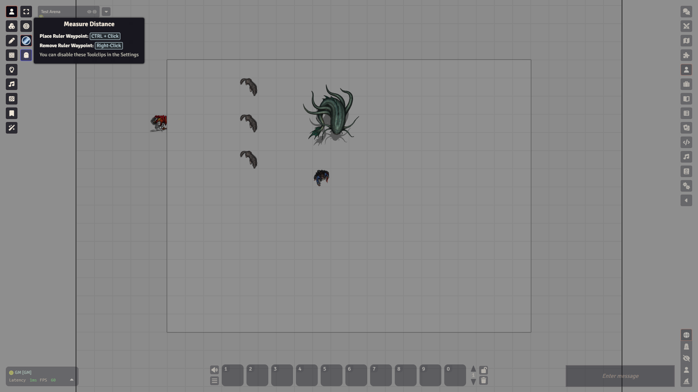
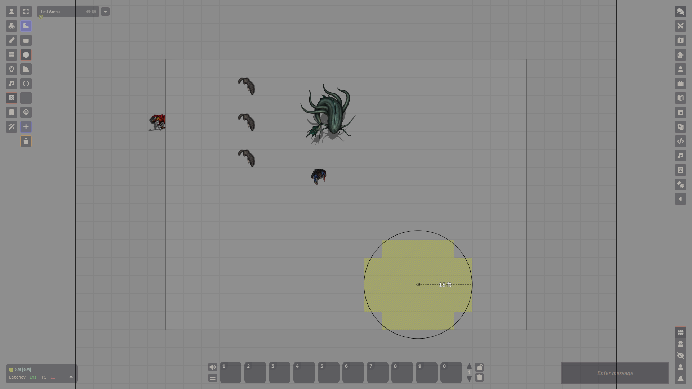

# Måling og templates

## Hvad det er

To ting hjælper dig med at bedømme plads på kortet. Linealen fortæller, hvor langt der er. En template markerer et område, for eksempel en fireball eller en cone of cold. I Foundry 14 er area templates **Regions**, som du tegner med Region Controls.

## Mål en afstand

<video src="../../images/foundry/measure-ruler.mp4" poster="../../images/foundry/measure-ruler.png" autoplay loop muted playsinline aria-label="Linealen trækkes hen over kortet og viser en afstand"></video>

1. Klik på **Token Controls** til venstre og så på **Measure Distance**. Holder du tasten R nede, er linealen slået til, så længe du holder. Foundry kalder den tast **Toggle Distance Ruler**.
2. Træk hen over kortet. En linje med afstanden dukker op.
3. For at bøje vejen skal du trykke F, mens du trækker. Foundry kalder den tast **Place Ruler Waypoint**.
4. Slip, så forsvinder linjen. Intet bliver gemt.

Afstanden bruger scenens grid-indstillinger. For at ændre dem skal du åbne scenens indstillinger (fanen Scenes, højreklik på scenen, **Edit**), gå til fanen **Grid** og sætte **Distance** og **Units**. På et almindeligt 5e-kort er det 5 fod pr. felt.

## Markér et spell-område

1. Klik på **Region Controls**.
2. Slå **Measured Template Mode** til. Den er slået fra for en GM, indtil du slår den til. I denne tilstand bliver hver form, du tegner, til en ny Region.
3. Vælg en form: **Draw Circle**, **Draw Cone**, **Draw Rectangle**, **Draw Line**, **Draw Ring** eller **Draw Emanation**.
4. Træk på kortet fra startpunktet. Formen følger din markør, og de grid-felter, den dækker, lyser op.
5. For at vælge formen senere skal du skifte til **Select Regions** og klikke på den.
6. For at fjerne den skal du vælge den og trykke Delete.

Slå **Force Snap to Grid Vertices** til, hvis formerne skal klikke fast på gridden.

## Templates fra spells og items

I dnd5e kan et item eller en spell med et område placere sin egen template. Chatkortet har en knap **Place Measured Template**. Klik på knappen på kortet i stedet for at tegne området i hånden.

## Pas på

:::note
Ældre videoer viser knapper, der hedder Circle, Cone, Rectangle og Ray i en separat gruppe, Measurement. Foundry 14 har ingen sådan gruppe. Kig under **Region Controls** i stedet.
:::

- **Clear Regions** sletter alle Regions på scenen efter én bekræftelse.
- Tjek, at scenens **Distance** er rigtig, før du stoler på et tal.
