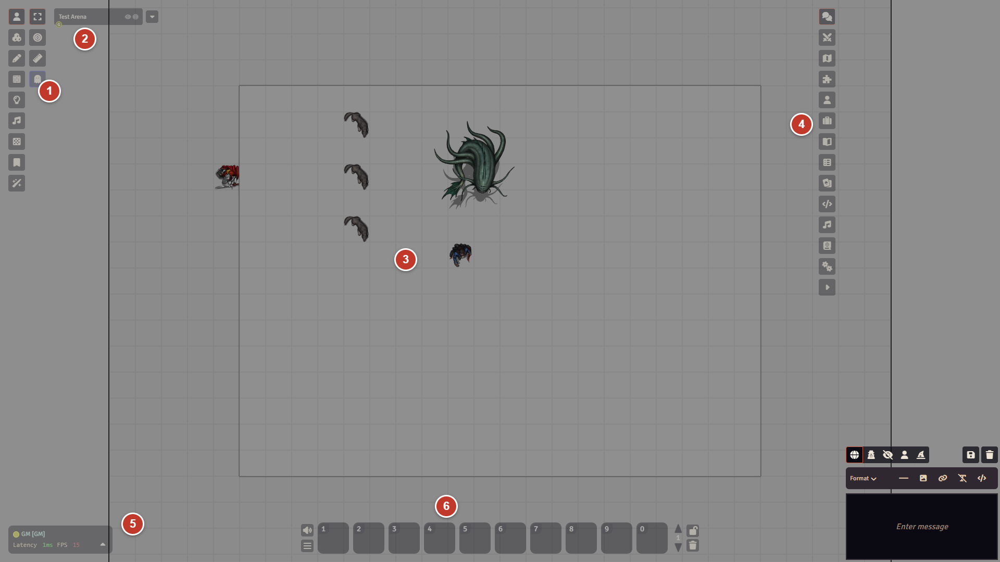
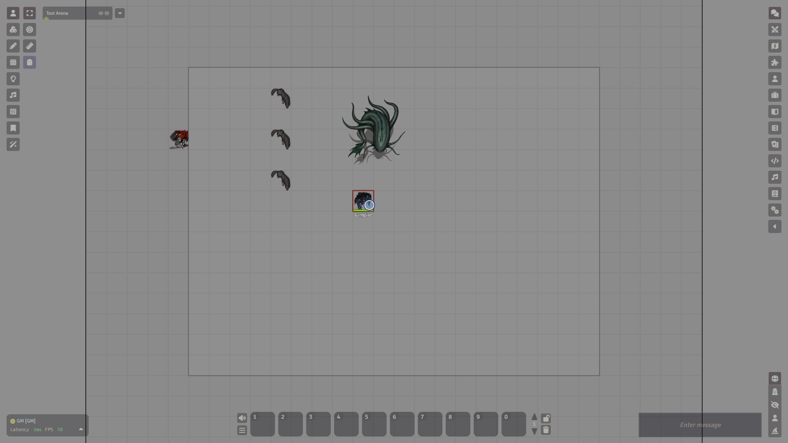

# En rundtur på Foundry-skærmen

Når du er kommet ind i en world, er alt, hvad du ser, én skærm. Kortet fylder midten, og værktøjerne sidder rundt om kanten. Denne side gennemgår delene, så du ved, hvor du skal kigge.

## 1. Scene controls (venstre kolonne)

Kolonnen af ikoner øverst til venstre. Hvert ikon er et **lag** på kortet, og når du klikker på et, vises værktøjerne til det lag i en anden kolonne ved siden af.

| Ikon (lag)                 | Hvad det bruges til                                         | Hvem ser det                                      |
| -------------------------- | ----------------------------------------------------------- | ------------------------------------------------- |
| **Token Controls**         | Vælg, flyt og target tokens, mål afstand                    | Alle                                              |
| **Tile Controls**          | Sæt billeder på kortet                                      | GM                                                |
| **Drawing Tools**          | Tegn figurer og tekst på kortet                             | GM og Trusted Players (en standard, du kan ændre) |
| **Wall Controls**          | Tegn vægge og døre                                          | GM                                                |
| **Lighting Controls**      | Sæt lys, skift mellem dag og nat                            | GM                                                |
| **Ambient Sound Controls** | Sæt lyde på kortet                                          | GM                                                |
| **Region Controls**        | Tegn områder, også de former der bruges til spell templates | Alle                                              |
| **Journal Notes**          | Nåle på kortet, der åbner journal entries                   | Alle                                              |

Kun ét lag er aktivt ad gangen. Standarden er **Token Controls** med værktøjet **Select Tokens**. En almindelig spiller ser Token Controls, Region Controls og Journal Notes.

Moduler kan tilføje deres egne ikoner. Med AI Tool-modulet slået til får GM'en også et **AI Tool**-ikon nederst i kolonnen.

Hold musen over et værktøj for at se dets navn. I **Game Settings** under **Core** slår indstillingen **Show Toolclips on Hover** de ekstra hjælpeklip på værktøjerne til eller fra.

## 2. Scene navigation

Øverst til venstre, lige til højre for scene controls. Når den er foldet sammen, viser den kun den scene, du kigger på, med et lille bogstav for hver tilsluttet bruger, der er på den. Klik på pilen (**Expand Navigation**) for at se de andre scener. Klik på en scene for at se den selv. Det flytter ikke nogen andre.

Som GM kan du højreklikke på en scene for **View**, **Activate**, **Pull Everyone**, **Edit**, **Preload** og **Toggle Navigation**. Se [Scenes](../../foundry/scenes.md).

## 3. Kortet

Kortet (canvas) fylder midten af skærmen.

- Zoom med musehjulet eller med Page Up og Page Down.
- Panorér ved at trække med højre museknap eller med piletasterne.
- Klik og hold på kortet, mens et Token Controls-værktøj er aktivt, for at sende et ping. Hold Alt nede samtidig for et alert ping.

## 4. Sidebar-faner (højre kant)

Sidebaren starter foldet væk, og kun en kolonne af ikoner er synlig. Klik på et ikon for at åbne den fane. Pilen nederst i kolonnen åbner og folder panelet. Højreklik på et ikon for at poppe fanen ud i sit eget vindue.

<video src="../../images/foundry/tour-sidebar-tabs.mp4" poster="../../images/foundry/tour-sidebar-tabs.png" autoplay loop muted playsinline aria-label="Sidebar-fanerne åbnes efter hinanden"></video>

Fra toppen og ned:

1. **Chat Messages**: chatloggen og stedet, hvor du skriver. Se [chat og terninger](chat-and-dice.md).
2. **Combat Encounters**: turorden og runder. Se [combat](combat.md).
3. **Scenes** (kun GM): alle scener i worlden.
4. **Placeables**: lister tokens, tiles, drawings, vægge, lys, lyde, regions og notes på den scene, du kigger på, en fane for hver slags.
5. **Actors**: karakterer, monstre og NPC'er. Se [Actors](../../foundry/actors.md).
6. **Items**: løse items, som ingen actor bærer.
7. **Journal**: noter og handouts. Se [Journal entries](../../foundry/journals.md).
8. **Rollable Tables**: tilfældige tabeller, du kan trække fra.
9. **Card Stacks**: kortbunker og hænder med kort.
10. **Macros**: gemte genveje, du kan lægge på hotbaren.
11. **Playlists**: musik og lyd. Se [Playlists and sound](../../foundry/playlists.md).
12. **Compendium Packs**: færdigt indhold fra systemet og moduler. Se [Compendiums](../../foundry/compendiums.md).
13. **Settings**: spilindstillinger, moduler, log ud. Se [Worlds og at komme ind](worlds-and-joining.md).

## 5. Spillerlisten (nederst til venstre)

Viser alle, der er forbundet lige nu, hver i sin egen farve, med dit eget navn først og GM'erne derefter. Efter et navn ser du **[GM]** eller navnet på spillerens karakter i parentes, hvis spilleren har en. Højreklik på et navn for at se valgmuligheder. Som GM kan du også vælge **Pull To Scene** for at flytte en spiller til din scene. Den lille pil nederst på listen viser også dem, der ikke er forbundet. Ved siden af ser du din latency og frame rate.

## 6. Hotbar (nederst i midten)

Ti macro-pladser, som du når med tasterne 1 til 9 og 0. Der er fem sider, så 50 pladser i alt. Klik på en tom plads for at åbne en ny macro dér. Gem den for at beholde den. Ved siden af pladserne er knapper til at skifte side, låse baren og rydde den. Til venstre er **Mute Volume**, som slår al lyd fra for dig, og **Main Menu**.

## Chat input

Når sidebaren er foldet sammen, flyder chat input stadig nær nederst til højre, og nye beskeder dukker op over den, så du kan læse og skrive uden at åbne noget. Tryk Shift+C for at hoppe til chat input.

## Pause

GM'en trykker på mellemrumstasten for at sætte pause. Et **GAME PAUSED**-banner vises for alle, og spillerne kan ikke flytte deres tokens, før GM'en trykker på mellemrum igen. Banneret blokerer ikke dine klik.

## Escape-menuen

Tryk Escape, når intet andet er åbent, for at få hovedmenuen. Alle får **Reload Application** og **Log Out**. GM'en får også **User Management** og **Return to Setup**.

:::caution
Escape lukker ting først og åbner kun menuen, når intet andet er åbent. Hvis et vindue er åbent, så tryk Escape, til det er væk.
:::

## Hvad en spiller ser anderledes

- Ingen **Scenes**-fane.
- Færre scene controls, som i tabellen ovenfor.
- Kun de actors, items og journals, spilleren har tilladelse til at se. Se [Users and permissions](../../foundry/users-and-permissions.md).
- En kortere Escape-menu og færre knapper i **Settings**.
- Mellemrumstasten sætter ikke spillet på pause.

Nye ord? Prøv [glossary](glossary.md).
