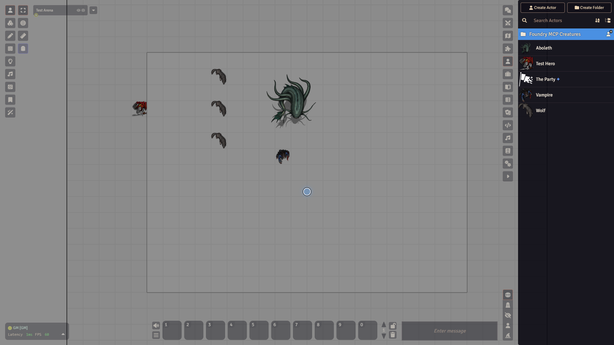
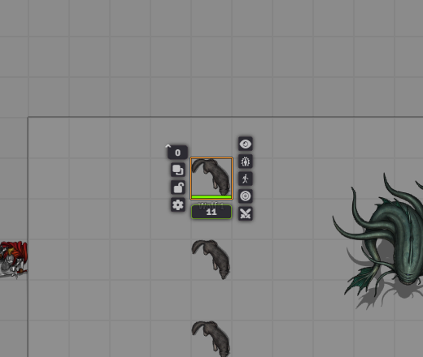
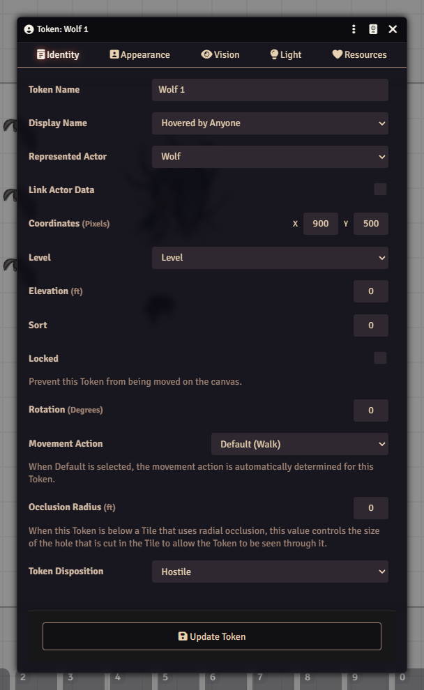

# Tokens

Et token er en actor på kortet. Actoren har værdierne. Tokenet er den lille figur, du skubber rundt. Du kan have ti goblin-tokens fra én goblin-actor.

## Sæt et token på kortet

1. Åbn fanen **Actors**.
2. Træk en actor fra listen ind på scenen.
3. Slip, hvor du vil have den.

<video src="../../images/foundry/tokens-drag.mp4" poster="../../images/foundry/tokens-drag.png" autoplay loop muted playsinline aria-label="En actor trækkes fra fanen Actors ud på kortet og bliver til et token"></video>

Det nye token kopierer actorens indstillinger for Prototype Token. Se [Actors](../../foundry/actors.md).

## Vælg og flyt

Åbn scene controls til venstre og vælg **Token Controls**. Værktøjerne er **Select Tokens** (standard), **Select Targets**, **Measure Distance** og **Unconstrained Movement**.

- Klik på et token for at vælge det.
- Træk et token for at flytte det.
- Dobbeltklik på et token for at åbne actorens ark.
- Flyttede du det forkerte token? Tryk Ctrl+Z.

## Token HUD'en

Højreklik på et token for at åbne HUD'en, en ring af små knapper rundt om det. Højreklik på tokenet igen eller tryk Esc for at lukke den.

Til venstre, oppefra:

- **Elevation**: skriv et tal og tryk Enter.
- **To Front/Back**: skifter, hvilket token der ligger øverst.
- **Lock** eller **Unlock**: et låst token kan ikke flyttes eller redigeres.
- **Open Configuration**: tandhjulet. Åbner Token Configuration.

Under tokenet: den første attribute bar. I dnd5e er det som regel hit points. Skriv et nyt tal ind i den.

Til højre, oppefra:

- **Hide** eller **Show**: øjet. Skjuler tokenet for spillerne.
- **Assign Status Effects**: vælg en condition, for eksempel Blinded.
- **Select Movement Action**: vælg, hvordan tokenet bevæger sig.
- **Target** eller **Untarget**.
- **Enter Combat** eller **Exit Combat**: tager tokenet med i eller ud af den aktuelle kamp. Se [Combat](combat.md).

## Token Configuration

Klik på tandhjulet i HUD'en for at indstille netop det token. For at ændre skabelonen til fremtidige tokens skal du åbne actorens ark, klikke på menuen med tre prikker i titellinjen og vælge **Prototype Token**.

Vinduet har fem faner:

- **Identity**: tokenets navn, visningsnavn, **Link Actor Data**, rotation, movement action og token disposition (Hostile, Neutral, Friendly eller Secret). Et placeret token viser også sin actor, position, level og elevation.
- **Appearance**: billede, fit mode, skala, tint, opacity og den dynamiske token ring.
- **Vision**: **Vision Enabled**, rækkevidde, vinkel, vision mode og detection modes.
- **Light**: tokenet afgiver lys, med de samme slags indstillinger som et lys, du placerer på kortet. Se [Walls and lighting](../../foundry/walls-and-lighting.md).
- **Resources**: **Display Bars**, hvilken attribute hver bar viser, og markøren for kampens tur.

Klik på **Update Token** nederst, når du er færdig. For et prototype token er der også en knap **Assign Token** ved siden af.

## Linked eller unlinked

**Link Actor Data** er en kontakt på fanen **Identity**. Kort sagt:

- **Linked** tokens deler én actor. Hit points og conditions på tokenet er actorens. Brug det til spillerkarakterer.
- **Unlinked** tokens arbejder hver på sin egen kopi af actoren. Brug det til monstre, så ti goblins kan såres hver for sig.

## Targeting

Targets viser, hvem et angreb eller en spell er rettet mod. Brug værktøjet **Select Targets** eller klik på **Target** i HUD'en. Klik på **Untarget** for at fjerne det.

## Pas på

- Hvis en spiller ikke kan flytte sit token, så tjek, at spilleren er **Owner** af actoren.
- At skjule et token med øjet skjuler det kun for spillerne.
