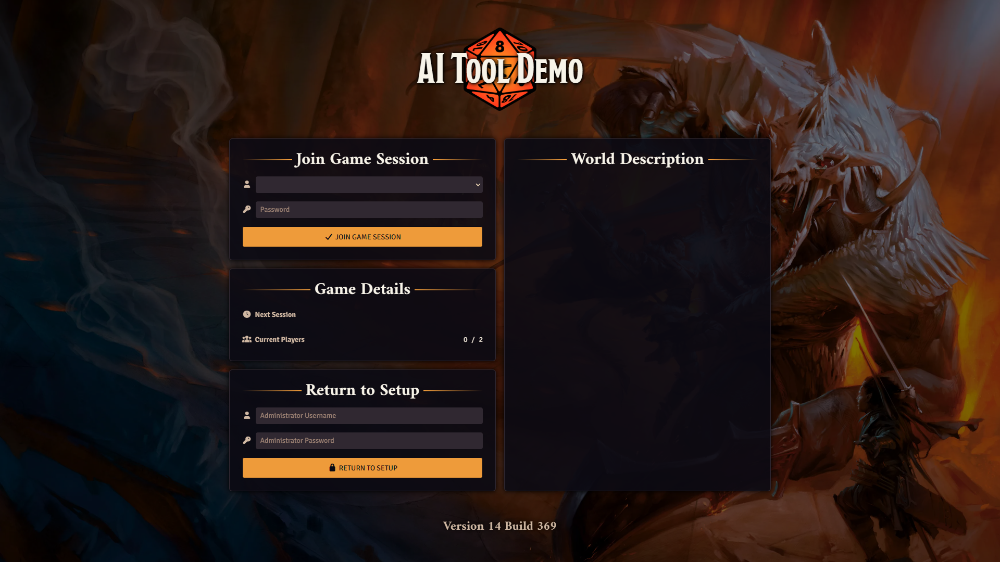
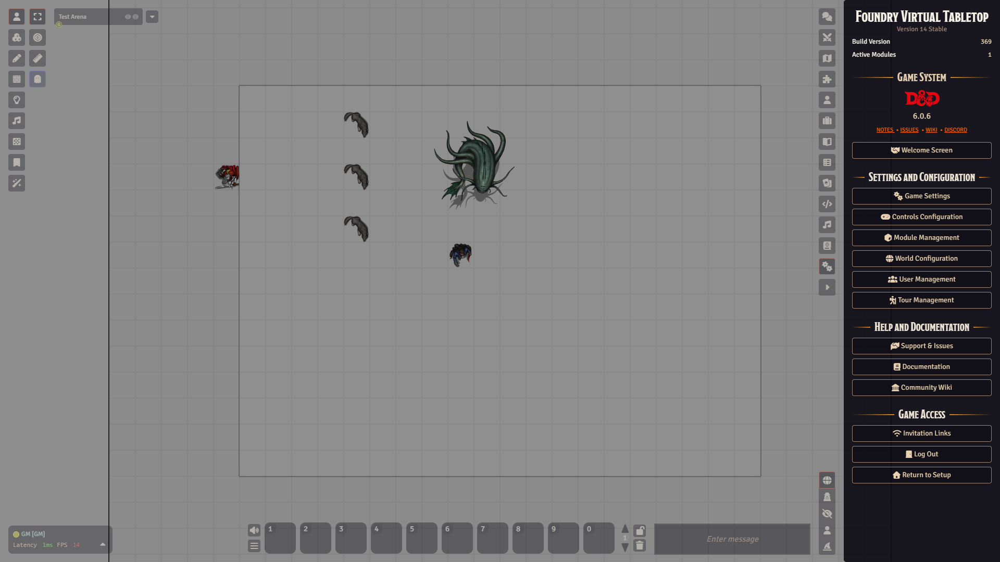

# Worlds og at komme ind

En **world** er én kampagne. Den rummer dine scener, actors, journals og listen over brugere. Foundry kører én world ad gangen. Når ingen world kører, ser du **setup-skærmen** i stedet.

## Setup-skærmen

Setup-skærmen er stedet, hvor du styrer, hvad der er installeret: worlds, spilsystemer og add-on moduler. Den har tre faner: **Game Worlds**, **Game Systems** og **Add-on Modules**. Kun den, der kører serveren, bruger den. Hvis der er sat en administratoradgangskode, logger du ind med den først.

Spillere ser aldrig denne skærm. De ser kun join-siden, når en world kører.

## Start en world

1. På setup-skærmen åbner du fanen **Game Worlds**.
2. Find din world på listen.
3. Klik på play-ikonet på worlden, eller højreklik på worlden og vælg **Launch World**.
4. Vent. Når den er færdig, åbner Foundry spilskærmen.

Hvis worlden sidst blev gemt med en ældre version af Foundry eller af systemet, viser Foundry først en **World Data Migration**-advarsel og tilbyder at lave en backup. Sig ja til backuppen. Trinnet **Begin Migration** kan ikke fortrydes uden en.

Du kan lave en ny world med knappen **Create World** på samme fane. Den kræver, at et spilsystem er installeret først.

## Lad spillerne komme ind

Spillere kommer ind via worldens adresse i deres browser. Sådan får du den:

1. Åbn fanen **Settings** i sidebaren (kun GM til denne del).
2. Klik på **Invitation Links**. Vinduet **Game Invitation Links** åbner.
3. Klik på et link for at kopiere det. **Local Network** virker for folk på samme netværk. **Internet** er adressen til folk andre steder fra. Den er skjult som en adgangskode. Klik på øje-ikonet for at vise den, eller på pile-ikonet for at tjekke, at forbindelsen er åben.

En spiller gør så følgende:

1. Åbner adressen.
2. Vælger sit brugernavn i boksen **Join Game Session**. I nogle Foundry 14-builds er det en
   rullemenu, i andre et tekstfelt, der foreslår navne, mens du skriver.
3. Skriver sin adgangskode, eller lader feltet stå tomt, hvis brugeren ikke har nogen.
4. Klikker på **Join Game Session**.

Under det viser en **Game Details**-boks **Next Session** og **Current Players**, for eksempel 3 / 5. GM'en sætter datoen for næste session i **World Configuration**. Brugere, der allerede er online, er grå på listen.

Hvis navnet eller adgangskoden er forkert, dukker en besked op, og der sker ikke andet.

Join-siden har også en **Return to Setup**-boks. Den kræver administrator-login, så spillere kan ignorere den.

## Log ud, eller luk worlden ned

Begge knapper findes i fanen **Settings**, i sektionen **Game Access** nederst. Du skal måske scrolle.

- **Log Out** tager dig direkte tilbage til join-siden. Intet går tabt. Kom ind igen, når du vil. Alle har den knap.
- **Return to Setup** lukker worlden ned for alle og vender tilbage til setup-skærmen. Kun en fuld Gamemaster har den. Hvis andre er forbundet, beder Foundry dig bekræfte først.

Escape-menuen har de samme to valg, som **Log Out** og **Return to Setup**.

For at starte worlden igen går du tilbage til setup-skærmen og bruger **Launch World**.

## Pas på

:::caution
**Return to Setup** afbryder alle spillere på én gang. Sig det til dem først.
:::

- Når du åbner join-siden, bliver din browser logget ud af worlden. Hvis du kun ville kigge, skal du joine igen.
- Adgangskoder sættes pr. bruger på siden **User Management**. Se [Users and permissions](../../foundry/users-and-permissions.md).
- Én browsersession rummer én bruger. For at teste en spillervisning, mens du er GM, kan du logge ud og joine som spilleren, bruge en anden browser eller bruge **Login as User** på User Management-siden.
- Del ikke **Internet**-linket offentligt. Det indeholder din offentlige adresse.

Næste: [En rundtur på Foundry-skærmen](screen-tour.md).
