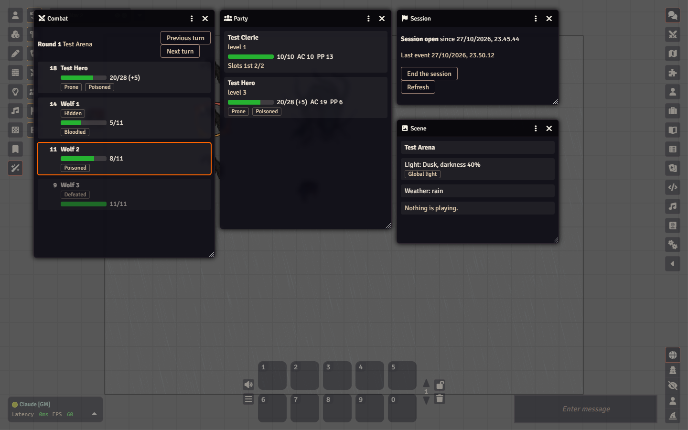
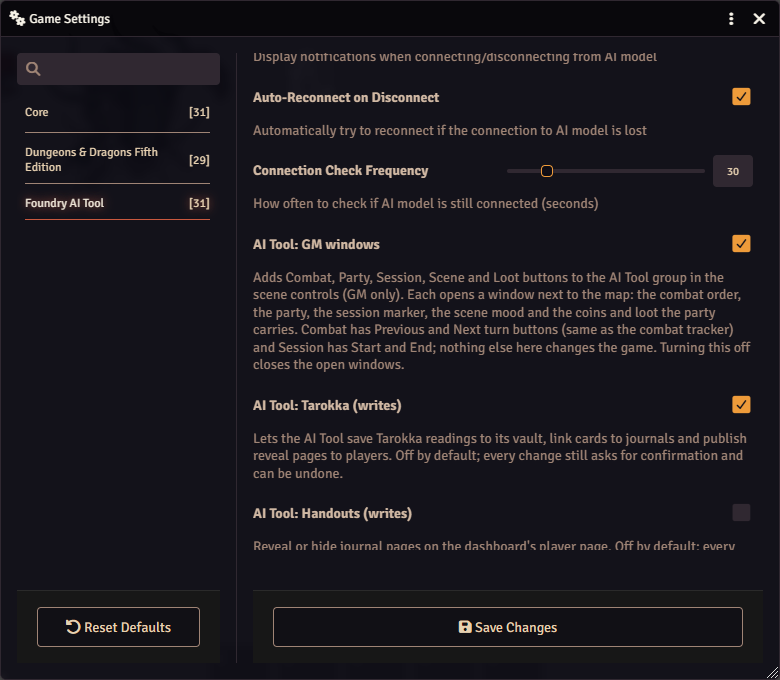
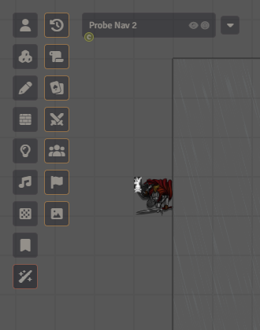
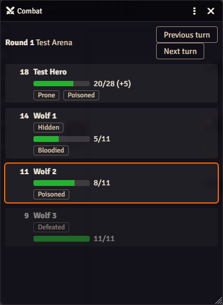
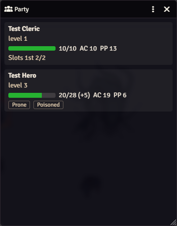
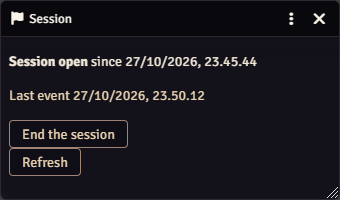
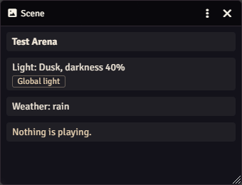
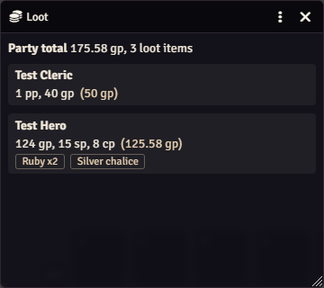

# GM-vinduerne

Under spillet kigger du hele tiden på de samme få ting: hvis turn det er, hvor såret partiet er,
om sessionen er markeret som i gang, hvordan lys og vejr er. Dashboardet viser
alt det, men det bor i en anden browserfane. **GM-vinduerne** lægger de samme ting i små
vinduer inde i Foundry, lige ved siden af kortet, så du kan køre en hel scene fra én skærm.

De er **kun til dig**. Spillerne ser dem aldrig, og der sendes intet til spillerne, når du åbner et.

## Slå dem til eller fra

Vinduerne er slået til som standard i en ny world. I en world, hvor modulets indstillinger nogensinde er blevet gemt,
kan indstillingen stadig være slået fra, og du kan selv slå den fra, hvis du ikke vil have knapperne.

1. Klik på tandhjulet i sidebaren (fanen **Settings**), derefter **Game Settings**.
2. Vælg kategorien **Foundry AI Tool**.
3. Sæt flueben ved **AI Tool: GM windows** (eller fjern det for at skjule knapperne) og tryk på **Save Changes**.

Knapperne dukker op med det samme, uden genindlæsning. Fjerner du fluebenet, lukkes alle åbne vinduer.

## Hvor knapperne er

Yderst til venstre på kortet har scene controls en gruppe, der hedder **AI Tool** (tryllestavsikonet nederst).
Klik på den, så åbner en anden kolonne med en knap til hvert vindue, i denne rækkefølge: Changes,
Handouts, Tarokka og Tarokka table (de fire er der altid), derefter **Combat**, **Party**, **Session**, **Scene** og **Loot**. En **Live**-knap kommer til sidst, når "AI Tool: Live window" er slået til (se [Live-visningerne](live-views.md)). Hold musen over en knap for at se dens navn.

Klik på en knap for at åbne vinduet (klikker du igen, kommer et åbent vindue forrest); krydset
i vinduet lukker det. Hvert vindue åbner på sit eget sted, så de ikke dækker hinanden. Du kan
trække i dem og ændre deres størrelse som alle andre Foundry-vinduer.

## Combat

Rækkefølgen i den igangværende combat: rounden, initiative, og for hver skabning hit
points (en grøn bjælke, med temporary hit points i parentes), conditions, og mærker for **Defeated**
og **Hidden** (en skjult skabning er skjult for spillerne, men du ser den stadig her).
Den skabning, hvis turn det er, har en orange ramme.

Knapperne **Previous turn** og **Next turn** gør nøjagtigt det samme som pilene i Foundrys combat
tracker. De vises først, når combaten er startet. Er der ingen combat i gang, siger vinduet det.

Når du beder Claude (eller dashboardets combat-bjælke) om at gå videre til næste turn eller sætte initiative lige
efter en skadesændring fra AI'en, så vent et sekund eller to først. Foundry kan tilføje Unconscious et øjeblik efter,
at hit points er faldet, og skifter turnen i det mellemrum, tæller den sene condition som en separat
ændring, så fortryder du damagen, bliver Unconscious på karakteren. Knappen Next turn i dette
vindue påvirkes ikke.

Hvornår: når bordet venter på dig, så rækkefølgen og hvem der er bloodied er et blik væk.

## Party

Ét kort pr. spillerkarakter: hit points, armor class (AC), passive Perception (PP), level, aktuelle
conditions og de spell slots, der er tilbage. Det viser kun karakterer, en spiller ejer, så et monster eller en
testkarakter uden ejer dukker aldrig op. Det opdaterer sig selv, når hit points eller conditions ændrer sig.

**Bed om roll.** En bjælke over kortene vælger rollet (en ability check, en saving throw eller en
skill), en valgfri DC, advantage og Public. **Ask** på et kort sender anmodningen til netop den karakter;
knappen under bjælken (**Group save** for en saving throw, ellers **Ask everyone**) sender den til
hver karakter på listen. Spillerne klikker på roll-kortet i chatten som sædvanligt. Resultatlisten under
bjælken fyldes ud, efterhånden som rollene kommer, pr. karakter, med "passes" eller "fails", når du gav en DC. Kun
det roll, du bad om, tæller: en anden save, en skill eller en attack fra samme karakter udfylder
ikke rækken. Et blot indtastet terningslag fra den karakter, som `/r 1d20`, udfylder den, så sig til
spillerne, at de skal klikke på kortet. Anmodningerne logges som alle andre anmodninger om roll, så recap og
statistik ser dem.

Knapperne er grå, med årsagen, mens "Allow Write Operations" er slået fra.

Hvornår: når du planlægger en combat eller et baghold og vil vide, hvad partiet kan tåle, og når
nogen spørger "hvad var min passive Perception nu igen".

## Session

Om en play session er **åben** eller ej, siden hvornår, og hvornår der sidst skete noget. Knappen
starter eller afslutter session-markøren, den samme som i dashboardet. Markøren skriver kun en linje
i session log (det er ud fra den, Claudes recap bygges); den ændrer intet i spillet, og
du kan starte eller afslutte den igen, når du vil.

Vinduet kræver, at AI Tool er forbundet (dashboardets **✈ Pre-flight** siger "Foundry connected"). Er det
ikke, siger vinduet "The AI Tool is not connected right now" i stedet for at stå tomt. **Refresh** spørger igen med det samme; det
tjekker også selv hvert femtende sekund.

Hvornår: start sessionen, når spillet begynder, og afslut den, når I stopper, så loggen og
recappen dækker det rigtige stykke.

## Scene

Den scene, bordet kigger på: dens navn, hvor mørkt der er (daylight, dusk, dark eller pitch dark, med
mørkhedsprocenten), om scenen har global light, vejret, og hvilke lyde der
spiller fra dine playlists. Det viser kun; for at ændre stemningen beder du Claude ("gør det til skumring og start
regnen") eller bruger dashboardet.

Hvornår: for at tjekke, hvad spillerne ser og hører, uden at åbne scenens
konfiguration.

## Loot

Hvad partiet bærer af skatte. Et kort for hver spillerkarakter med deres mønter (og hvad
mønterne svarer til i guldmønter) og deres skatte-items, med en total for hele partiet
øverst. Det opdaterer sig selv, når nogen får eller bruger mønter, eller et item tilføjes eller fjernes.

Kun items, der er markeret som skat, tæller: på itemets ark sætter du **Loot Type** til Art Object,
Gemstone, Treasure eller Trade Good. Almindeligt eventyrudstyr (et koben, en sovepose) er udeladt, så
vinduet ikke er en liste over alt i rygsækken. Vinduet viser kun; for at dele loot ud beder du
Claude ("giv Thorin 50 guld og en rubin") og bekræfter den ændring, den planlægger.

Hvornår: efter en combat eller et skatkammer, for at se, hvad partiet har nu, og hvem der har det.

## Hvis noget ser forkert ud

- **Ingen AI Tool-gruppe overhovedet:** indstillingen er slået fra (se Slå dem til eller fra ovenfor), eller du er ikke logget ind som GM. Spillerne
  får aldrig gruppen.
- **En besked nederst siger, at GM-vinduerne er slået fra:** indstillingen er slået fra. Slå den til igen i
  indstillingerne.
- **Combat eller Party er tom:** der er ingen combat i gang, eller ingen karakter ejes endnu af en spiller. Vinduet
  fortæller, hvilket af dem.
- **Session viser en fejl:** AI Tool er ikke forbundet. Se [Fejlfinding](troubleshooting.md).
- **Intet ændrer sig i et vindue:** luk det og åbn det igen. Combat, Party og Scene læser Foundrys
  egne data og tegner om inden for et øjeblik efter en ændring; Session spørger AI Tool og tjekker hvert femtende
  sekund, eller med det samme, når du trykker på Refresh.

Mere om de andre dele af værktøjet: [dashboardet](dashboard.md) og
[features og hvornår du slår dem til](features.md#gm-windows).
