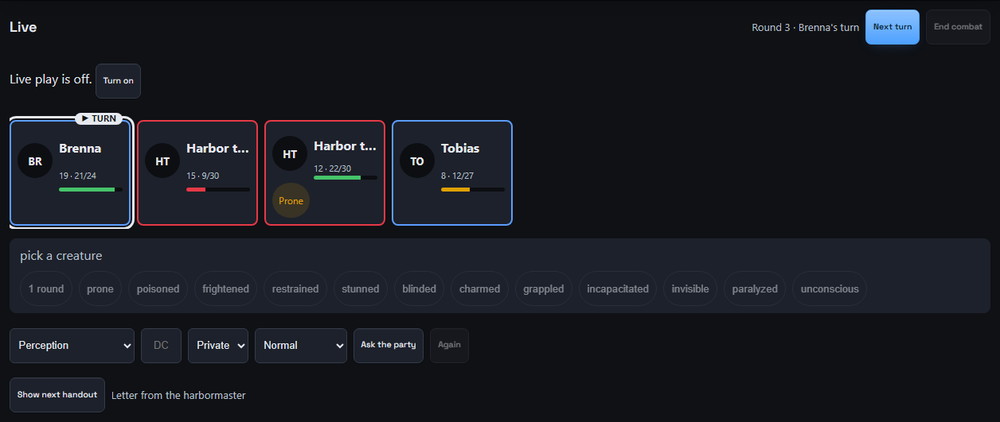

# Live-visningerne

Under en combat vil du have combat-rækkefølgen og de hurtige knapper (damage, conditions, party) i
syne, mens du kigger på kortet. Det kan gøres på tre måder. Alle tre ligger det samme sted: knappen
**Live views** øverst på dashboardet.

| Visning                   | Hvad det er                                          | Brug den, når                                                      |
| ------------------------- | ---------------------------------------------------- | ------------------------------------------------------------------ |
| **Live screen**           | Én fast dashboard-side med stripen.                  | Du har en ekstra skærm eller en tablet ved siden af Foundry.       |
| **GM page**               | Foundry og stripen side om side i ét vindue.         | Du har én skærm og vil have ét browservindue til det hele.         |
| **Live window** (Foundry) | Et lille vindue inde i Foundry, ved siden af kortet. | Du vil have stripen inde i Foundry og er okay med et smalt vindue. |

Menuen har én post mere, **Table at a glance**. Den er ikke en måde at se stripen på: det er en
skrivebeskyttet side med party, kampen og scenen, til en telefon. Se
[Table at a glance](dashboard.md#table-at-a-glance).

> **Usikker? Spørg Claude.** Spørg GM coach: "Hvilken live view passer til min opsætning, når jeg kører en combat?" ([sådan tilføjer du GM coach](gm-coach.md))

## Monster-angreb på strimlen

Vælg én creature, der ikke er en spillerkarakter, på strimlen, og op til fire af dens weapon attacks
vises som knapper under pick-baren. Target først spillerkarakteren i Foundry (den almindelige
targeting, tryk T eller brug target-knappen på token'en). Klik derefter på et angreb. Roll og damage
kommer i Foundrys chat som altid, og strimlen viser én resultatlinje. Damage lægges først på målet,
når du bekræfter, medmindre kontakten "apply without confirming" til live-spil er slået til. Uden
target, eller med mere end ét, siger strimlen det og ruller ingenting.

## På en tablet

På en touch-skærm, eller en tablet op til 10 tommer i landscape, er hver knap, select og
checkbox-etiket på Live view mindst 44 pixel høj, og siden scroller aldrig sidelæns. Hover findes
ikke på en tablet, så hold en finger på en kontrol i et halvt sekund, så vises dens tooltip som en
kort besked.

## Live screen

Åbn **Live views**, og vælg **Live screen**. Der er ikke mere at sætte op.

## GM page

Åbn **Live views**, og vælg **GM page** (adressen er `/gm` på dashboardet). Foundry kommer frem til
venstre og stripen til højre.

- **Luk din almindelige Foundry-fane først.** En Foundry-bruger kan kun være logget ind én gang, så
  med Foundry åbent i en anden fane er dit navn gråt i listen over brugere inde i siden.
- Log ind inde i siden. Den gule besked "Can't see Foundry here?" øverst over Foundry forsvinder, når
  du er kommet ind.
- Stripen er 320 til 720 pixel bred, og Foundry beholder altid mindst 1024 pixel. Træk i skillelinjen, eller brug piletasterne på den.
  Strip right, Strip left og Foundry alone skifter uden at genindlæse Foundry. Dit valg bliver gemt.
- Hvis Foundry ikke vil åbne inde i siden, tilbyder siden at åbne det i sin egen fane.
- Dashboardet skal kende Foundrys adresse (`DASHBOARD_FOUNDRY_URL`). Gør det ikke det, siger menuen
  Live views det.

## Live window

Live window ligger inde i Foundry. Slå det til dér: fanen **Settings**, **Game
Settings**, kategorien **Foundry AI Tool**, **AI Tool: Live window**. En knap **Live** kommer så frem i gruppen AI Tool.
Hvis vinduet er tomt, siger det hvorfor og hvad der skal ændres; den sædvanlige årsag er indstillingen
**AI Tool: Live window address**.

Live window følger Foundrys lyse eller mørke indstilling.

Dashboardet har endnu ingen knap til den; slå den til i Foundry.
