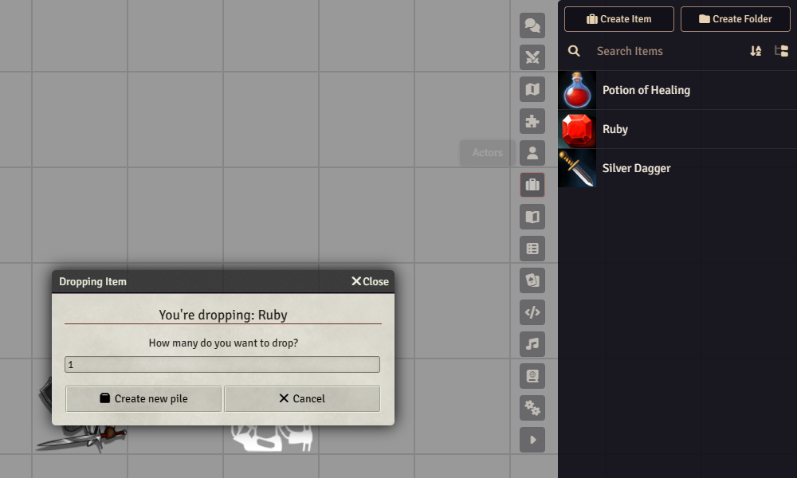
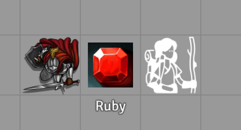
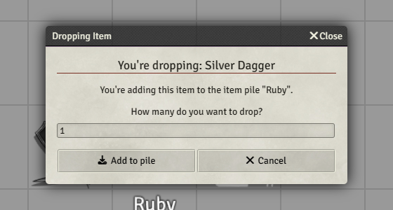
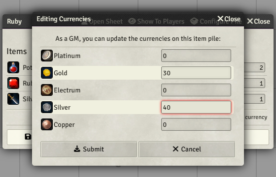
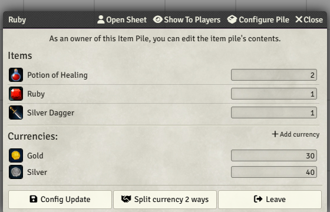
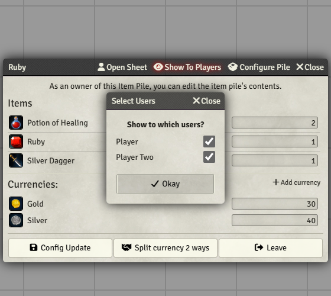
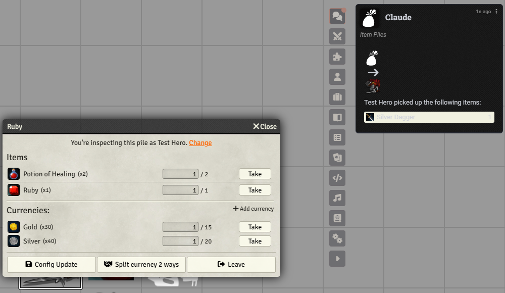
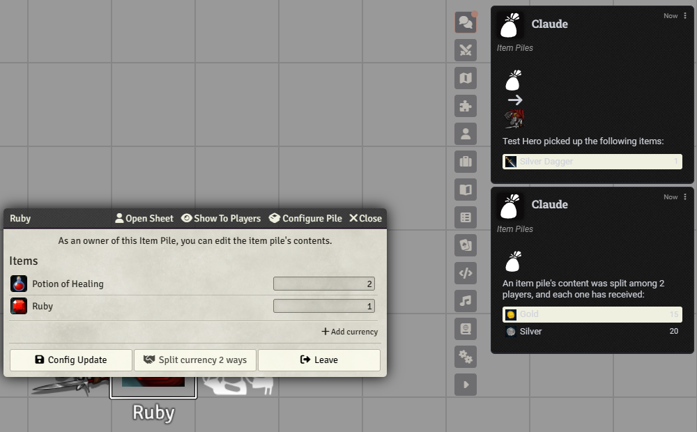
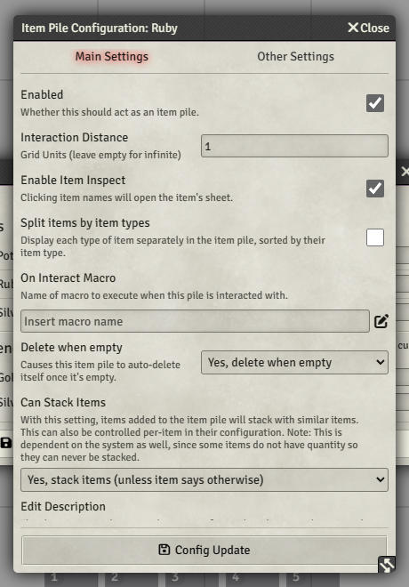

# Del loot ud med Item Piles

Loot ved bordet går gennem **Item Piles**, et Foundry-module, der allerede er slået til i Curse of
Strahd-worlden (sammen med dets lille hjælpe-module til D&D 5e). En bunke er en pose på kortet. Du
lægger items og mønter i den, og spillerne tager det, de vil have, med ét klik hver.

Dashboardets **Loot**-vindue deler ikke noget ud. Det viser kun, hvad partiet bærer rundt på (se
[Loot-vinduet og at spørge Claude](#loot-vinduet-og-at-spørge-claude) til sidst på siden).

Billederne er taget i en test-world med helt almindelige opfundne items (en rubin, en dolk, en
potion). Din skærm ser ud på samme måde, med dine egne items.

## Før du går i gang

- Spillerne skal have deres **eget token på scenen**, og Foundry skal vide, hvilken karakter hver
  spiller har. En spiller skal stå **lige ved siden af bunken** for at åbne den (se
  [Hvis en spiller ikke kan åbne bunken](#hvis-en-spiller-ikke-kan-åbne-bunken)).
- Åbn fanen **Items** i sidebaren (briefcase-ikonet). Det, du vil dele ud, skal være et item der, eller
  du laver det: **Create Item**, giv det et navn og et billede.

## 1. Lav bunken

Træk et item fra fanen **Items** ud på kortet, dér hvor lootet ligger. Et lille vindue, **Dropping
Item**, spørger, hvor mange. Klik **Create new pile**.

**Færdig, når det ser sådan ud:** itemets billede ligger på kortet som et token med itemets navn
under. Det token er bunken. En bunke med ét item ligner det item; den beholder billedet og navnet, når
du lægger mere i, så omdøb tokenet, hvis den skal hedde "Chest".

**Hvis det fejler:** vinduet **Dropping Item** åbner ikke, når du slipper itemet. Sørg for, at du
slipper over kortet og ikke over sidebaren eller et andet vindue, og at du er på den scene, spillerne
er på.

## 2. Læg flere items i

Træk det næste item fra fanen **Items** og slip det **på bunke-tokenet**. Vinduet siger nu "You're
adding this item to the item pile", og knappen hedder **Add to pile**. Ret tallet, hvis der er mere
end ét (to potions, for eksempel), og klik **Add to pile**.

**Færdig, når det ser sådan ud:** du kan dobbeltklikke på bunken og se alle items på listen.

**Hvis det fejler:** vinduet siger **Create new pile** igen i stedet for **Add to pile**. Du slap ved
siden af bunken og ikke på den. Annuller og slip itemet på selve tokenet.

## 3. Læg mønter i

Dobbeltklik på bunken for at åbne den. Klik **Add currency**, skriv mønterne i felterne (Gold, Silver
og så videre) og klik **Submit**.

**Færdig, når det ser sådan ud:** bunke-vinduet har en liste **Currencies** med dine beløb.

**Hvis det fejler:** et beløb viser 0, eller den forkerte mønt har det. Klik **Add currency** igen, tjek, at du
skrev i det rigtige felt (Gold, ikke Platinum), og klik **Submit**.

Tallene ved siden af items er, hvor mange der ligger i bunken, og du kan rette dem lige dér. Bunken er
din at redigere. Spillerne ser en udgave med **Take**-knapper.

## 4. Sig det til spillerne (valgfrit)

En spiller åbner en bunke ved at dobbeltklikke på den på kortet. For at spare dem for at lede kan du
klikke **Show To Players** i bunke-vinduet. Foundry spørger, hvilke spillere, og så **Okay**.

**Færdig, når det ser sådan ud:** bunke-vinduet åbner af sig selv på de spilleres skærme.

**Hvis det fejler:** en spiller ser ingenting. Vinduet åbner kun for spillere, der er logget ind og sat kryds ved
i listen. Bed dem dobbeltklikke på bunken på kortet i stedet.

## 5. Det gør spillerne

Spilleren ser items og mønter med en **Take**-knap ved hver. Ved flere af det samme siger det lille
felt, hvor mange der tages. Klik **Take**. Itemet lander på karakterarket, og et kort i chatten
fortæller, hvem der tog hvad, så alle kan se det. Vinduet har også knapperne **Config Update** og
**Leave** nederst; en spiller har kun brug for **Leave**, som lukker vinduet.

Når bunken har spillere med en karakter online, er grænsen ved mønterne hver spillers **andel**: med
to spillere står 30 guld som "1 / 15", så ingen kan tømme pungen alene. Items er først til mølle.

**Færdig, når det ser sådan ud:** itemet ligger på spillerens karakterark, og et chatkort siger, hvem der tog
det.

**Hvis det fejler:** spilleren kan slet ikke få vinduet åbent. Se [Hvis en spiller ikke kan åbne
bunken](#hvis-en-spiller-ikke-kan-åbne-bunken).

## 6. Del mønterne

Nederst i bunke-vinduet står **Split currency 2 ways** (tallet er, hvor mange spillere der er online
med en karakter). Du trykker på den; spillernes vindue viser den samme knap, så aftal, hvem der gør
det. Hver mønt deles ligeligt, og et chatkort siger det.

**Færdig, når det ser sådan ud:** mønterne er væk fra bunken, og hvert karakterark har sin andel.
Items bliver liggende i bunken, så spillerne kan tage dem.

**Hvis det fejler:** knappen siger **Split currency 0 ways**. Ingen er online med en karakter, så der
er ingen at dele med. Spillerne skal være logget ind, hver med en karakter tildelt.

## 7. Når bunken er tom

En bunke sletter sig selv, når sidste item og sidste mønt er taget. Vil du beholde den (en kiste,
partiet vender tilbage til), åbn **Configure Pile**, ret **Delete when empty** til **No, don't delete
when empty**, og klik **Config Update**. Indstillingsvinduet er vist under
[Hvis en spiller ikke kan åbne bunken](#hvis-en-spiller-ikke-kan-åbne-bunken).

**Færdig, når det ser sådan ud:** efter **Config Update** står **Delete when empty** på **No, don't
delete when empty**. Tokenet ligger så stadig på kortet, efter at sidste item og sidste mønt er taget.

**Hvis det fejler:** bunken forsvandt, og du ville have, at den blev. Den slettede sig selv, da den var tom. Lav
en ny bunke (trin 1), og ret **Delete when empty**, før spillerne begynder at tage.

## Hvis en spiller ikke kan åbne bunken

- **"You're too far away to interact with this pile."** Spillerens token står ikke ved siden af
  bunken. En bunke åbner som standard kun for et token ét gitterfelt væk (**Interaction Distance** er 1). Flyt tokenet hen til den, eller gør rækkevidden
  længere: åbn bunken, klik **Configure Pile**, ret **Interaction Distance** (tomt betyder alle steder
  fra) og klik **Config Update**.
- **De kan ikke finde den.** Brug **Show To Players** (trin 4); vinduet åbner på deres skærm.
- **Vinduet er til den forkerte karakter.** Der står "You're inspecting this pile as ...". Spilleren
  klikker **Change** og vælger sin egen karakter.
- **Der sker ikke noget ved dobbeltklik.** Tjek **Enabled** i **Configure Pile**. Er den slået fra,
  er tokenet kun et billede og ikke en bunke.

## Loot-vinduet og at spørge Claude

**Loot**-vinduet i [GM-vinduerne](gm-windows.md#loot) viser, hvad hver karakter bærer, og mønterne,
og det opdaterer sig selv, når mønter eller skat skifter hænder. Kun mønter og items markeret som skat
tæller (sæt **Loot Type** på itemet), så en dolk eller en potion, der tages fra en bunke, vises ikke
dér. Det er **read-only**: det har ingen knap, der giver noget
væk. Det job er bunkens.

Du kan også bede Claude lægge loot direkte på en karakter ("giv Thorin 50 guld og en rubin"). Det er
en almindelig guarded ændring: Claude viser en **plan**, du **bekræfter** den, og den kan **undo'es**
i Recent Changes (se [Hvordan Claudes ændringer godkendes](asking-claude.md#hvordan-claudes-ændringer-godkendes)).
Det kræver, at kontakten **AI Tool: Live play (writes)** er slået til ([funktioner](features.md)).
Claude åbner eller fylder ikke bunker; til en bunke bruger du trinnene ovenfor.

## Godt at vide

- Item Piles kan sende et velkomstkort i chatten, første gang det indlæses, og spillerne kan se det.
  Ser du et, så slet det, før spillerne kommer på.
- Mønter og items i en bunke er ikke i Loot-vinduet, før nogen tager dem: vinduet viser karakterer,
  ikke bunker.
