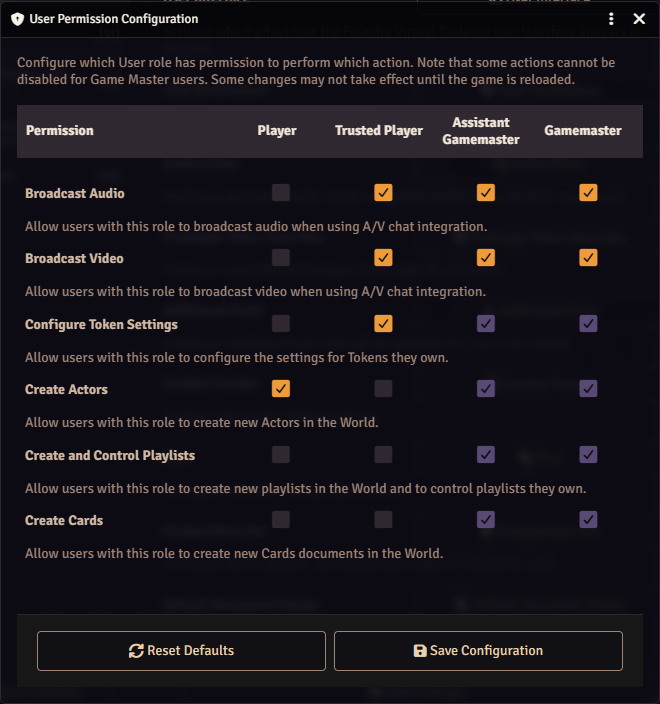
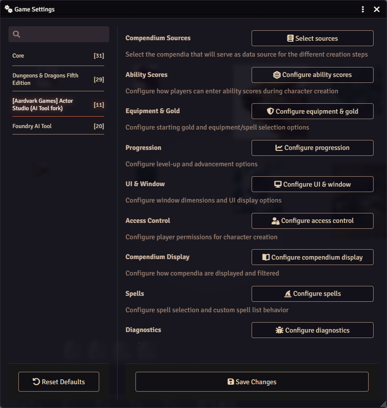
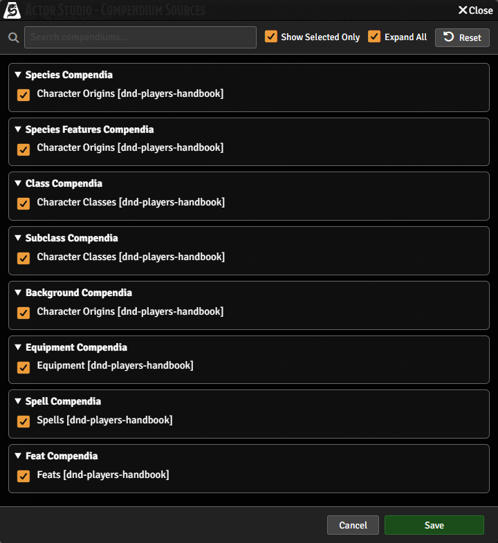

# Forbered session 0

Til session 0 laver hver spiller en karakter på level 3 i Foundry hjemmefra, med builderen
**Actor Studio** (spillerens side står i [Lav din karakter](../player/make-a-character.md)).
Builderen laver altid en karakter på level 1, så spillerne bygger den og stiger derefter to gange i level,
og de vælger deres subclass ved den anden level up.
Som standard kan spillerne ikke det: de må ikke oprette karakterer, Actor Studio læser de
ældre gratis regler i stedet for 2024 Player's Handbook, og knappen **Level Up** vises ikke,
før en karakter har nok experience points til det. Denne side sætter alle tre ting op, én gang, en uge
eller deromkring før session 0. Det tager ca. 30 minutter.

**På vores server er en del allerede gjort.** Adminens opsætningsscript sætter fire ting for karakterer:
spillerne må oprette karakterer, Actor Studio giver startudstyr, udstyret kommer fra
Player's Handbook, og ability scores kommer fra standard array eller point buy. Så trin 2 er et tjek,
og det er udstyrsrækken og metoderne til ability scores i trin 3 også.
**Alt andet i trin 3 er dit**: de andre rækker under Compendium Sources og Enable Spell Selection.
Scriptet rører dem ikke, og indtil du har sat dem, kan en spiller se
den ældre gratis species-liste og intet Spells-trin (se efter, hvad worlden viser). Sammenlign hvert vindue med billedet og
tabellen, og ret det, der er anderledes. Trin 1 og 4 er også dine.

Det hele er almindelige Foundry-indstillinger, du sætter som Gamemaster i din browser. Intet her kræver
kommandolinjen eller Claude. Hvad selve session 0 skal indeholde, bestemmer du; [Forberedelse og
forventninger](prep-and-expectations.md) har en dagsorden, du kan ændre.

:::tip
**Tag det som en quest.** [Quest: forbered session 0](prepare-session-0-quest.md) er denne side som
fem trin, du kan sætte flueben ved, uden billederne.
:::

## 0. Indsaml spillernes e-mails

Før alt andet: bed hver spiller i Discord om den e-mailadresse, de vil bruge, og send
listen til værktøjets admin. Kun adresser på adminens Cloudflare-liste får en login-kode. En adresse,
der ikke står på den, får aldrig en fejl, bare ingen kode, så det er det, der oftest går galt
den første aften. Sig til spillerne, at de skal bruge præcis den adresse, de har givet dig.

## 1. Én bruger til hver spiller

1. Tryk på **Esc** og vælg **User Management** (eller Settings tab, **User Management**).
2. For hver spiller klikker du på **Create Additional User**, skriver deres navn i **User Name**, lader
   **Password** stå tomt (Cloudflare Access og dens kode på mail er låsen) og beholder rollen **Player**.
3. Klik på **Save and Return**.

Send hver spiller deres brugernavn privat (en direkte besked på Discord), sammen med linket
til [Kom ind i spillet](../player/join.md).

## 2. Lad spillerne oprette karakterer (et tjek på vores server)

1. Settings tab, **Game Settings**, kategorien **Core**, knappen **User Permissions**.
2. I rækken **Create Actors** sætter du flueben i kolonnen **Player**.
3. Klik på **Save Configuration** (kun hvis du har ændret noget).

Uden det siger Actor Studio til en spiller "User requires the 'Create New Actors' permission".

## 3. Peg Actor Studio på 2024 Player's Handbook (delvist gjort på vores server)

Settings tab, **Game Settings**, kategorien **[Aardvark Games] Actor Studio (AI Tool fork)**.

1. **Compendium Sources**, **Select sources**. Vinduet åbner med **Show Selected Only**
   afkrydset, så det kun viser de packs, der allerede bruges: fjern fluebenet for at se dem alle. Sæt kun flueben ved
   packsene fra Player's Handbook-modulet (deres navne ender på `[dnd-players-handbook]`):

   | Række                                         | Sæt flueben ved   | Gjort på vores server?  |
   | --------------------------------------------- | ----------------- | ----------------------- |
   | Species Compendia, Species Features Compendia | Character Origins | Sættes ikke af scriptet |
   | Background Compendia                          | Character Origins | Sættes ikke af scriptet |
   | Class Compendia, Subclass Compendia           | Character Classes | Sættes ikke af scriptet |
   | Spell Compendia                               | Spells            | Sættes ikke af scriptet |
   | Feat Compendia                                | Feats             | Sættes ikke af scriptet |
   | Equipment Compendia                           | Equipment         | Ja, tjek det            |

   Metoderne til ability scores (punkt 2 herunder) sættes også af scriptet.

   Fjern flueben ved D&D 5e-systemets egne packs (de ældre gratis regler), ellers viser hver liste hvert valg
   to gange. Klik på **Save**, og derefter **Yes**, når Foundry spørger, om den skal genindlæse.

   

2. **Configure ability scores**: adminens script sætter **Allow standard array** og **Allow point
   buy** til og **Allow rolling** og **Allow manual input** fra, så hver spiller vælger standard array
   eller point buy, og ingen kan skrive et vilkårligt tal. Tjek, at de fire står, som beskrevet. Vil du have et andet sæt efter
   snakken ([Snakken om ability scores](prep-and-expectations.md#snakken-om-ability-scores)), så ændr det her, før
   spillerne åbner builderen, og sig det til admin: kører scriptet igen, kommer vores to metoder tilbage.
3. **Configure equipment & gold**: **Enable Equipment Selection** er afkrydset.
4. **Configure spells**: sæt flueben ved **Enable Spell Selection**. Adminens script sætter ikke den, så
   den kan være slået fra, indtil du sætter flueben. Er den slået fra, får en spellcaster måske ingen **Spells**-fane og skal tilføje
   cantrips og spells i hånden på det færdige ark, og det er let at gøre forkert. Er den slået til,
   spørger builderen efter dem og viser, hvor mange der er tilladt.

   Rækken Spell Compendia (punkt 1) bestemmer, hvilke spells Spells-fanen tilbyder, så sæt kun flueben ved
   Player's Handbook der. Feats som Magic Initiate er anderledes: de åbner Foundrys egen
   spell-browser, som viser alle udgaver, uanset hvad du har sat flueben ved. Spillerguiden beder spillerne
   vælge kopien "PHB 2024".

5. **Configure progression**, under **Leveling Options**: sæt flueben ved **Enable Level Up** og **Milestone
   Levelling**. **Uden Milestone Levelling ser en spiller ingen gylden Level Up-knap på sit
   ark, før karakteren har 300 XP (til level 2) og derefter 900 XP (til level 3).** Når den er slået til,
   er knappen der altid, og spillerne kan stige i level uden XP, og det vil vi ved
   session 0. (Alternativet er, at du selv giver hver karakter 900 XP.) Efter session 0 kan du
   fjerne fluebenet igen, hvis du hellere vil dele levels ud efter XP.

Når det hele er sat, er der et hurtigt tegn på, at packsene er rigtige: species-listen viser kun 2024-species,
en Cleric får en **Spells**-fane, og en ny karakters ark har en **Level Up**-knap.
Trin 5 er den fulde test.

Lad usage tracking være slået fra: vores kopi af Actor Studio har den slået fra for alle.

Actor Studio læser disse indstillinger, når siden indlæses. Ændrer du en, mens spillerne har
spillet åbent, så bed dem genindlæse (F5), før de åbner builderen.

Vores bord holder sig til 2024 Player's Handbook. Hvis du nogensinde tillader mere (for eksempel ældre species
i vores eget indholdsmodul), så sæt flueben ved de packs også og sig det til spillerne.

## 4. Giv tilmeldingssiden kampagnens udseende (valgfrit)

Tilmeldingssiden er det første, dine spillere ser, når de åbner linket til spillet. Ét klik giver den
The Veil: slottet i tågen som baggrundsbillede og en linje i lampelys over din world-beskrivelse.

1. Settings tab, **Game Settings**, kategorien **Foundry AI Tool**, knappen **Choose join page look**.
2. Behold eller ret **The lamplit line** (én kort linje).
3. Lad **Use The Veil picture as the world background** stå afkrydset, eller fjern fluebenet for at beholde dit eget
   billede.
4. Klik på **Apply The Veil**.

Din beskrivelsestekst bliver, som den er. **Back to Foundry's look** i samme vindue fjerner
linjen og billedet igen. Hvis du senere gemmer beskrivelsen i **Edit World**, og linjen
forsvinder eller mister sine farver, så åbn vinduet igen og anvend den.

## 5. Prøv det som spiller

Lav selv én karakter som spiller, så du ved, hvad de ser, og at det virker før aftenen.

1. I User Management laver du en bruger, der hedder **Test Player** (rolle Player).
2. Åbn spillet i et privat browservindue og log ind som Test Player.
3. Følg [Lav din karakter](../player/make-a-character.md) til ende.
4. Som GM ser du på karakterens ark med tjeklisten i trin 10 på den side, og derefter sletter du
   karakteren og brugeren Test Player.

## På aftenen

En dagsorden for hele aftenen, fra teknik-tjekket til afslutningen: [Forberedelse og
forventninger](prep-and-expectations.md#en-dagsorden-til-session-0-du-kan-ændre).

- Læg linket til [Lav din karakter](../player/make-a-character.md) op i Discord, plus dine
  svar: hvilken metode til ability scores, hvilke muligheder der er tilladt, og alt om kampagnen.
- Spillerne bygger samtidig; det tager dem ca. en time, level ups medregnet. Bliv i voice til spørgsmål.
- Når en spiller er færdig, åbner du karakterens ark og går tjeklisten i trin 10 igennem
  sammen med spilleren. Den hyppigste fejl: et valg, der blev sprunget over med **Next** (en manglende skill eller spell). Ret det
  i hånden, eller slet karakteren og lad dem lave den om.
- **Wizards:** Player's Handbook-modulets startudstyr til wizards har ingen spellbook. Åbn
  wizardens ark og fanen **Inventory**. I fanen **Compendium Packs** i sidebaren klikker du på
  **Open Compendium Browser**, åbner dens fane **Items**, søger på "Spellbook" og trækker den over på
  arket.
- Tjek, at hver spiller har valgt sin karakter i **User Configuration** (spillerlisten viser
  `Name [Character]`).
- **Læg hver færdig karakter i Party.** Terningekast uden for kamp (fx "alle slår Perception") går
  til Party, så en karakter uden for den bliver sprunget over. Åbn Party-skuespilleren og træk hver
  færdig karakter ind på arket, eller bed Claude om det. Følgende NPC'er kommer med på samme måde:
  sæt NPC'ens token til **Friendly** og træk NPC'en ind i Party.
- Tilføj portrætter: spillerne kan ikke uploade billeder, så de sender dem til dig. Åbn arket, klik
  på portrættet og vælg billedet.

## Bagefter

Du kan fjerne fluebenet ved **Create Actors** for spillerne igen; ingen har brug for det, før en karakter dør. Når
det sker, se [Når en karakter dør](death-and-new-characters.md).
