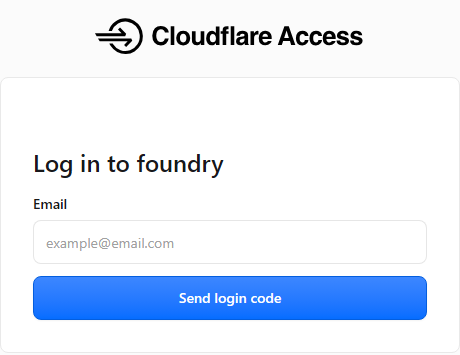
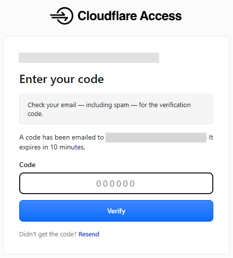
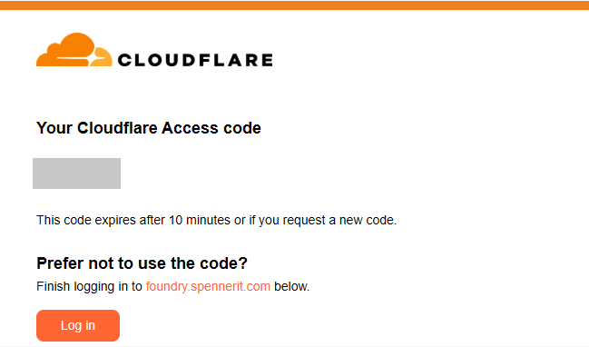
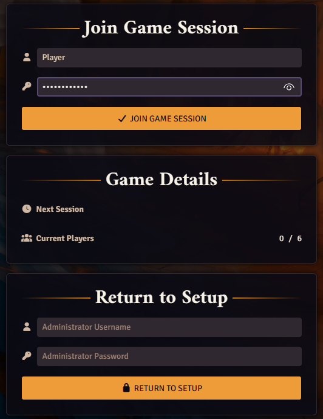
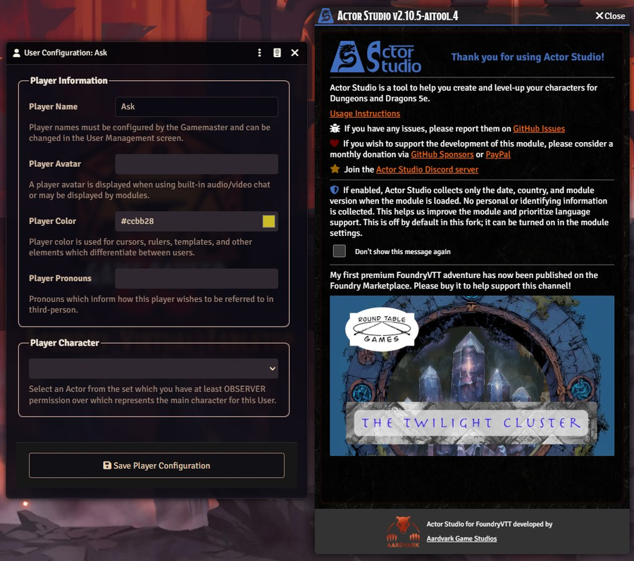
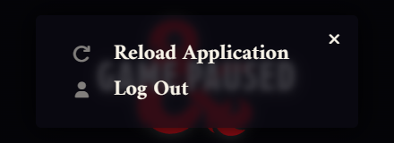

# Kom med i spillet

**Telefoner er til at læse på, ikke til at spille på.** Brug en laptop eller en stationær computer
til at spille. Og **giv Danni din e-mail først**: indtil Danni har lagt den på listen, kommer der
aldrig en login-kode, og Cloudflare viser ingen fejl.

Vi spiller to steder på én gang: **Foundry** i din webbrowser (kortet, dit karakterark, terningerne)
og **Discord** (voice). Denne side får dig ind begge steder. Gør det én gang før session 0, så et
eventuelt problem viser sig før spillet.

Det tager cirka ti minutter første gang. Bagefter er det bare adressen og dit navn.

## Det skal du bruge

- **En laptop eller en stationær computer.** Foundry skal bruge en skærm på mindst 1366 gange 768
  pixel. Telefoner og tablets er fine til at læse dit ark, ikke til at spille.
- **En nyere Chrome, Edge eller Firefox.** Chrome eller Edge virker bedst. Lad "hardware
  acceleration" stå slået til i browserens indstillinger (det er det, medmindre du har slået det
  fra).
- **Et headset eller earbuds med mikrofon**, så de andre ikke hører sig selv gennem dine højttalere.
- **Discord**, appen eller i browseren, og en invitation til vores server.
- **Fra GM'en:** spillets webadresse og dit Foundry-brugernavn (dit fornavn). Din bruger har ingen
  adgangskode: login-koden på e-mail er låsen.
- **En e-mailadresse, du kan åbne lige nu.** Giv den til Danni før session 0. Kun adresser på listen
  kan komme ind, så en anden adresse end den, du gav, virker ikke.

## 1. Åbn spillets adresse

Åbn den adresse, GM'en sender dig. Den starter med `https://` og ender med spillets eget navn. Vi
skriver den ikke her, fordi denne side er offentlig. Indsæt den fra GM'ens besked i browserens
adresselinje.

Første gang, og cirka en gang om måneden derefter, åbner en almindelig hvid side fra **Cloudflare
Access** i stedet for spillet. Den er låsen på hoveddøren. Du behøver ingen Cloudflare-konto.

1. Skriv den e-mailadresse, du gav GM'en, i **Email**-boksen.
2. Klik på **Send login code**. Siden beder nu om en kode.
3. Åbn din e-mail. En besked fra Cloudflare har en kode på seks cifre. Er den der ikke efter et
   minut, så kig i spam.
4. Skriv koden ind på siden og bekræft.

Siden tager dig nu videre til Foundry. Hvis du skrev en adresse, der ikke står på GM'ens liste,
siger Cloudflare det ikke: den sender bare aldrig en kode. Det er det første, du skal tjekke, hvis
der ikke kommer noget.

## 2. Log ind i Foundry

Foundrys join-side åbner. Den viser spillets navn øverst og tre felter til venstre.

1. I den første boks vælger du dit **brugernavn** på listen, præcis som GM'en skrev det.
2. Lad adgangskodeboksen stå tom. Din bruger har ingen adgangskode.
3. Klik på **Join Game Session**.

Ignorer boksen **Return to Setup** nederst. Den er til den, der kører serveren, og den gør ingenting
for dig.

Spillet indlæses. Første gang åbner to vinduer af sig selv: velkomstvinduet fra Actor Studio og
Foundrys **User Configuration**. Luk dem begge for nu. User Configuration kommer tilbage hver gang
du kommer ind, indtil du har en karakter og har valgt den der (se
[Lav din karakter](make-a-character.md)).

De to vinduer kan overlappe. Træk det ene til side, eller klik først på **Close** i Actor
Studio-vinduet.

Hvis skærmen siger **Game Paused**, har GM'en sat spillet på pause. Der er ikke noget galt. Det
forsvinder, når GM'en starter igen.

### At forlade spillet eller skifte bruger

For at forlade spillet skal du lukke browserfanen. For at skifte bruger på den samme computer skal
du trykke på **Esc** (tryk igen, hvis et vindue lukkede først) og vælge **Log Out**.

**Reload Application** i den samme menu er det første, du skal prøve, hvis spillet ser ud til at
hænge.

## 3. Kom med i Discord voice

Kom med i spillets voice-kanal på vores Discord-server. Brug push-to-talk, eller hold
baggrundsstøjen nede, og mute dig selv, når du går væk.

Sessioner kan blive optaget til noter. Din stemme gemmes kun, hvis du sagde ja skriftligt, og botten
skriver altid en besked, når den starter. Hvad der optages, og hvad der sker med det: [spillerguiden](README.md).

## Den skrivebeskyttede player page

GM'en sender dig måske også en anden adresse: **player page**. Det er en skrivebeskyttet webside,
praktisk på en telefon eller laptop, med combat order, session feed og de handouts, GM'en har vist
dig. Den er live nu. Den vil også have en e-mailkode, af samme slags som i trin 1 men et separat
login, så det første besøg forløber på samme måde. Du behøver den ikke for at spille. Mere i
[spillerguiden](README.md).

## Hvis det ikke virker

| Hvad du ser                                               | Hvad du skal gøre                                                                                                                                            |
| --------------------------------------------------------- | ------------------------------------------------------------------------------------------------------------------------------------------------------------ |
| Der kommer ingen e-mailkode                               | Vent et minut og tjek spam. Tjek, at du skrev den adresse, du gav GM'en, uden ekstra mellemrum. Ellers sig det til GM'en.                                    |
| Cloudflare-siden beder om din e-mail igen                 | Normalt cirka en gang om måneden eller i en ny browser. Få en ny kode.                                                                                       |
| Koden bliver afvist                                       | Koder udløber efter kort tid. Genindlæs adressen, klik på **Send login code** igen og brug den nyeste e-mail.                                                |
| "The requested User ... does not exist"                   | Brugernavnet er stavet anderledes. Kopiér det fra GM'ens besked.                                                                                             |
| Dit navn er gråt på listen eller mangler                  | Gråt: du er allerede logget ind et andet sted (en anden fane eller enhed). Luk den og prøv igen. Mangler: navnet er ikke i dette spil, så sig det til GM'en. |
| Foundry beder om en adgangskode                           | Du valgte den forkerte bruger, eller GM'ens. Vælg dit eget navn, det har ingen adgangskode. Bliver du stadig spurgt? Sig det til GM'en.                      |
| En advarsel om skærmopløsning                             | Gør browservinduet større, eller brug en computer med en større skærm.                                                                                       |
| Siden indlæses, men forbliver sort eller er meget langsom | Luk andre faner, tjek at hardware acceleration er slået til, og genindlæs siden (F5).                                                                        |
| Siden kan slet ikke nås                                   | Serveren er måske nede. Sig det til GM'en på Discord, GM'en har en plan B.                                                                                   |
