# Lav din karakter

Her gennemgår du, hvordan du laver en **level-3 karakter** i Foundry, sådan som vi gør det til
session 0: vores kampagne starter på level 3. Builderen laver altid en level-1 karakter, så du
bygger den først (trin 1 til 9) og levler den derefter op to gange til level 3. Det er også her, du
vælger din subclass (trin 10). Første gang tager det cirka en time. Du skal være logget ind først:
se [Kom med i spillet](join.md).

Vi bruger **Actor Studio**, en character builder inde i Foundry. Den stiller de samme spørgsmål som
2024 Player's Handbook, i samme rækkefølge, og udfylder dit character sheet for dig. Du kan ikke
ødelægge noget: går det galt, sletter GM'en karakteren, og du starter forfra.

Tjekket på Foundry 14, D&D 5e system 6, Actor Studio 2.10.5 og 2024 Player's Handbook-modulet
2.2.0 (oktober 2026).

## Før du starter

Spørg din GM, eller læs beskeden om session 0, om:

- **Hvordan du får dine ability scores.** Vores bord bruger to metoder: standard array (15, 14,
  13, 12, 10, 8) og point buy. Terningkast og at skrive sine egne tal er slået fra, så builderen tilbyder
  kun de to. Vælg den, du vil; standard array er den hurtigste.
- **Hvilke muligheder der er tilladt.** Som regel alt i 2024 Player's Handbook, og det holder vores
  bord sig til. Nogle borde tilføjer eller fjerner species, backgrounds eller classes.
- **Om der er noget særligt ved kampagnen.** Nogle kampagner foreslår backgrounds eller ideer til
  karakterer.
- **At level up er slået til for dig.** Det gør GM'en (se trin 10). Kan du ikke finde knappen
  **Level Up**, når du når dertil, så spørg GM'en.

Hav en grov idé om din class, species og background. Du behøver ikke kunne reglerne udenad: hvert valg
i builderen viser sin beskrivelse.

To små ting, der sparer dig besvær:

- **Genindlæs siden (F5), hvis GM'en har ændret builderens indstillinger, mens du havde den åben.**
  Builderen læser dem kun, når siden indlæses.
- **Et trin kan vise et tomt panel i omkring 5 sekunder**, efter du har klikket **Complete**. Der er
  ikke noget galt. Vent på, at næste trin dukker op, og klik ikke igen.

## 1. Åbn Actor Studio

1. I sidebaren til højre klikker du på fanen **Actors** (ikonet med personen).
2. Øverst i den fane klikker du på knappen **Actor Studio** (dens logo, under **Create Actor**).

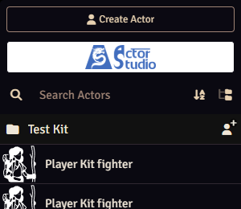

Første gang du logger ind, åbner to vinduer af sig selv: velkomstvinduet fra Actor Studio og
Foundrys **User Configuration**. Sæt flueben i **Don't show this message again** i velkomstvinduet
og luk det. Luk også User Configuration: du vælger din karakter dér i
[trin 11](#11-gør-den-til-din-karakter), og indtil du gør det, åbner den igen hver gang du joiner.

Builder-vinduet har fanerne **Abilities**, **Species**, **Background** og **Class**, en boks
**Character Name** nederst og en bar, der viser, hvor langt du er.

> Får du beskeden "User requires the 'Create New Actors' permission", så sig det til GM'en.
> Spillere kan ikke lave karakterer, før GM'en sætter flueben ved **Create Actors** for rollen Player
> (GM'ens side "Prepare session 0" dækker det).

## 2. Abilities

1. Ser du en liste **Ability Generation Method**, så åbn den og vælg den metode, din GM har valgt.
   Har GM'en kun slået én metode til, er der ingen liste: fanen viser bare den metode.
2. Læg dine bedste scores der, hvor din class har brug for dem. Med standard array bruger du de små
   pile ved hver score til at bytte den med naboen. En wizard vil for eksempel have den højeste score
   i Intelligence, en fighter i Strength eller Dexterity.

Læg ikke noget til for din background endnu: det spørger builderen om senere.

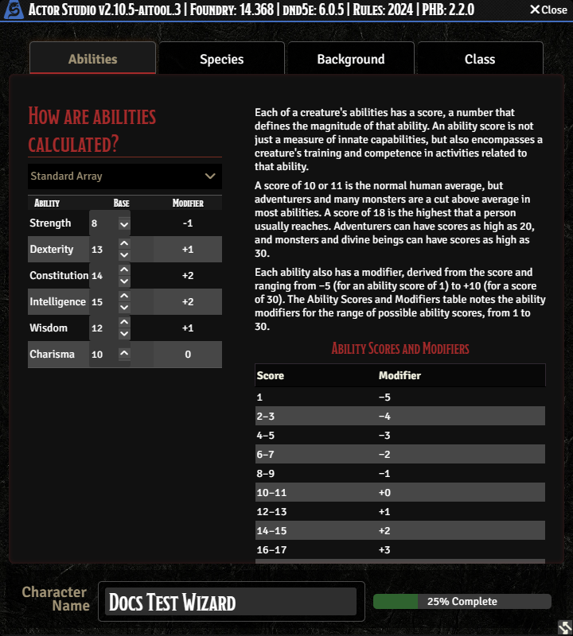

## 3. Species

Åbn listen **Species** og vælg en. Beskrivelsen og dens traits vises nedenunder.

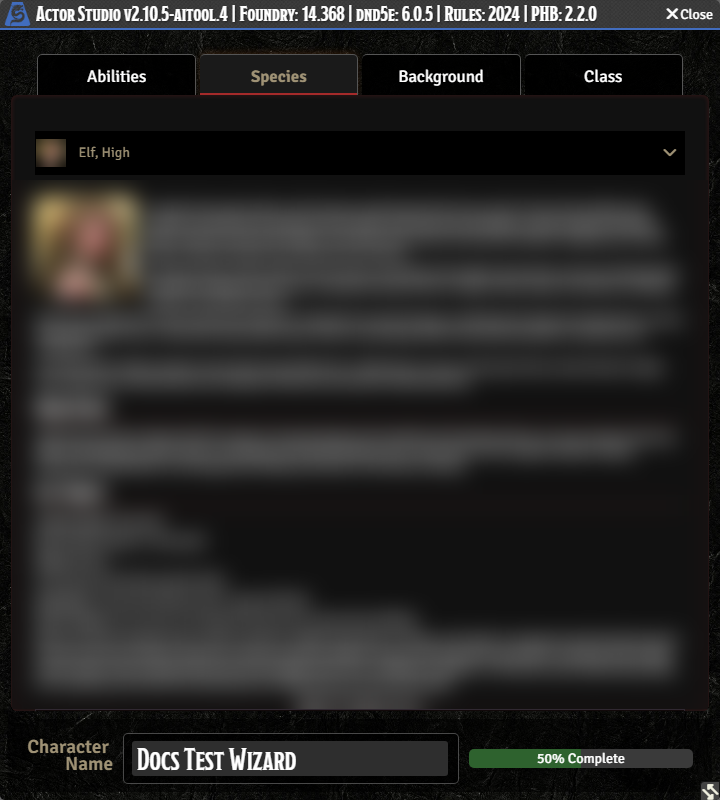

Nogle species står der flere gange, én post per lineage: Elf (Drow, High, Wood), Gnome (Forest,
Rock) og Tiefling (Abyssal, Chthonic, Infernal). Listen viser lineage efter navnet, for eksempel
"Elf, High". Vælg den, du vil have.

## 4. Background

Åbn listen **Background** og vælg en. Boksen viser, hvad den giver dig: hvilke ability scores den kan
hæve, en feat, to skills, et tool og startudstyr.

**Notér de to skills, din background giver.** Din species lader dig måske vælge en skill senere (en
elf gør), og vælger du en, du allerede har, mister du en proficiency, se
[trin 7](#7-advancements-svar-på-hvert-trin).

## 5. Class

Åbn listen **Class** og vælg en. Siden viser classens main ability, hit points, saving throws, de
skills du kan vælge imellem og startudstyret. I 2024-reglerne vælger du subclass på level 3, altså
ikke nu: du vælger den, når du levler op i
[trin 10](#10-level-up-til-level-3-og-tjek-så-dit-sheet).

## 6. Navn og opret

1. **Erstat navnet i Character Name** nederst. Det starter med dit eget spillernavn, og baren
   viser allerede 100 %, før du har skrevet noget, så det er let at klikke lige igennem.
   Glemmer du det, ender din karakter med at hedde det samme som dig.
2. Klik **Create Character**.

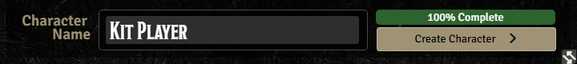

Din karakter findes nu (du kan se den i fanen Actors), og builderen går videre til fanen
**Advancements**. Indtil her kunne du ændre alt frit. Herfra gælder det: har du valgt forkert,
så gør dig færdig alligevel og sig det til GM'en.

## 7. Advancements: svar på hvert trin

Builderen gennemgår, hvad din species, background og class giver dig, ét trin ad gangen
("Step 2 of 3"; antallet af trin afhænger af dine valg). Nogle trin fortæller dig bare, hvad du
får: klik **Next**. Andre beder dig vælge. Efter **Complete** kan et trin vise et tomt panel i
omkring 5 sekunder: vent på det næste.

**Vælg alt, hvad et trin beder om, før du klikker Next.** Knappen Next virker, selv når du ikke har valgt
noget, og så mangler din karakter bare det valg. Kig efter tekst som "Select 1 more Skill
Proficiency": den skal være væk, før du klikker Next. **Previous** går et trin tilbage.

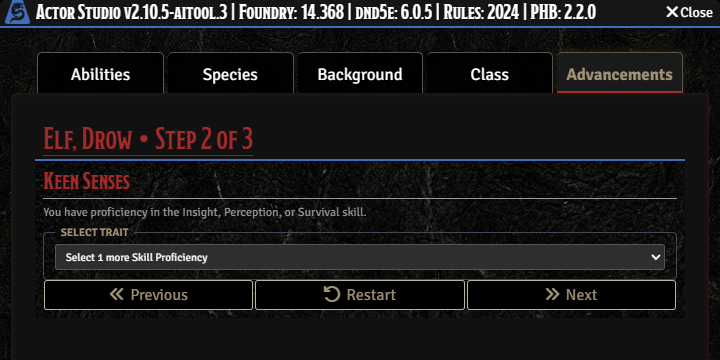

De trin, du kommer til at se, nogenlunde i denne rækkefølge:

- **Species traits:** for eksempel en skill at vælge (en elf vælger Insight, Perception eller
  Survival) og en spellcasting ability til species-magi. **Vælg en skill, som din background ikke
  allerede giver dig.** Species-trinnene kommer først, og backgroundens faste skills tilbydes ikke
  igen bagefter, så en skill, du vælger to gange, går stille tabt, og du ender med én skill for lidt.
- **Size:** trinnet kan stå på **Small**, selv for en species, der er Medium (en human, for
  eksempel). Åbn listen og vælg **Medium**, medmindre din species virkelig er small.
- **Valg med en tæller**, som Divine Order for en cleric: trinnet viser **Chosen 0 of 1**.
  Next lader dig komme videre ved 0, så vent, til der står **Chosen 1 of 1** (eller hvad det andet
  tal nu er). Har du klikket forbi et, så tryk **Previous** for at gå tilbage og vælge.
- **Background ability scores:** hæv de tre scores, der er nævnt: én med 2 og en anden med 1, eller
  alle tre med 1. Klik på **+** ved scorerne, til der står **0 Points Remaining**.

  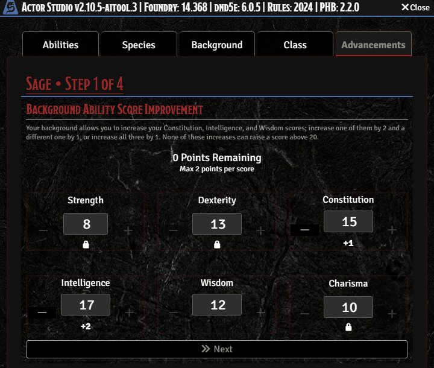

- **Languages, skills og tools** fra din background. Trinnet **Languages** beder dig vælge, ud over
  Common: teksten siger for eksempel "Select 2 more Languages". Klik på de sprog, du vil have, i
  listen (spørg din GM eller din D&D-hjælper, hvilke der passer til kampagnen), til teksten er
  væk, og klik så **Next**.
- **Backgroundens feat.** Nogle feats beder om flere valg. Magic Initiate beder for eksempel om
  to cantrips og en level-1 spell: vælg dem alle med **Select Spell** for hver. Vælgeren er Foundrys
  compendium browser, og den kræver lidt omhu:
  - **Vælg kopien mærket "PHB 2024".** De fleste spells står der én gang per bog (SRD 5.1, SRD 5.2,
    PHB, PHB 2024), så du ser det samme navn op til fire gange.
  - **Vælg kun spells fra den class, der står efter Magic Initiate**, for eksempel Wizard spells til
    Magic Initiate (Wizard). Class-filtrene er låst til Cleric, Druid og Wizard på én gang, så du
    også får vist spells fra de to andre lister, og intet forhindrer dig i at vælge en af dem.
  - Søgefeltet i den browser skal have **Enter**, før det filtrerer.
  - **En feat, der beder om en spellcasting ability og så spørger igen** (et andet Magic Initiate
    trin): det andet trin sætter ability tilbage til **Intelligence**, selvom den burde passe til den
    første. Sæt den igen til samme ability som dine cantrips, for eksempel Wisdom til en clerics
    liste.
  - Et spell-kort kan blive hængende nederst til højre på skærmen, efter browseren er lukket.
    Ignorér det.

  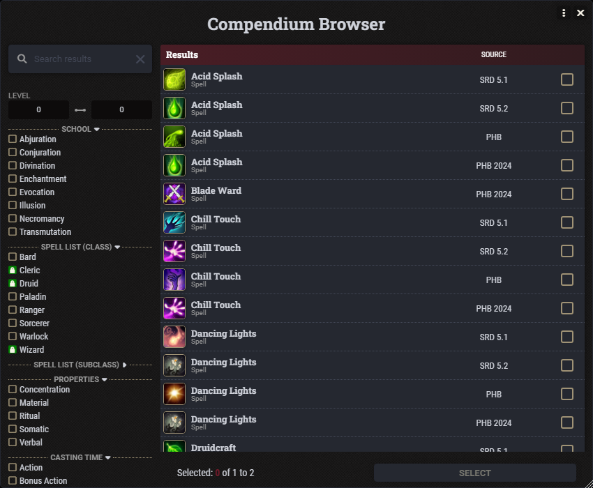

- **Class:** hit points, saving throws, **skills du kan vælge** (de fleste classes vælger to), træning i
  våben og rustning og dine level-1 class features. **Weapon Mastery:** barbarian, fighter,
  paladin, ranger og rogue får et trin, hvor du vælger de våben, du kender mastery for (for
  eksempel "Select 3 more Weapon Masteries" for en fighter). Vælg de våben, du vil kæmpe med, og
  vent, til teksten er væk, før du klikker Next. Våbnets mastery-egenskab (Topple, Sap, Vex og så
  videre) virker så, hver gang du angriber med det. Trinnene har overskriften "Level 1 -> 2", selvom
  du bygger en level-1 karakter først. Det er bare en mærkelig overskrift. Tag trinnene, som de
  kommer.

## 8. Equipment

Så kommer fanen **Equipment**.

1. Under **Starting Gold** vælger du én mulighed for din background og én for din class: udstyret
   plus lidt guld, eller kun guld.
2. **Planned Inventory** til højre viser, hvad du får.
3. Scroll ned i venstre kolonne. Items bliver grønne af sig selv, men **guldbeløbene
   (for eksempel 5 GP og 8 GP) forbliver sorte, til du klikker på dem**, og det er én af tingene, der
   holder baren på 75 %. Klik på hvert guldbeløb, til det er grønt, og baren nederst når
   **100% Complete**.
4. **Hvis en række tilbyder "any holy focus"** (en clerics class-række og backgroundet Acolyte gør),
   åbner den en liste **Select focus** til højre, og baren bliver på 75 %, til du har valgt i
   hver sådan række. Listen har ikke et almindeligt "Holy Symbol": vælg **Amulet**, **Emblem** eller
   **Reliquary**, alt efter hvad der passer til din karakter.
5. Klik **Confirm**.

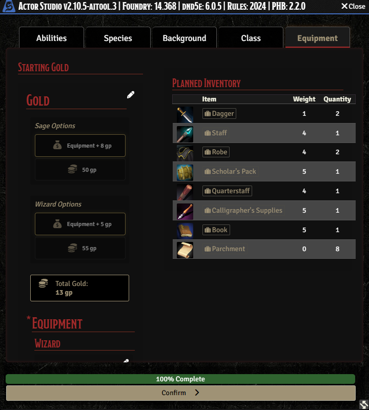

## 9. Spells (kun spellcasters)

Caster din class spells på level 1, åbner fanen **Spells**. Øverst står der, hvor mange du må
vælge, for eksempel "Cantrips: 0/3, Spells: 0/6".

1. Klik **[+] Cantrips** for at åbne listen, og så på **+** til højre for hver cantrip, du vil have.
   **Spring cantrips over, du allerede har fået fra en feat** som Magic Initiate: listen tilbyder
   dem stadig, og en dublet spilder et valg.
2. Gør det samme under **[+] Level 1**.
3. Når begge tællere er fyldt, klik **Finalize Spells**.

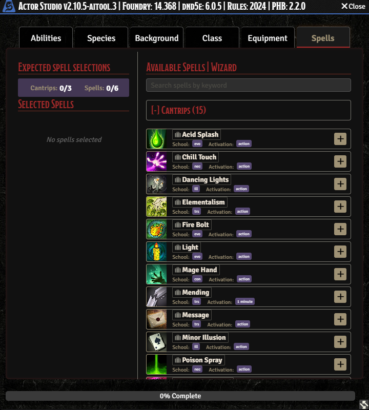

Dit character sheet åbner.

## 10. Level up til level 3, og tjek så dit sheet

Dit sheet er åbent og viser level 1. Vores kampagne starter på level 3, så du levler op to gange,
ét level ad gangen, med den samme builder.

### Level up til level 3

1. En lille rund blå knap **Level Up** (Actor Studios logo, en pil på en drage) dukker op øverst
   på dit sheet, ved siden af level-badget. Hold musen over den, så står der "Level Up". **Den
   vises kun, når GM'en har slået Milestone Levelling til, eller har givet dig nok experience
   points (XP).** Er der ingen knap, så spørg GM'en.
2. Klik på den. Vinduet **Level Up Existing Class** åbner. Klik på **+** yderst til højre i rækken
   for din class (selve rækken gør ingenting).
3. **Når du går fra level 2 til 3, vælger du også din subclass.** En liste **Choose Subclass**
   dukker op under class-rækken. Klik på den (åbner den ikke, så klik igen), vælg en og læs dens
   beskrivelse. Baren nederst når 100 %, når du har valgt.
4. Klik **Add Character Level**. Trinnene kører som i [trin 7](#7-advancements-svar-på-hvert-trin):
   - **Hit Points:** sæt flueben i **Take Average** (eller rul). Next gør ingenting, før du har valgt.
   - **Valg med en tæller** (for eksempel en wizards level-2 skill **Scholar** til Expertise, eller
     en elfs spellcasting ability på level 3): vælg, før du klikker Next.
   - **Informationstrin** (nye class features, **Max Prepared Spells**, trinnet **Subclass**):
     klik **Next**.
5. Klik **Complete** på det sidste trin. **På level 3 åbner der så et andet vindue med din
   subclassens features (for eksempel "Champion • Level 2 -> 3, Step 1 of 1"). Klik Complete i det
   også.** Springer du det over, viser sheetet det nye level, men ingen subclass og ingen subclass
   features.
6. Gør det to gange: først level 1 til 2 (ingen subclass da, så gå direkte til **Add Character
   Level**), derefter level 2 til 3.

Et level-up for en caster hæver, hvor mange spells du må **prepare**, men det spørger **ikke** om, hvilke
nye spells du lærer (en wizards to nye spellbook-spells, for eksempel). Åbn fanen **Spells**
bagefter og spørg GM'en eller din D&D-hjælper, hvilke du skal tilføje.

### Tjek dit sheet

Gå dit sheet igennem, før du kalder det færdigt. Spørg GM'en, hvis noget ser forkert ud.

- [ ] Levelet er 3, og class, subclass, species og background er rigtige.
- [ ] Hit points: den højeste værdi på din classens hit die på level 1, plus gennemsnittet (eller dit slag)
      for level 2 og 3, plus din Constitution modifier for hvert af de tre levels (en fighter
      med Constitution 14, der tog gennemsnittet, har 12 + 8 + 8 = 28).
- [ ] Proficiency bonus er +2 (den bliver ved med at være +2 til level 5).
- [ ] Skills: dem fra din background (to), din class (som regel to) og din species, hvis den giver
      en (og en wizards Scholar skill). Tæl dem: én for lidt betyder, at et trin blev sprunget over,
      eller at du valgte en skill, du allerede havde.
- [ ] Spells: hver cantrip og spell, du valgte, også dem fra en feat som Magic
      Initiate.
- [ ] Armor class (AC). **Actor Studio lægger din rustning, dit skjold og dine våben på sheetet,
      men equipper dem ikke**, så AC viser, som om du ikke havde noget på (en cleric med chain shirt
      og skjold viser 11 i stedet for 16). Åbn fanen **Inventory** og klik på det lille ikon yderst
      til højre i rækken for hvert stykke rustning, dit skjold og dine våben (hold musen over det:
      der står "Not Equipped", og "Equipped" efter du har klikket). AC opdaterer med det samme.
- [ ] Udstyr og guld ligger i fanen **Inventory**. **Wizards:** startsættet har ingen
      spellbook. Bed GM'en om at tilføje en.

**Forbered dine spells.** Classes, der forbereder spells (for eksempel wizard, cleric, druid), starter
uden nogen forberedte. Under fanen **Spells** står der på kortet øverst, hvor mange du må forberede. Klik
på den lille knap yderst til højre i rækken for en spell for at forberede den; hold musen over den for
at se, om en spell er forberedt ("Prepared" eller "Not Prepared").

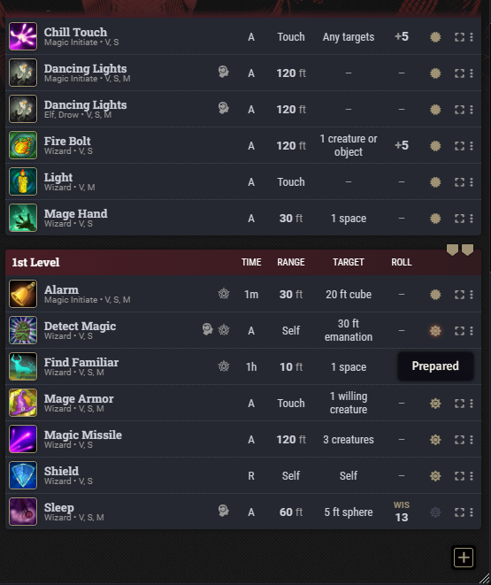

Nogle få kosmetiske finurligheder er normale. Fanen Spells kan for eksempel vise en rå label som
`GAS.Spells.Cantrip` under dine valgte cantrips. Den ændrer ingenting.

**Kend din karakter.** Før den første session skal du læse dine features og spells igennem én gang.
Det er dit job at vide, hvad din karakter kan, så spillet ikke går i stå, mens I slår op.

## 11. Gør den til din karakter

Foundry skal vide, hvilken karakter der er din, så den bruger den til dine rolls og tokens.

1. I listen **Players** nederst til venstre højreklikker du på dit eget navn og vælger **User
   Configuration**.
2. Under **Player Character** vælger du din nye karakter.
3. Klik **Save Player Configuration**.

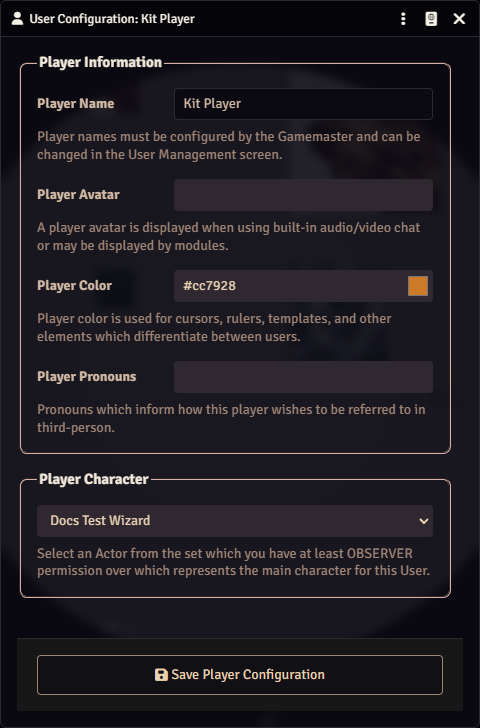

Players-listen viser nu dit navn med karakterens navn i parentes.

## 12. Et portræt (valgfrit)

Spillere kan ikke uploade billeder til Foundry. Send dit billede til GM'en på Discord, så tilføjer
GM'en det som dit portræt og dit token.

## Hvis noget går galt

| Hvad der skete                                            | Hvad du skal gøre                                                                                                                  |
| --------------------------------------------------------- | ---------------------------------------------------------------------------------------------------------------------------------- |
| "User requires the 'Create New Actors' permission"        | GM'en skal tillade, at spillere laver karakterer. Sig det til dem.                                                                 |
| En liste er tom eller viser kun få valg                   | Builderen er ikke sat til de rigtige bøger. Sig det til GM'en.                                                                     |
| Du lukkede builderen halvvejs                             | Din karakter findes måske halvfærdig i fanen Actors. Bed GM'en slette den, og start så forfra.                                     |
| Actor Studio siger, at den er "already open and busy"     | Den halvfærdige karakter blokerer. Genindlæs siden (F5). Spillere kan ikke slette karakterer, så bed GM'en slette den halvfærdige. |
| AC er lavere, end den burde være                          | Equip din rustning og dit skjold i fanen **Inventory** på dit sheet.                                                               |
| Next lader dig forbi et trin uden et valg                 | Tryk **Previous** og vælg. Tjek tælleren **Chosen x of y**, før du klikker Next hver gang.                                         |
| Der er ingen knap **Level Up** på dit sheet               | GM'en skal slå Milestone Levelling til eller give dig XP. Sig det til dem.                                                         |
| Level 3 vises, men ingen subclass på sheetet              | Du sprang det andet **Complete** over (vinduet med subclassens features). Sig det til GM'en, som kan tilføje subclass.             |
| Du sprang et valg over med Next                           | Gør dig færdig og fortæl så GM'en, hvad der mangler. GM'en kan tilføje det eller slette karakteren, så du kan lave den om.         |
| Equipment bliver under 100 %                              | Klik på guldbeløbene og vælg i hver **Select focus** liste, til alt er grønt.                                                      |
| Panelet er tomt, efter du har klikket Complete            | Vent cirka 5 sekunder. Det næste trin dukker op af sig selv.                                                                       |
| En liste er ikke, som GM'en beskrev                       | GM'en har måske ændret indstillingerne, efter du åbnede siden. Genindlæs siden (F5).                                               |
| Din karakter hedder det samme som dig                     | Du lod Character Name stå, som det var. Sig det til GM'en, som kan omdøbe den.                                                     |
| Du valgte en forkert spell eller den samme spell to gange | Sig det til GM'en. GM'en kan bytte den på dit sheet.                                                                               |

## Hvad du kan spørge din GM om

- Hvilken ability score-metode, og hvilke bøger og muligheder der er tilladt.
- Hvordan din karakter kender de andre, eller hvorfor de rejser sammen.
- Alt om verdenen, som din karakter ville vide.

Hvad værktøjet optager, mens du spiller, og hvordan du får det fjernet: [spillerguide](README.md).
