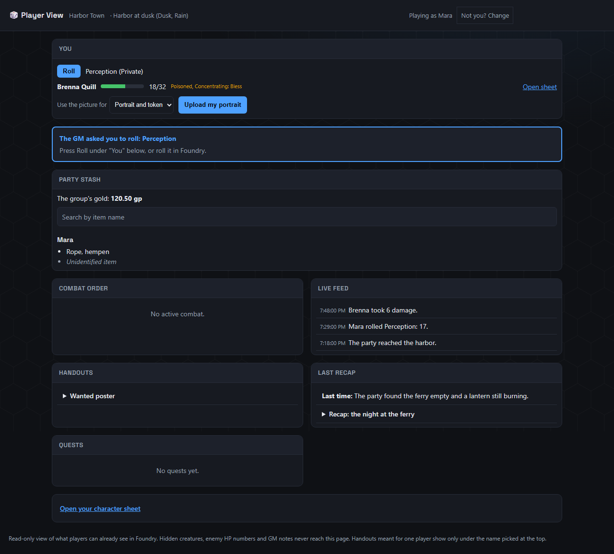

# Brug player page

Korte how-tos til de ekstra ting omkring Foundry. Alt i selve Foundry virker som altid: player page
og My character er valgfrie ekstraer ved siden af, aldrig en erstatning. Hvad værktøjet optager, og
hvilke dele der når en AI, står i [spillerguiden](README.md). Vil du have færdige forespørgsler til
D&D-hjælperen (planlæg en karakter, level op, regler)? Se
[D&D-hjælperens kogebog](cookbook.md).

Player page er live bag login med e-mailkode. GM'en sender dig adressen.

## Vælg dit navn på player page

- **Gør:** første gang du åbner player page, så klik på dit navn øverst. Så står der
  "Playing as ...". Klikkede du på det forkerte? Klik på **Not you? Change** og vælg igen.
- **Hvorfor:** handouts, der kun er til dig, vises først, når du har valgt dit navn. Valget fortæller
  også GM'en, hvilke handouts du har åbnet.
- **Tip:** dit valg huskes i den browser. På en ny computer eller i en ny browser skal du vælge igen.

## Følg combaten

- **Se på:** **Combat order** på player page: hvem der handler hvornår, hvis turn det er, og rounden.
- **Godt at vide:** dit party har HP-bars. Monsters viser ingen tal og intet helbredsord (spørg GM'en,
  hvem der er såret; den, der kører værktøjet, kan slå et groft ord til), og en skabning, hvis navn
  du ikke har lært, hedder "Unknown creature". Skjulte skabninger er slet ikke på listen.

## Læs en handout

- **Gør:** åbn **Handouts** på player page og klik på en titel. Du kan også finde den samme side i
  Foundrys Journal tab.
- **"just for you":** GM'en har kun vist den for dig (eller nogle få af jer). Andre spillere ser den
  ikke på deres side, og i Foundry kan kun du åbne den. Del den ved bordet, hvis din karakter ville.
- **Tip:** er der ikke noget nyt? Handouts dukker op inden for få sekunder efter, at GM'en har vist
  dem. Genindlæs siden, hvis en ser ud til at mangle.

## Tjek quests og party stash

- **Kig på:** **Quests** på player page. En åben quest viser den dag, GM'en afslørede den, en færdig er
  streget over under **Done**, og en mislykket har et **Failed**-mærke. Recap-kortet begynder med en
  enkelt linje, **Last time**.
- **Kig på:** **Party stash**: hvad partiet bærer, med et søgefelt og gruppens guld. Et item, du ikke har
  identified, vises kun som "Unidentified item".
- **Godt at vide:** du ser kun det, GM'en har afsløret. Intet her er en spoiler.

## Skriv din downtime og din diary

To valgfrie fold-ud under dit ark på **My character**. Spring dem over, hvis du vil: spillet virker
på samme måde.

- **Downtime:** skriv, hvad din karakter gør mellem sessionerne, for eksempel "Jeg besøger smeden og
  spørger om den mærkelige mønt". Du kan have op til ti korte indlæg og redigere eller slette dine
  egne. Kun du og din GM kan læse dem, og GM'en ser dem som ønsker, ikke som noget, der er sket.
- **My diary:** bed din Claude-hjælper om et kort diary-indlæg med din karakters stemme om sidste
  session (den spørger først om én følelse og bruger kun det, du har fået vist), indsæt det i
  **Diary entry**, ret det, som du vil, og tryk **Save entry**. Kun du kan læse din diary: ikke GM'en,
  ikke de andre spillere. Hvis siden siger, at bordet kun gemmer diaries i hukommelsen, forsvinder de,
  når dashboardet genstarter, så kopiér det, du vil beholde.
- **Godt at vide:** du skal bruge dit private My character-link til begge. Intet skal slås til.

## Få et omen på Discord

Mellem sessionerne kan GM'en sende hver spiller et kort privat hint om, hvad der kommer. Det
kommer som en privat Discord-besked fra bordets bot, kun til dig, og først når GM'en har godkendt
det. Du behøver ikke gøre noget. Får du aldrig et, har GM'en måske ikke dit Discord-bruger-id
endnu, så sig det til dem. Ingen andre ser din besked, og den står ikke på player page.

## Se, hvad du kan på din tur

- **Kig på:** **On my turn**-kortet på **My character**. Det grupperer, hvad din karakter kan gøre, som
  action, bonus action, reaction, free og movement (din speed), med uses og spell slots tilbage, så du ikke skal huske det. Kontakten **Show the "On my turn" card** nederst på siden
  skjuler det, hvis du ikke vil have det.

## Spørg Discord-botten

- **Gør:** skriv `/recap` i Discord for det seneste recap, `/npc <navn>` for det, GM'en har fortalt alle
  om en person, eller `/handouts` for de handouts, der er afsløret indtil nu.
- **Godt at vide:** kun du ser svaret. Det er handoutens egen tekst, den samme som på player page, og et
  navn, GM'en ikke har afsløret, giver "Nothing revealed yet".

## Vid, hvornår sessionen bliver optaget

- **Godt at vide:** når den, der kører værktøjet, skriver `/record start` i Discord, bliver
  voice-chatten optaget til `/record stop`, og botten skriver en besked, når den starter. Hvis du
  sagde nej, bliver dit spor slettet efter hver session, og noterne skrives uden dig.
- **Tip:** vil du have noget slettet eller holdt uden for optagelsen? Spørg GM'en, se
  [få dine data slettet](README.md#få-dine-data-slettet).

## Spørg GM'en om historien og bordet

Til din egen karakter og reglerne bruger du selv [D&D-hjælperen](dnd-helper.md). Til historien eller
noget, værktøjet holder styr på ved bordet, spørger du GM'en, som kan slå det op. Gode spørgsmål:

- "Hvor meget damage gav jeg sidste session?" (play-statistikken pr. karakter)
- "Hvilke handouts har vi indtil videre?"
- "Kan du sende os et recap af sidste session?" (et recap uden spoilers, lavet til spillere)
- "Hvad stod der i brevet fra i sidste uge igen?"

## Roll, når GM'en beder om det

Slå roll i Foundry som altid: klik på rollet på din character sheet, eller skriv det i chatten.
Mere skal du ikke.

Som en valgfri genvej vises et roll, GM'en beder om, også som en knap på player page og på My
character, hvis du har åbnet dit private link. Den bruger Foundrys eget roll, så conditions og
advantage på din karakter gælder, og resultatet er det samme som at slå roll i Foundry. Ignorer
knappen, hvis du hellere vil slå roll i Foundry.
