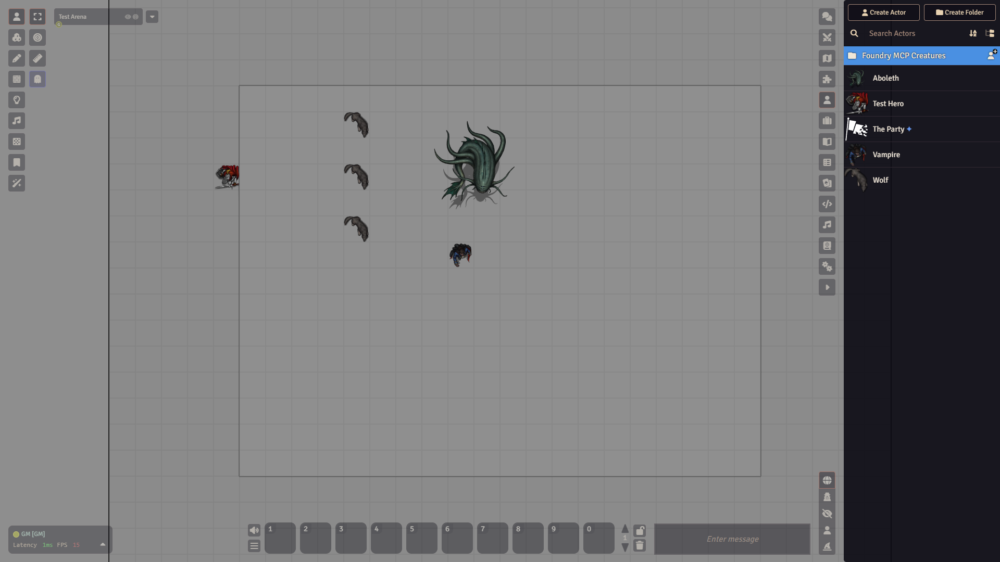
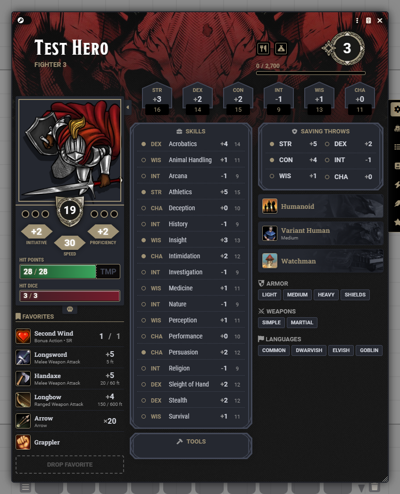
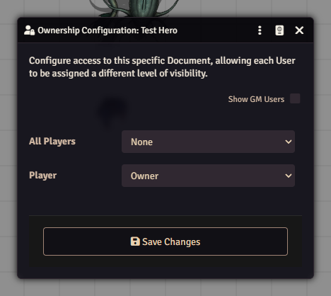

# Actors

An actor is anyone or anything with stats: a player character, a shopkeeper, a goblin, a ship. The actor holds the numbers, items and spells. To show it on a map you use a [token](tokens.md).

## Types in dnd5e

When you create an actor in the dnd5e system you pick one of these types:

- **Player Character**: a hero a player controls.
- **Non-Player Character**: a monster or person you run as GM.
- **Vehicle**: a ship, a cart, a siege engine.
- **Group**: a wrapper for the party.
- **Encounter**: a list of monsters for one fight.

## The Actors tab

Open the **Actors** tab in the sidebar. It lists every actor in the world. Folders group them.

## Create an actor

1. Open the **Actors** tab and click **Create Actor**.
2. Type a name.
3. Click the card for the type you want, for example **Non-Player Character**.
4. Click **Create Actor**. The sheet opens.

If you leave the name empty, the actor is named after its type, for example "Non-Player Character". There is also a **Folder** drop-down in the dialog.

Click an actor's name in the list at any time to open its sheet. Right-click it for **Edit**, **Configure Ownership**, **View Character Artwork**, **View Token Artwork**, **Export Data**, **Import Data**, **Delete** and **Duplicate**.

## The character sheet

At the top you see the name, class and level, an experience bar, and two small icon buttons for **Short Rest** and **Long Rest**. A row of six ability scores sits below. On the left are the portrait, armor class, initiative, proficiency, speed, hit points, hit dice and your favorites.

The tabs are a column of small icons on the right edge of the sheet. Hover over one to see its name:

- **Details**: skills, saving throws, languages, armor and weapon training and other traits.
- **Inventory**: items, coins and carrying weight.
- **Features**: class and species features.
- **Spells**: spell slots and the spell list.
- **Effects**: conditions and other lasting effects.
- **Biography**: background text, ideals, bonds and flaws.
- **Special Traits**

A small switch at the top left of the sheet toggles it between **Play** and **Edit** mode. In Edit mode little gear icons appear next to ability scores, skills, hit points and more, and you click one to change that value. If you cannot change something, switch to Edit.

NPC sheets look similar but show the challenge rating at the top right, and the skills and senses on the left. They have no **Details** tab. Their tabs are **Features**, **Inventory**, **Spells**, **Effects**, **Biography** and **Special Traits**.

## Import a monster from the compendium

You do not have to build monsters by hand. Open the **Compendium Packs** tab, open a monster pack, and drag a monster into the **Actors** tab. You get your own copy to edit. See [Compendiums](compendiums.md).

## Who can see and edit: ownership

Every actor has an ownership level for each user.

| Level        | What the user gets                                   |
| ------------ | ---------------------------------------------------- |
| **None**     | The actor is hidden.                                 |
| **Limited**  | The actor is listed, with a short view of the sheet. |
| **Observer** | The full sheet, read-only.                           |
| **Owner**    | Can edit the sheet and control the actor's tokens.   |

To set it:

1. Right-click the actor in the **Actors** tab and choose **Configure Ownership**. You can also open the sheet, click the three-dot menu in its title bar and choose **Configure Ownership**.
2. Set **All Players** for the default, and a level for each person in the list. Each person can also stay on **Default**.
3. Click **Save Changes**.

For a player character, set that player to **Owner** and leave the rest of the table on **None** or **Limited**. Gamemaster users are hidden from the list until you tick **Show GM Users**.

## The Prototype Token

Each actor carries a Prototype Token: the template that new tokens are stamped from. Open the actor sheet, click the three-dot menu in the title bar and choose **Prototype Token**. A window opens with the same settings as [Token Configuration](tokens.md), so you set image, size, vision and bars once and every new token starts that way. Click **Update Token** to save it.

## Watch out

- A player who cannot see their own character usually has ownership **None**. Check **Configure Ownership**.
- Think twice before you delete an actor.
- Imported monsters are copies. Editing yours does not touch the compendium.
