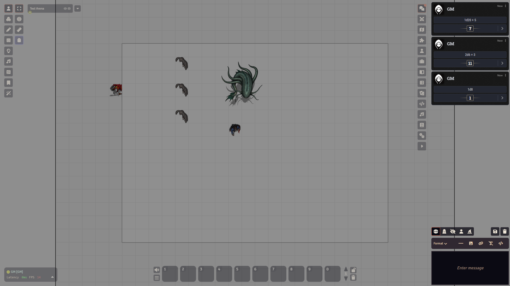
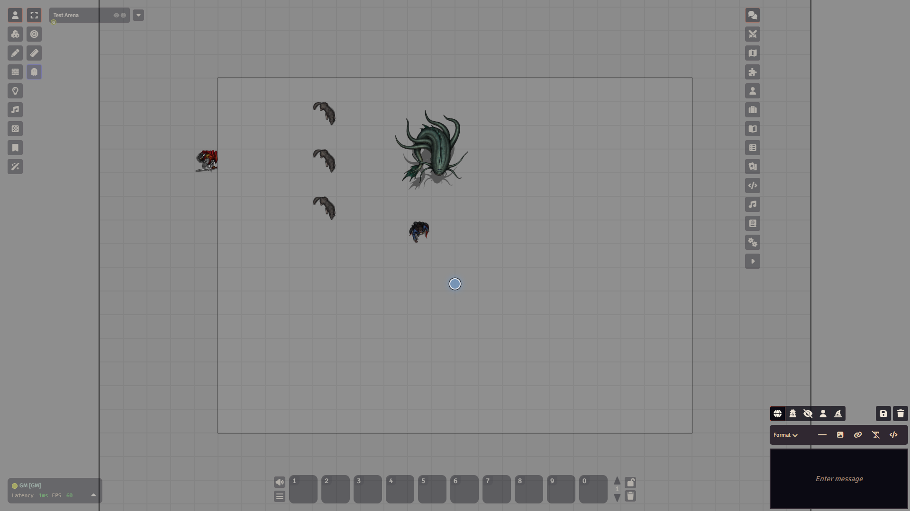

# Chat and dice

## What it is

The chat is where everything the table says and rolls ends up. Players type there, sheets post their rolls there, and Foundry prints roll cards there. Dice are rolled by typing a short formula such as `1d20+5`.

Open it with the first button in the sidebar tab strip on the right, called **Chat Messages**. You can also press Shift+C, which Foundry calls **Focus Chat**.

## Send a message or a roll

1. Click the message box at the bottom of the chat tab. It is a small text editor with a **Paragraph** formatting bar on top.
2. Type your text and press Enter.
3. To roll, start with `/r` and a formula, for example `/r 1d20+5`, then press Enter.

<video src="../images/foundry/chat-roll.mp4" poster="../images/foundry/chat-roll.png" autoplay loop muted playsinline aria-label="Typing /r 1d20+5 in the chat box and sending it"></video>

Press the up arrow in the message box to bring back what you sent before. Add a label after a `#`, like `/r 1d20+5 # Perception`, and the label shows on the roll.

Each roll shows the formula and the total. Click the small arrow on a roll to see the single dice.

## Dice formulas

- `1d20+5`: one twenty-sided die, plus 5.
- `2d6`: two six-sided dice added up.
- `2d20kh`: roll two d20 and keep the highest. That is advantage. Use `2d20kl` to keep the lowest (disadvantage). Add a bonus after it: `2d20kh+5`.
- `4d6kh3`: roll four, keep the best three.
- Percentile dice: write `1d100`. The `d%` shortcut is not accepted in Foundry 14.

## Who sees a roll

Below the chat log is a row of five small icon buttons, then two more at the right end. The five set who sees your next message or roll. Hover each one to see its name.

- **Public as User**: everyone sees it. This is the default.
- **Private to Gamemasters**: only you and the GMs see it.
- **Blind to Gamemasters**: only the GMs see it. A player who rolls this cannot see their own result.
- **Self Only**: only you see it.
- **Public as Character**: the message goes out as your character instead of as you.

The setting applies to plain text too, not only to rolls. If your messages seem to vanish, check that this is not on **Self Only**.

You can also pick the visibility for a single roll by command:

- `/r`: a normal roll.
- `/gmroll` (or `/gmr`): private to the GMs.
- `/blindroll` (or `/br`): blind to the GMs.
- `/selfroll` (or `/sr`): only you.
- `/publicroll` (or `/pr`): everyone.

## Whisper to someone

1. Type `/w` and the player's name, then your message: `/w Alex meet me at the door`.
2. For a name with spaces, or several people, use square brackets: `/w [Alex Smith, Sam] hold still`.
3. Use `/w gm` to whisper to the GMs, or `/gm text` as a shortcut.

Only the people you name can see a whisper.

## Rolling from sheets

On a dnd5e character sheet you rarely type formulas. Click a skill, a saving throw or an attack and the roll lands in the chat. A small window usually asks first. It has **Advantage**, **Normal** and **Disadvantage** buttons and a **Roll Mode** choice. Hold Shift while you click to skip the window and roll normally. Alt rolls with advantage. Ctrl rolls with disadvantage.

## Clear the chat (GM)

At the right end of the row under the chat log, the GM sees two icon buttons: **Export Chat Log** (a disk) and **Clear Chat Log** (a trash can). Clear opens a window called **Flush Chat Log** that asks **Are You Sure?**. **Yes** deletes every message for good.

To remove one message, click the trash icon in its header.

## Watch out

:::caution
**Clear Chat Log** with **Yes** cannot be undone. The trash icon on a single message deletes it at once, with no question asked.
:::

- If Foundry does not accept a command, such as `/r 1d%`, nothing is sent and your text stays in the box.
- A name with spaces after `/w` needs the square brackets. Without them the whisper goes nowhere.
- `/save` and `/check` are not Foundry chat commands. Roll saves and checks from the sheet.
