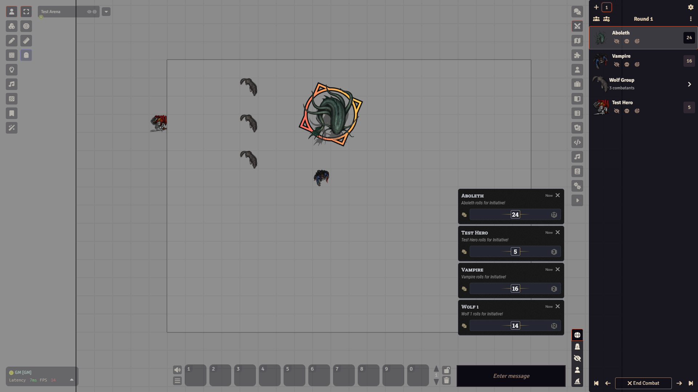
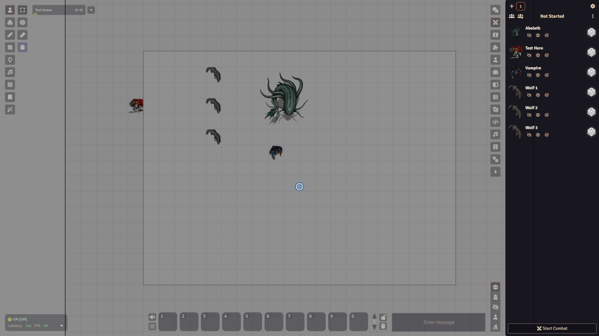

# Combat

## What it is

An encounter is a list of fighters in turn order, kept in the **Combat Encounters** tab of the sidebar (the crossed swords icon). The GM builds it, and everyone sees it. When it is someone's turn, their row is highlighted and a marker spins under their token.

## Start a fight

<video src="../images/foundry/combat-start.mp4" poster="../images/foundry/combat-start.png" autoplay loop muted playsinline aria-label="Rolling initiative and starting an encounter"></video>

1. Switch to the token controls on the left and right-click a token on the map. The token HUD opens around it.
2. Click the crossed swords button, **Enter Combat**. If there is no encounter yet, Foundry makes one. You can also open the **Combat Encounters** tab and click the **+** at the top, **Create Combat**.
3. To add several at once, select them all (drag a box, or Shift+click), then do the same on one of them. All the selected tokens join.
4. Open the **Combat Encounters** tab. Each token has a row. Before the fight starts the header says **Not Started**.
5. Roll initiative. Click the d20 icon on a row, **Roll Initiative**, to roll for that fighter. Two icon buttons at the top left, **Roll All** and **Roll NPCs**, roll for everyone who has not rolled, or for the non-player fighters only.
6. Click **Start Combat** at the bottom. The header changes to **Round 1** and the top row has the turn.

The d20 icon opens a roll window with **Advantage**, **Normal** and **Disadvantage** buttons and a **Roll Mode** choice. **Roll All** and **Roll NPCs** roll without a window.

## Run the turns

Along the bottom, the GM has five buttons. Hover them to see their names:

- **Previous Round** and **Previous Turn**: step back if you passed too early.
- **End Combat**: asks "End this combat and empty the turn tracker?". **Yes** ends and removes the encounter.
- **Next Turn**: pass to the next row. After the last row it starts the next round.
- **Next Round**: jump to the next round.

Each round counts as 6 seconds on the game clock in dnd5e.

## Change a fighter

Each row has small buttons on it:

- **Hide** (the crossed eye): hides the fighter from the players' list. Use it for ambushes.
- **Mark Defeated** (the skull): puts a Dead mark on the fighter. Click again to undo.
- **Ping Token**: pings the token on the map.

Setting initiative by hand: click the number in the row, type a new value and press Enter. `=15` sets it to 15, and `+2` adds 2.

Right-click a row for **Update Combatant**, **Clear Initiative**, **Re-roll Initiative** and **Remove Combatant**. Double-click a row to open the actor sheet.

Identical monsters, such as three wolves, share one initiative roll and show as one row, for example **Wolf Group** with "3 combatants". Click it to open the group.

The three-dot button in the header opens the encounter menu: **Edit Name**, **Reset Initiative**, **Clear Movement Histories**, **Link to Viewed Scene** and **End Combat**.

The gear at the top opens **Combat Tracker Settings**. There you can turn the token turn markers on or off, turn on **Skip Defeated** so defeated fighters lose their turns, or pick a **Tracked Resource** such as hit points to show in each row. Click **Save Tracker Settings** to keep your changes.

## Watch out

:::caution
**End Combat** removes the encounter, so a new one means adding the tokens and rolling again.
:::

- Marking a character defeated adds the Dead mark to the actor itself. Unmark it if the character was only knocked down for a moment.
- The **End Combat** window has **No** selected from the start. Pressing Enter there keeps the fight.
- If you make a new encounter, check you are on the one you mean. Numbered buttons at the top switch between encounters.
