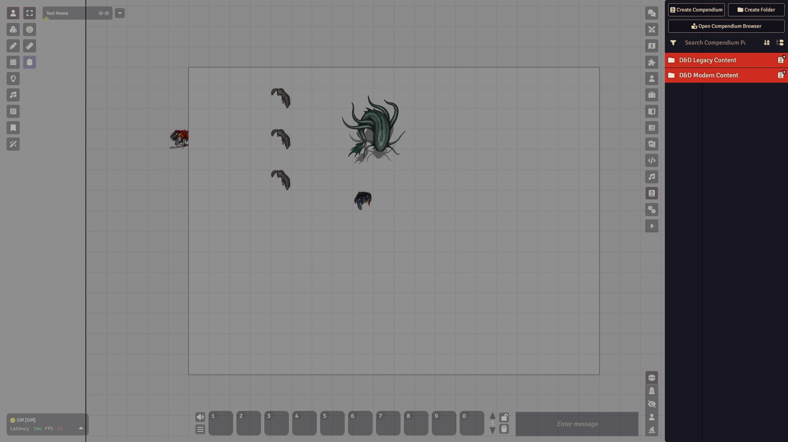
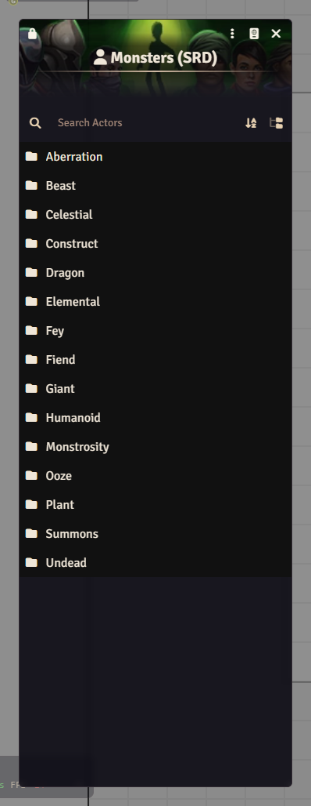

# Compendiums

A compendium pack is a library. It holds a lot of ready-made actors, items, spells, journal entries or tables that are not part of your world until you bring them in. The dnd5e system ships with a set of packs, and modules can add more.

## The Compendium Packs tab

Open the **Compendium Packs** tab in the sidebar. The packs are sorted in folders. The dnd5e system gives you two top folders: **D&D Legacy Content** and **D&D Modern Content**. Click a folder to open it.

The pack types include monsters, items, spells, classes and rules. Locked packs show a small lock icon. The header has **Create Compendium** and **Create Folder**, and dnd5e adds **Open Compendium Browser**, a window that searches across packs.

To find something, type in **Search Compendium Packs**. The filter button (**Filter Documents by Type**) shows only, say, Actor packs.

## Open a pack

Click a pack's name. A window opens listing what is inside, with its own search box. In the Monsters (SRD) pack the monsters are grouped in folders by creature type, such as Beast and Undead.

Click an entry to open and read it. Everything in a pack is a template you can look at.

## Bring an entry into your world

This is called importing.

1. Open the pack.
2. Drag the entry out of the pack window and drop it on the matching sidebar tab. A monster goes to the **Actors** tab, an item to **Items**.

   You can also right-click the entry and choose **Import Entry**.

3. The copy now appears in your world list.

## Imported copies are independent

When you import, you get a copy in your world. Change the copy as much as you like: raise the hit points, rename it, add a spell. The pack stays as it was.

## Locked packs

System and module packs are locked. That keeps you from changing the library by accident. Right-click a pack to see its menu: **Configure Ownership**, **Unlock** (or **Lock**), **Import All Content**, **Duplicate**, and **Clear Folder** when the pack sits in a folder. The same **Unlock** is in the pack window's three-dot menu. Unlocking a system pack shows a warning with **Duplicate**, **Unlock** and **Cancel**. Most of the time you do not need to unlock anything. Import the entry and edit the copy.

## What dnd5e gives you

The dnd5e system ships its free SRD content. That is the open rules text: many monsters, spells, items, classes and species. It is not the full set of published books. For anything outside the SRD you need to add your own entries or a module.

## Watch out

- Do not use **Import All Content** on a big pack unless you want hundreds of new entries in your world lists.

Related: [Actors](actors.md), [Modules](modules.md).
