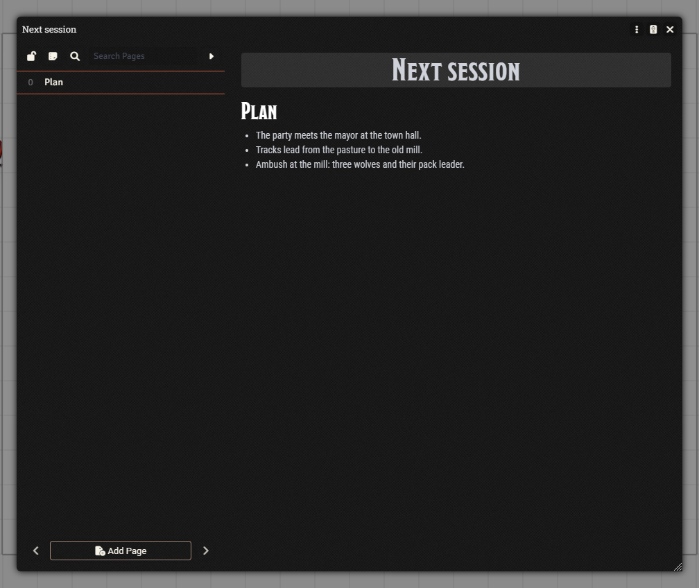
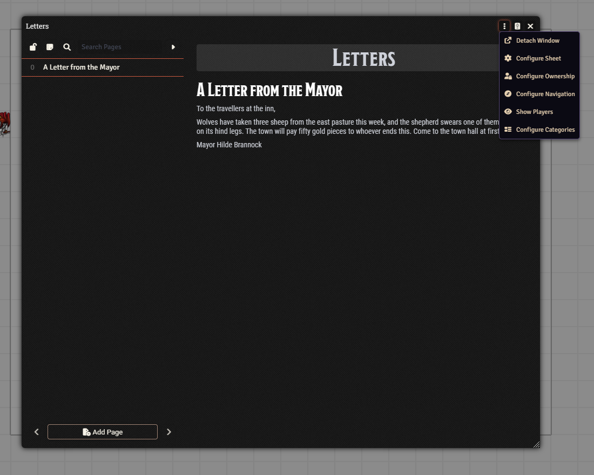

# Journal entries

A journal entry is a notebook. Use it for session notes, NPC write-ups, letters and handouts. One entry holds one or more pages. Each page can be text, a picture, a PDF or a video.

## The Journal tab

Open the **Journal** tab in the sidebar. The header has **Create Entry** and **Create Folder**, a search box (**Search Journal Entries**) and a sort button. Click an entry's name to open it.

Right-click an entry for its menu: **Edit**, **Configure Ownership**, **Export Data**, **Import Data**, **Delete** and **Duplicate**.

## Create an entry

1. Open the **Journal** tab and click **Create Entry**.
2. Type a name, pick a **Folder** if you like, and click **Create Journal Entry**. The entry opens.
3. Click **Add Page**. It sits under the page list on the left.
4. Give the page a name and pick its type. The type starts on **Text**.
5. Click **Create Page**. A text page opens in its own editing window.
6. Write your content, then click **Save Entry** in that window.

The list on the left is the table of contents. Click a page name to jump to it. Small buttons above the page area switch between one page at a time (**Single Page Mode**) and all pages in one scroll, lock the page list so it cannot be changed by accident, and collapse the sidebar.

To edit a text page that is already written, click the pencil **Edit Page** button.

## Page types

- **Text**: written notes. This is the one you will use most.
- **Image**: a picture, with an optional caption. Good for a handout.
- **PDF** and **Video**.
- dnd5e adds **Class Summary**, **Subclass Summary**, **Map Location**, **Rule** and **Spell List**. You can ignore these at first.

## Show a page to your players

Players cannot see an entry until you let them. There are two ways.

**Show it once, right now:** open the journal and click the three-dot menu in its title bar, next to the close button. Choose **Show Players**. This shows the whole entry. To show just one page, right-click it in the left-hand list and choose **Show Players**. A small dialog opens, named after the entry or page.

**Let them read it any time:** set the ownership. Right-click the entry in the **Journal** tab and choose **Configure Ownership**. Set **All Players** to **Observer** and they can open and read it. To hide a single page, right-click the page in the list, choose **Configure Ownership**, and set it to **None**.

The title-bar menu also holds **Detach Window**, **Configure Sheet**, **Configure Ownership**, **Configure Navigation** and **Configure Categories**.

The **Show** dialog lists **All Players** and each user as checkboxes. Under **Ownership** is a **Configure Ownership** drop-down that starts on **No Change**. If you change it, showing the page also raises the players' ownership. Leave it alone unless you mean it. Click **Show Players** to send it.

## Watch out

- Players only see pages they have permission to view. If a player cannot see something, check the ownership.
- Look at the ownership before you reveal a whole entry. Pages you want to keep secret may need their own setting of **None**.
- Notes that stay on your side belong in an entry the players have no access to. Keep spoilers there.

Next: [Chat and dice](chat-and-dice.md), where shown pages and rolls appear.
