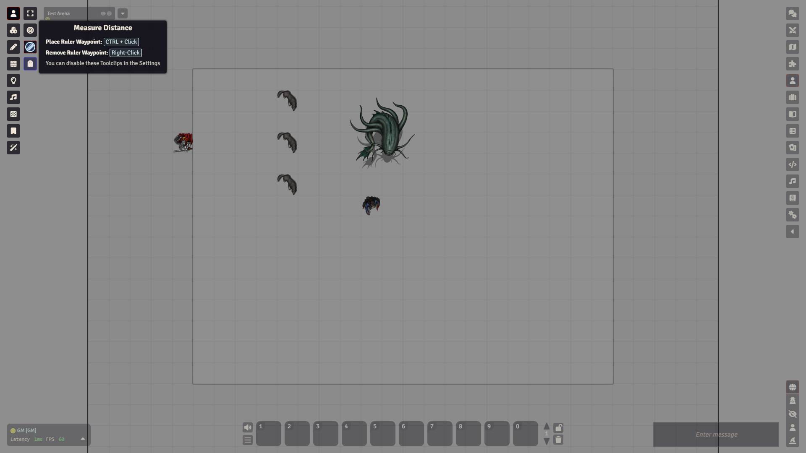
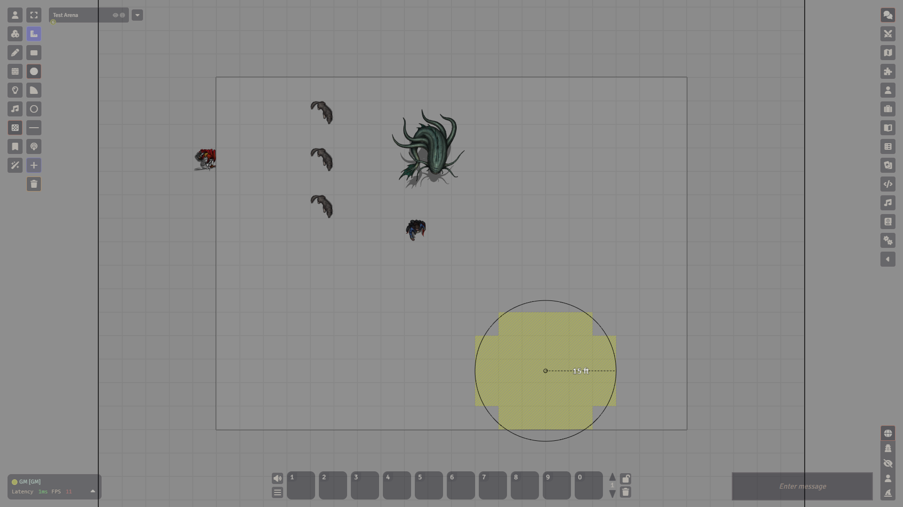

# Measuring and templates

## What it is

Two things help you judge space on the map. The ruler tells you how far something is. A template marks an area, such as a fireball or a cone of cold. In Foundry 14 area templates are **Regions**, drawn with the Region Controls.

## Measure a distance

<video src="../images/foundry/measure-ruler.mp4" poster="../images/foundry/measure-ruler.png" autoplay loop muted playsinline aria-label="Dragging the ruler across the map to show a distance"></video>

1. Click **Token Controls** on the left, then **Measure Distance**. Holding the R key switches the ruler on for as long as you hold it. Foundry names that key **Toggle Distance Ruler**.
2. Drag across the map. A line with the distance appears.
3. To bend the path, press F while dragging. Foundry calls that key **Place Ruler Waypoint**.
4. Let go and the line disappears. Nothing is saved.

The distance uses the grid settings of the scene. To change them, open the scene settings (Scenes tab, right-click the scene, **Edit**), go to the **Grid** tab and set **Distance** and **Units**. For a standard 5e map that is 5 feet per square.

## Mark a spell area

1. Click **Region Controls**.
2. Switch on **Measured Template Mode**. It is off for a GM until you turn it on. In this mode each shape you draw becomes a new Region.
3. Pick a shape: **Draw Circle**, **Draw Cone**, **Draw Rectangle**, **Draw Line**, **Draw Ring** or **Draw Emanation**.
4. Drag on the map from the starting point. The shape follows your pointer, and the grid cells it covers light up.
5. To pick the shape later, switch to **Select Regions** and click it.
6. To remove it, select it and press Delete.

Turn on **Force Snap to Grid Vertices** if you want the shapes to snap to the grid.

## Templates from spells and items

In dnd5e, an item or spell with an area can place its own template. Its chat card has a **Place Measured Template** button. Click the button on the card instead of drawing the area by hand.

## Watch out

:::note
Older videos show buttons named Circle, Cone, Rectangle and Ray in a separate Measurement group. Foundry 14 has no such group. Look under **Region Controls** instead.
:::

- **Clear Regions** deletes every Region on the scene after one confirmation.
- Check that the scene's **Distance** is right before you trust a number.
