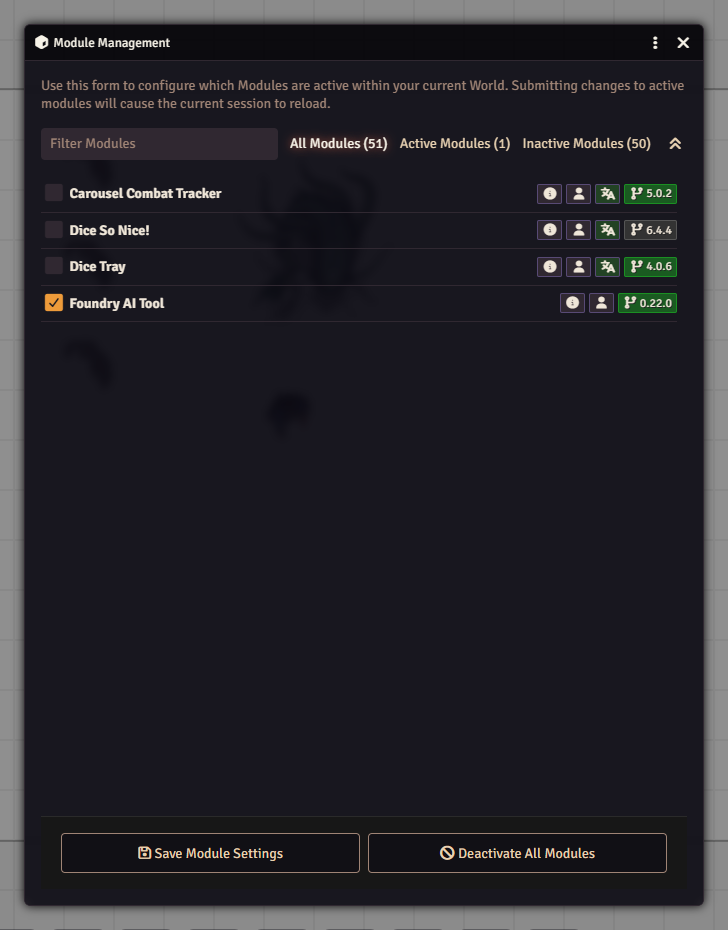

# Modules

## What it is

A module is an add-on that gives Foundry new features, such as a dice animation, a map tool or extra content. Modules are installed once on the server, and then each world chooses which ones to use. A module can be on in one world and off in another.

Only the GM can turn modules on and off. Players can see which ones are active, under **Active Modules** in the same place.

## Turn modules on or off in a world

1. Join the world as the GM.
2. Open the **Settings** tab in the sidebar.
3. Click **Module Management**.
4. Tick the box next to a module to turn it on, or untick it to turn it off.
5. Click **Save Module Settings**.
6. Foundry asks **Reload Application?**. Click **Yes** to apply the change. Changing active modules reloads the session.

Handy parts of the window:

- The **Filter Modules** box finds a module as you type.
- **All Modules**, **Active Modules** and **Inactive Modules** narrow the list. Each shows how many modules it holds.
- The **Expand** button shows more about each module.
- **Deactivate All Modules** unticks everything. Nothing is applied until you save.

## Dependencies and errors

Some modules need other modules. When you tick one, a **Dependency Resolution** window lists the required and optional ones and asks if you want to enable them together with it. A module whose required dependencies have problems cannot be enabled. Saving can also fail with a message that a module's dependencies are not enabled. Turn the missing ones on and save again.

## Install, update and remove

This happens on the setup screen, outside any world, and needs the admin. This part was not click-tested for these pages.

1. On the setup screen, open the **Add-on Modules** tab.
2. **Install Module** opens a list of modules you can install.
3. **Update All** checks every module and installs newer versions.
4. **Uninstall** removes a module from the server.

## Watch out

:::caution
Before you update or remove modules for a campaign, make a backup. There is no built-in way back from an update.
:::

- Turning a module on or off reloads the world. Do it between sessions, not mid-fight.
- Try a new module in a spare world first, so a bad one cannot hurt your campaign.
- Check what a module is for before you untick it. Others, or the world itself, may depend on it.
