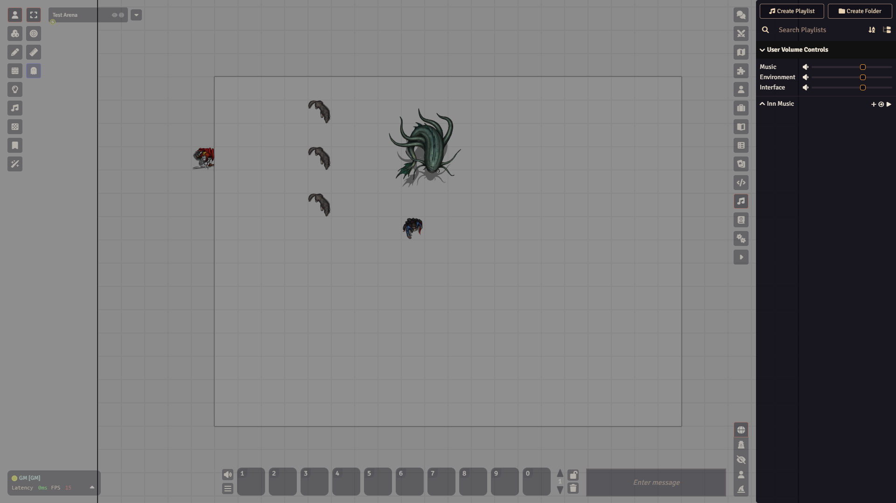

# Playlists and sound

A **playlist** is a group of sound tracks: music, ambience or one-off effects. You play them from the **Playlists** tab in the sidebar, and everyone connected hears them.

At the top of the tab you find the buttons **Create Playlist** and **Create Folder** and a search box. Below that are the volume sliders, then your playlists. While something plays, a **Currently Playing** block appears. The pin button in it moves it to the top or the bottom of the tab.

## Make a playlist and add a sound

1. Open the **Playlists** tab (the music note icon).
2. Click **Create Playlist**.
3. A small window asks for a **Name**. Type one, for example "Inn Music", and click **Create Playlist**.
4. The playlist's settings window opens. Close it, or pick a **Playback Mode** and click **Update Playlist**.
5. The playlist now sits in the list. Its row has three buttons: **Add Sound** (a plus), the playback mode, and **Play Playlist**. Click the playlist's name to open or close its list of sounds.
6. Click **Add Sound**. A window called **Playlist Sound** opens.
7. Pick a file under **Audio Source**. The **Track Name** fills in from the file name, and you can change it.
8. Set **Sound Volume**, or tick **Repeat** if you want the track to loop.
9. Click **Create Sound**.

To change a track later, right-click it and choose **Edit Sound**. The same menu has **Preload Sound** and **Delete Sound**. Each track also has **Play Sound** and **Loop Sound** buttons.

## Play, stop and skip

1. Click **Play Playlist** on the playlist's row. While it plays, the row shows **Previous Sound**, **Next Sound** and **Stop Playlist**.
2. To work with one track, use **Play Sound** on it. A playing track has **Pause Sound** and **Sound Stop**.

Starting and stopping is the same for everyone at the table.

## Playback mode

Each playlist has a mode. Change it in the settings window (right-click the playlist, choose **Edit**, then **Playback Mode**), or cycle it with the mode button on the playlist's row. The four modes:

- **Soundboard Only**
- **Sequential Playback**: tracks play one after the other.
- **Shuffle Tracks**: tracks play in random order.
- **Simultaneous Playback**: all tracks play together.

The same settings window holds **Audio Channel** (**Music**, **Environment** or **Interface**), **Sort Mode** and **Fade Duration**.

## Volume

The **User Volume Controls** section at the top of the tab has three sliders: **Music**, **Environment** and **Interface**. They affect only your own browser, so each player sets their own. Click the section title to fold it away. A playlist uses the slider that matches its **Audio Channel**.

There is also a **Mute Volume** button on the left of the hotbar. It silences all sound for you only.

## Watch out

:::note
Players cannot add or edit playlists in the default setup. The permission **Create and Control Playlists** starts at Assistant Gamemaster. See [Users and permissions](users-and-permissions.md).
:::

- If a player hears nothing, ask them to check their own **Music** slider and the **Mute Volume** button. Your volume does not change theirs.
- Right-click a playlist and choose **Preload Sounds** before the session to avoid a delay at the moment you press play.
- Playlists are different from ambient sounds. Ambient sounds are placed on a scene with the **Ambient Sound Controls**, one of the layers in the [screen tour](screen-tour.md).
- **Delete** in the playlist menu removes the playlist and cannot be undone. Foundry asks you to confirm.

Next: [A tour of the Foundry screen](screen-tour.md).
