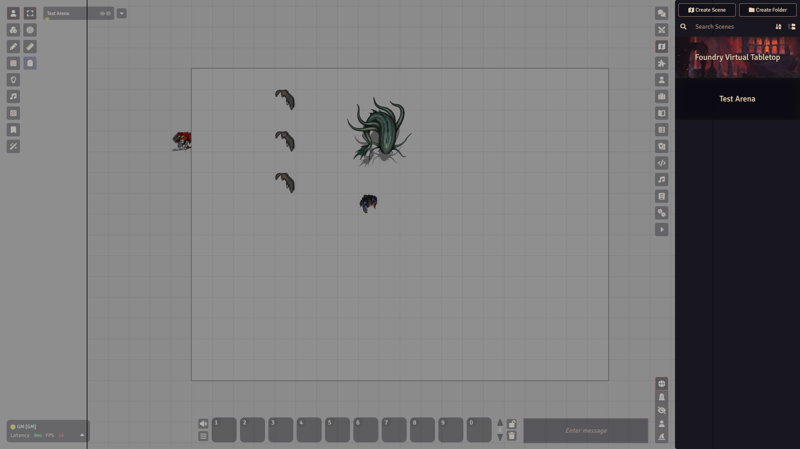
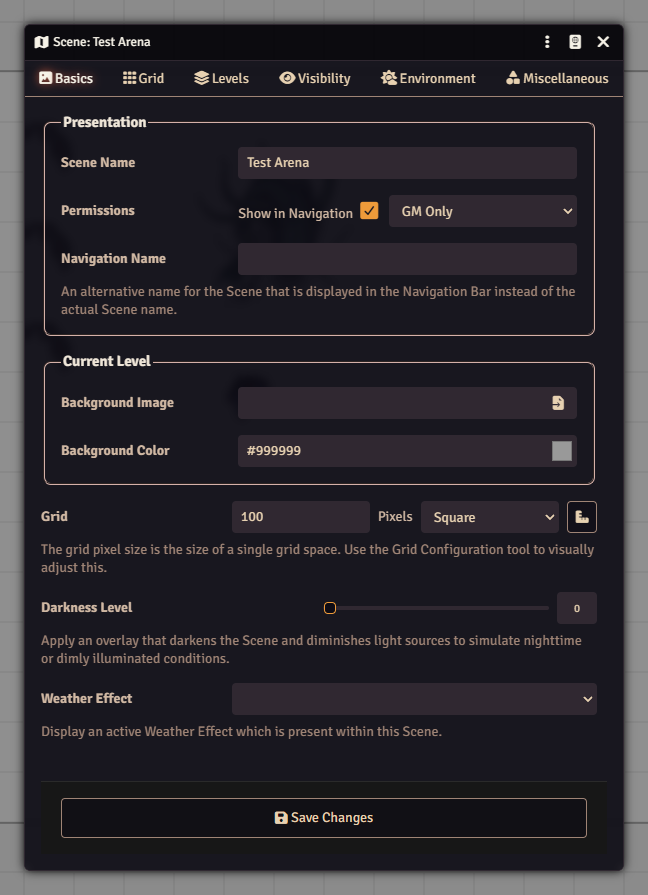
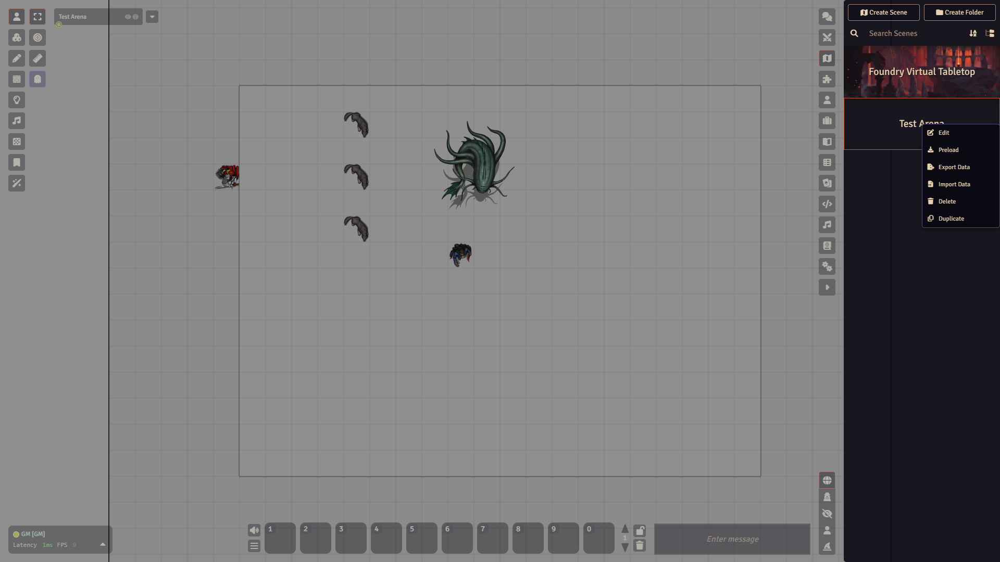

# Scenes

A scene is one map plus all its settings: the background picture, the grid, the walls and lights, the tokens standing on it. Every place your party visits is a scene. You manage them in the **Scenes** tab of the sidebar.

## The Scenes tab

Open the **Scenes** tab in the sidebar on the right. Each scene shows as a wide picture with its name on top. Click a name to open that scene's settings window.

The header has **Create Scene** and **Create Folder**. Below them are a search box (**Search Scenes**), a sort button and a **Collapse All Folders** button.

## Make a scene

1. Open the **Scenes** tab.
2. Click **Create Scene**.
3. Type a **Name** and click **Create Scene** in the small dialog. The scene is created at once and its settings window opens.
4. On the **Basics** tab, set the **Background Image**.
5. Open the **Grid** tab and set the grid.
6. Click **Save Changes**.

### Scene Configuration in short

The window has six tabs:

- **Basics**: scene name, **Show in Navigation**, a **Navigation Name**, the background image and colour, **Darkness Level** and **Weather Effect**.
- **Grid**: grid type (Gridless, Square or one of four Hexagonal types), the size of one square in pixels, the distance and units it stands for, and the grid colour and opacity. This tab also holds the scene width and height. The **Grid Configuration Tool** button helps you line the grid up with a map that has its own squares.
- **Levels**: a scene can have more than one vertical level. You can ignore this for a normal flat map.
- **Visibility**: **Token Vision**, **Fog of War**, **Exploration Mode** and **Global Illumination**.
- **Environment**: the light and colour mood of the scene.
- **Miscellaneous**: link a **Journal Entry** and a **Scene Playlist**, and pick a **Transition Animation**.

You can open this window again later: right-click the scene in the list and choose **Edit**, or just click its name.

## View or Activate

These two are easy to mix up.

- **View** loads the scene for you only. Use it to prepare a map while the players look at something else.
- **Activate** makes it the active scene and pulls every connected user to it.

To use either, right-click the scene in the Scenes tab.

Which entries you see depends on the scene. A scene that is not viewed and not active gets the full menu:

- **View** and **Activate**: left out when you are already viewing the scene, or when it is already active.
- **Edit**: opens Scene Configuration.
- **Preload**: gets the scene's pictures ready ahead of time.
- **Toggle Navigation**: adds the scene to, or removes it from, the navigation bar. Not offered for the active scene.
- **Generate Thumbnail Image**: only offered when the scene has a background image.
- **Export Data**, **Import Data**, **Delete** and **Duplicate**.

The picture above shows Test Arena, which is the active scene. That is why it has only **Edit**, **Preload**, **Export Data**, **Import Data**, **Delete** and **Duplicate**.

## The navigation bar

The scene navigation bar sits at the top left, just right of the control icons. It shows the scene you are viewing. Click the small arrow beside it (**Expand Navigation**, which then reads **Collapse Navigation**) to list the other scenes. Click a scene there to view it yourself. The active scene does not change and nobody else moves.

Right-click a scene in the bar for **Pull Everyone**, which moves all connected users to that scene, plus **Edit**, **Preload** and **Toggle Navigation**.

To keep a scene out of the bar, right-click it in the Scenes tab and choose **Toggle Navigation**. Do the same again to bring it back.

## Folders

Click **Create Folder** to make a folder. Give it a **Folder Name** and a **Folder Color**, and pick **Alphabetical** or **Manual** sorting. Drag scenes onto a folder to file them. Right-click a folder for **Edit Folder**, **Configure Ownership**, **Export to Compendium**, **Remove Folder** and **Delete All**.

:::caution
**Remove Folder** removes the folder and keeps the scenes. **Delete All** is the one that deletes the scenes inside too. Pick carefully.
:::

## Watch out

- **Activate** moves every player. If you only want to look, use **View**.
- If the map looks empty, check the **Background Image** on the **Basics** tab.

Next: [Tokens](tokens.md) to put characters on the map, and [Walls and lighting](walls-and-lighting.md).
