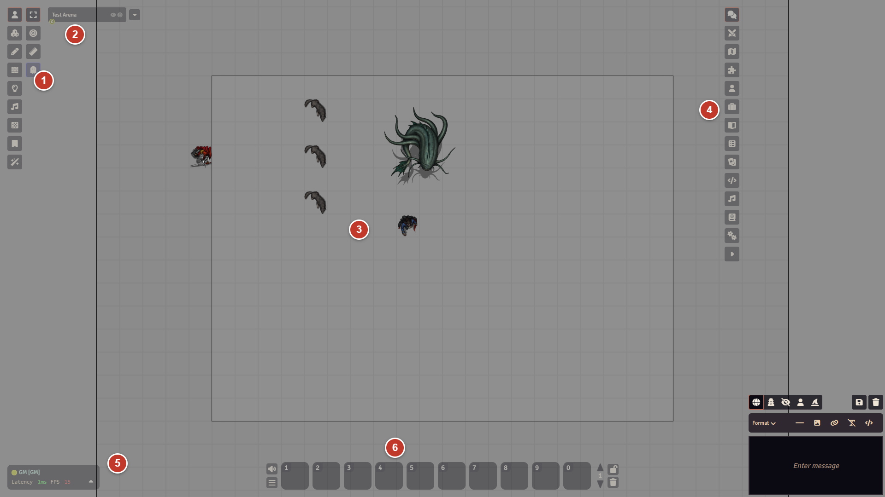
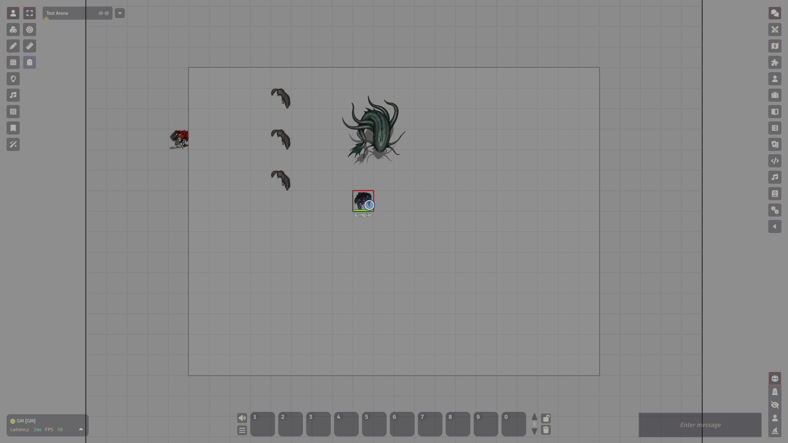

# A tour of the Foundry screen

Once you join a world, everything you see is one screen. The map fills the middle and the tools sit around the edges. This page walks through the pieces so you know where to look.

## 1. Scene controls (left column)

The column of icons at the top left. Each icon is a **layer** of the map, and clicking one shows the tools for that layer in a second column next to it.

| Icon (layer)               | What it is for                                            | Who sees it                                       |
| -------------------------- | --------------------------------------------------------- | ------------------------------------------------- |
| **Token Controls**         | Select, move and target tokens, measure distance          | Everyone                                          |
| **Tile Controls**          | Place images on the map                                   | GM                                                |
| **Drawing Tools**          | Draw shapes and text on the map                           | GM and Trusted Players (a default you can change) |
| **Wall Controls**          | Draw walls and doors                                      | GM                                                |
| **Lighting Controls**      | Place lights, switch between day and night                | GM                                                |
| **Ambient Sound Controls** | Place sounds on the map                                   | GM                                                |
| **Region Controls**        | Draw areas, including the shapes used for spell templates | Everyone                                          |
| **Journal Notes**          | Pins on the map that open journal entries                 | Everyone                                          |

Only one layer is active at a time. The default is **Token Controls** with the **Select Tokens** tool. A normal player sees Token Controls, Region Controls and Journal Notes.

Modules can add their own icons. With the AI Tool module on, the GM also gets an **AI Tool** icon at the bottom of the column.

Hover a tool to see its name. In **Game Settings**, under **Core**, the setting **Show Toolclips on Hover** switches the extra help clips on tools on or off.

## 2. Scene navigation

At the top left, just to the right of the scene controls. Folded, it shows only the scene you are looking at, with a small letter for each connected user who is on it. Click the arrow (**Expand Navigation**) to list the other scenes. Click a scene to view it yourself. This does not move anyone else.

As GM, right-click a scene for **View**, **Activate**, **Pull Everyone**, **Edit**, **Preload** and **Toggle Navigation**. See [Scenes](scenes.md).

## 3. The map

The map (the canvas) fills the middle of the screen.

- Zoom with the mouse wheel, or with Page Up and Page Down.
- Pan by dragging with the right mouse button, or with the arrow keys.
- Click and hold on the map while a Token Controls tool is active to send a ping. Hold Alt while you do it for an alert ping.

## 4. Sidebar tabs (right edge)

The sidebar starts folded away, with only a column of icons showing. Click an icon to open that tab. The arrow at the bottom of the column opens and folds the panel. Right-click an icon to pop the tab out into its own window.

<video src="../images/foundry/tour-sidebar-tabs.mp4" poster="../images/foundry/tour-sidebar-tabs.png" autoplay loop muted playsinline aria-label="The sidebar tabs being opened one after another"></video>

From top to bottom:

1. **Chat Messages**: the chat log and where you type. See [Chat and dice](chat-and-dice.md).
2. **Combat Encounters**: turn order and rounds. See [Combat](combat.md).
3. **Scenes** (GM only): every scene in the world.
4. **Placeables**: lists the tokens, tiles, drawings, walls, lights, sounds, regions and notes on the scene you are viewing, one tab for each kind.
5. **Actors**: characters, monsters and NPCs. See [Actors](actors.md).
6. **Items**: loose items that no actor is carrying.
7. **Journal**: notes and handouts. See [Journals](journals.md).
8. **Rollable Tables**: random tables you can draw from.
9. **Card Stacks**: decks and hands of cards.
10. **Macros**: saved shortcuts you can put on the hotbar.
11. **Playlists**: music and sound. See [Playlists and sound](playlists.md).
12. **Compendium Packs**: ready-made content from the system and modules. See [Compendiums](compendiums.md).
13. **Settings**: game settings, modules, log out. See [Worlds and joining](worlds-and-joining.md).

## 5. Players list (bottom left)

Shows everyone who is connected right now, in their own colour, with your own name first and the GMs next. After a name you see **[GM]**, or the name of that player's character in brackets if they have one. Right-click a name for options. As GM you can also choose **Pull To Scene** to move a player to your scene. The small arrow at the bottom of the list also shows the people who are not connected. Next to it you see your latency and frame rate.

## 6. Hotbar (bottom centre)

Ten macro slots, reached with the keys 1 to 9 and 0. There are five pages, so 50 slots in all. Click an empty slot to open a new macro there. Save it to keep it. Beside the slots are buttons to switch pages, lock the bar and clear it. On the left are **Mute Volume**, which mutes all sound for you, and **Main Menu**.

## Chat input

When the sidebar is folded, the chat input still floats near the bottom right, and new messages pop up above it, so you can read and type without opening anything. Press Shift+C to jump to the chat input.

## Pause

The GM presses the Space bar to pause. A **GAME PAUSED** banner shows for everyone, and players cannot move their tokens until the GM presses Space again. The banner does not block your clicks.

## The Escape menu

Press Escape with nothing else open to get the main menu. Everyone gets **Reload Application** and **Log Out**. The GM also gets **User Management** and **Return to Setup**.

:::caution
Escape closes things first and only opens the menu when nothing else is open. If a window is open, press Escape until it is gone.
:::

## What a player sees differently

- No **Scenes** tab.
- Fewer scene controls, as in the table above.
- Only the actors, items and journals they have permission to see. See [Users and permissions](users-and-permissions.md).
- A shorter Escape menu and fewer buttons in **Settings**.
- Pressing Space does not pause the game.

New words? Try the [glossary](glossary.md).
