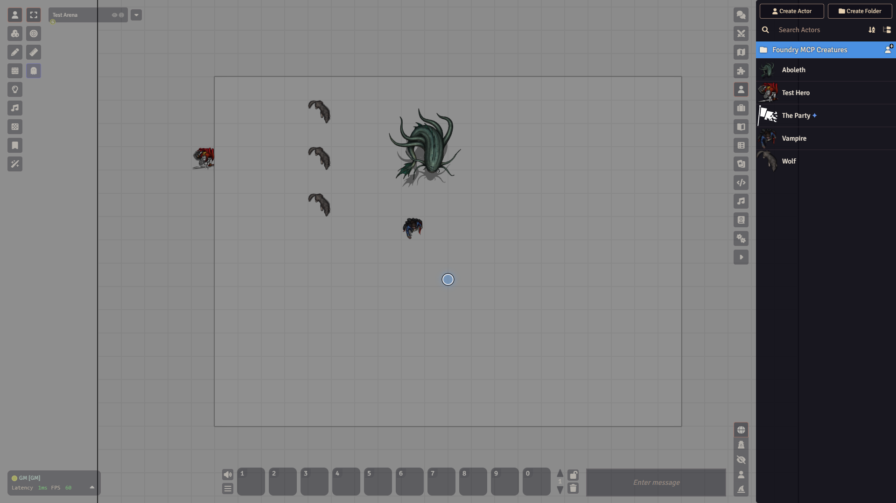
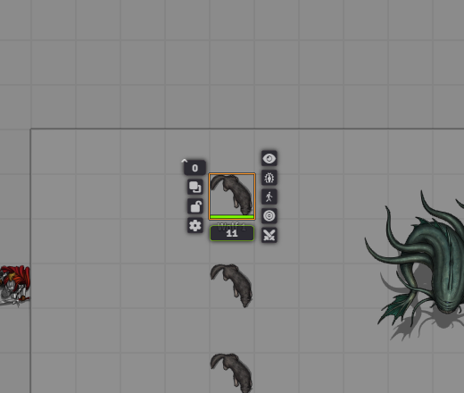
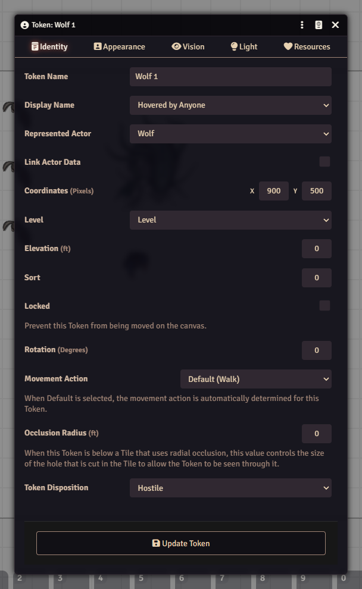

# Tokens

A token is an actor on the map. The actor holds the stats. The token is the little picture you push around. You can have ten goblin tokens from one goblin actor.

## Put a token on the map

1. Open the **Actors** tab.
2. Drag an actor from the list onto the scene.
3. Let go where you want it.

<video src="../images/foundry/tokens-drag.mp4" poster="../images/foundry/tokens-drag.png" autoplay loop muted playsinline aria-label="Dragging an actor from the Actors tab onto the map to make a token"></video>

The new token copies the actor's Prototype Token settings. See [Actors](actors.md).

## Select and move

Open the scene controls on the left and pick **Token Controls**. Its tools are **Select Tokens** (the default), **Select Targets**, **Measure Distance** and **Unconstrained Movement**.

- Click a token to select it.
- Drag a token to move it.
- Double-click a token to open its actor sheet.
- Moved the wrong token? Press Ctrl+Z.

## The token HUD

Right-click a token to open the HUD, a ring of small buttons around it. Right-click the token again or press Esc to close it.

Left side, from the top:

- **Elevation**: type a number and press Enter.
- **To Front/Back**: switches which token sits on top.
- **Lock** or **Unlock**: a locked token cannot be moved or edited.
- **Open Configuration**: the gear. Opens Token Configuration.

Under the token: the first attribute bar. For dnd5e this is usually hit points. Type a new number into it.

Right side, from the top:

- **Hide** or **Show**: the eye. Hides the token from players.
- **Assign Status Effects**: pick a condition such as Blinded.
- **Select Movement Action**: pick how the token moves.
- **Target** or **Untarget**.
- **Enter Combat** or **Exit Combat**: adds or removes the token from the current fight. See [Combat](combat.md).

## Token Configuration

Click the gear on the HUD to configure that one token. To set the template for future tokens, open the actor sheet, click the three-dot menu in the title bar and choose **Prototype Token**.

The window has five tabs:

- **Identity**: token name, display name, **Link Actor Data**, rotation, movement action and token disposition (Hostile, Neutral, Friendly or Secret). A placed token also shows its actor, position, level and elevation.
- **Appearance**: image, fit mode, scale, tint, opacity, and the dynamic token ring.
- **Vision**: **Vision Enabled**, range, angle, vision mode and detection modes.
- **Light**: the token gives off light, with the same kind of settings as a light placed on the map. See [Walls and lighting](walls-and-lighting.md).
- **Resources**: **Display Bars**, which attribute each bar shows, and the combat turn marker.

Click **Update Token** at the bottom when you are done. For a prototype token there is also an **Assign Token** button next to it.

## Linked or unlinked

**Link Actor Data** is a switch on the **Identity** tab. In short:

- **Linked** tokens share one actor. Hit points and conditions on the token are the actor's. Use this for player characters.
- **Unlinked** tokens each work on their own copy of the actor. Use this for monsters, so ten goblins can each be hurt separately.

## Targeting

Targets mark who an attack or spell is aimed at. Use the **Select Targets** tool, or click **Target** in the HUD. Click **Untarget** to clear it.

## Watch out

- If a player cannot move their token, check that they are **Owner** of the actor.
- Hiding a token with the eye hides it from players only.
