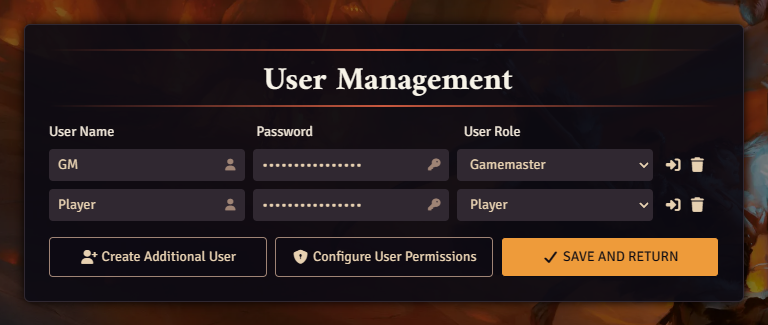
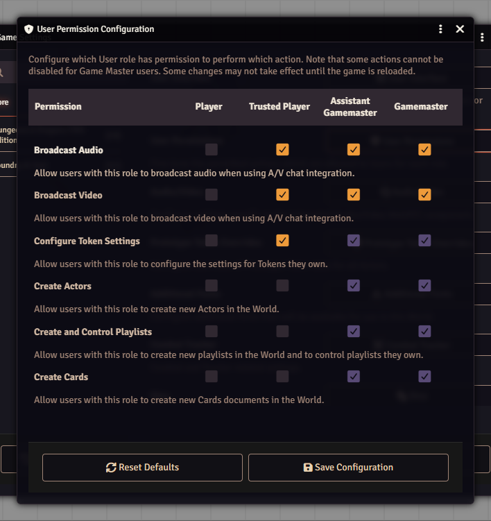

# Users and permissions

Every person who joins your world is a **user**. Each user has a **role**, and the role decides what they may do. On top of that, every actor, item and journal has its own **ownership** setting that decides who can see or edit it.

## The four roles

A user can also have the role **None**, which means they cannot join at all. Foundry uses this to ban someone.

| Role                     | What it is for                                                                                                                              |
| ------------------------ | ------------------------------------------------------------------------------------------------------------------------------------------- |
| **Player**               | A normal player. Plays their own character, rolls, chats.                                                                                   |
| **Trusted Player**       | A player with a few extras by default: drawing on the map, creating journal entries and map notes, using the file browser.                  |
| **Assistant Gamemaster** | Sees everything as an owner and gets the GM's screens. Cannot open User Permissions or World Configuration, and cannot use Return to Setup. |
| **Gamemaster**           | Full control of the world. Every world needs at least one.                                                                                  |

## Manage your users

User names, passwords and roles all live on one page.

1. Open the **Settings** tab in the sidebar.
2. Click **User Management**. The browser leaves the game and opens a full page with a row for each user.
3. Change a name, a password or a role in the row. The eye icon next to the password shows what you typed. Roles are in a drop-down: **None**, **Player**, **Trusted Player**, **Assistant Gamemaster**, **Gamemaster**.
4. Click **Create Additional User** to add a new person. This creates the user right away, named Player plus a number, so rename it.
5. Click **Save and Return** to save and go back to the game.

Each row also has two buttons. **Login as User** saves your changes and logs you in as that user, which is a quick way to see what a player sees. **Delete User** deletes that user for good, after a confirmation. Do not use it for someone who is just taking a break.

:::note
You need at least one Gamemaster in the list, or saving fails.
:::

## Configure permissions

This table sets what each role is allowed to do across the whole world, such as **Create Actors**, **Use Drawing Tools** or **Ping the Canvas**. Only a full Gamemaster sees it.

1. Open the **Settings** tab and click **Game Settings**.
2. Open the **Core** tab at the top of the window.
3. Find **User Permissions** in the list and click its **User Permissions** button. You can also click **Configure User Permissions** on the User Management page.
4. Tick or untick boxes. Each column is a role: **Player**, **Trusted Player**, **Assistant Gamemaster**, **Gamemaster**. Greyed boxes are fixed.
5. Click **Save Configuration**.

:::caution
**Reset Defaults** in this window changes the settings at once, with no question first.
:::

## Ownership of a document

Roles are about the whole world. Ownership is about one thing, such as one character. There are four levels:

- **None**: hidden. They do not see it in the sidebar.
- **Limited**: they see it in the list and can open a short version. For a D&D 5e actor that is the portrait, name, description and biography.
- **Observer**: they can open the full sheet but not change it.
- **Owner**: they can edit it, and for an actor they control its tokens.

A GM or Assistant Gamemaster always counts as owner of everything. To change ownership, right-click the entry in its sidebar tab and choose **Configure Ownership**. The **Ownership Configuration** window has an **All Players** row for the default and one row per user. Click **Save Changes** when you are done.

## How a player gets a character

A character belongs to a player in two steps. Both are done by the GM.

1. Make the player an owner of the actor: right-click the actor in the **Actors** tab, choose **Configure Ownership**, and set that user to **Owner**.
2. Assign it as their character: right-click the player's name in the players list (bottom left) and choose **User Configuration**. In the **Player Character** list, pick the actor and click **Save Player Configuration**.

The same window has **Player Color**, **Player Pronouns** and **Player Avatar**. A player can open it for themselves from their own name in the players list.

## Watch out

- Give a player **Owner** on their own character so they can edit it. **Observer** only lets them read it.
- Players can only see what ownership lets them see. If a player says an actor is missing, check **Configure Ownership** first.
- **Kick Player** and **Ban Player** appear when you right-click another connected user in the players list. They act at once, with no question first. **Ban Player** sets the role to None.
- Do not pass the GM account to players. Make a separate user for each person.

Next: [Worlds and joining](worlds-and-joining.md), [Actors](actors.md).
