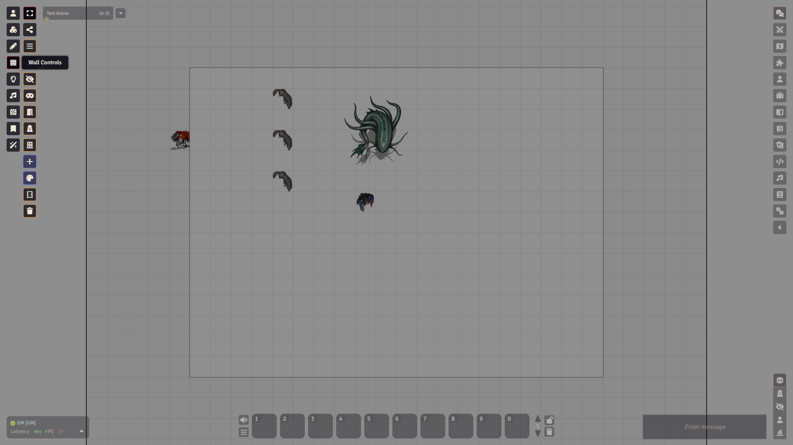
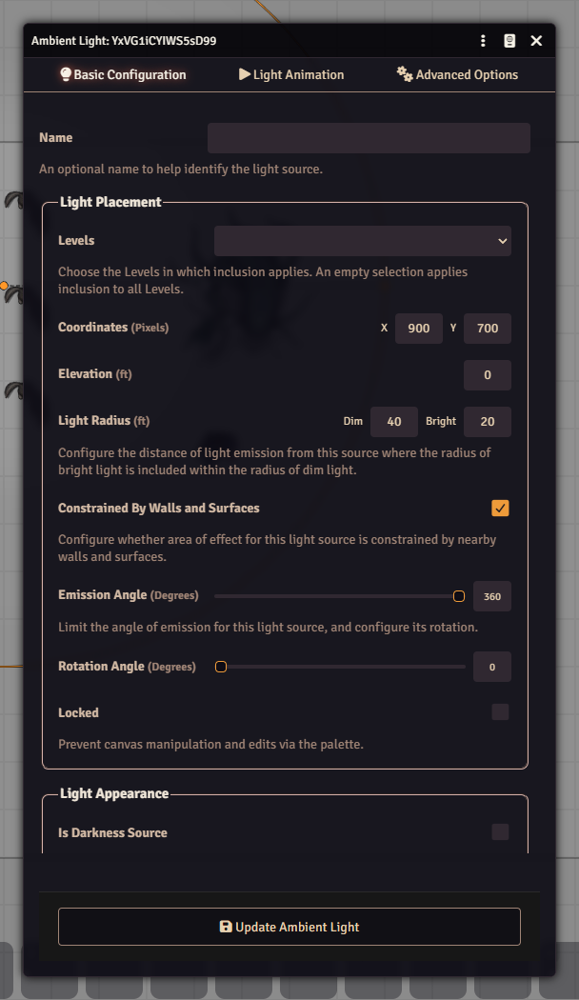

# Layers, walls and lighting

## What it is

The map is built in layers: tokens, tiles, drawings, walls, lights, sounds, regions and notes. The column of buttons on the left edge of the screen is the **scene controls**. Each button picks one layer, and the tools next to it work only on that layer's objects. Objects on other layers stay visible but cannot be clicked.

The buttons you see depend on your role. A GM sees all of them:

- **Token Controls**: **Select Tokens**, **Select Targets**, **Measure Distance** and **Unconstrained Movement**.
- **Tile Controls**: images laid on the map.
- **Drawing Tools**: shapes, freehand and text.
- **Wall Controls**: walls and doors.
- **Lighting Controls**: lights, day and night, fog reset.
- **Ambient Sound Controls**: sounds that play in an area.
- **Region Controls**: areas on the map. It also holds the spell templates (see [Measuring and templates](measuring-and-templates.md)).
- **Journal Notes**: pins that open journal pages (see [Journals](journals.md)).
- **AI Tool**: this project's own group, with **Changes**, **Handouts** and **Tarokka**.

Most groups also have **Force Snap to Grid Vertices** and a **Clear** button that deletes every object on that layer.

## Draw walls

1. Click **Wall Controls**.
2. Pick the kind of wall: **Solid Wall**, **Terrain Wall**, **Invisible Wall**, **Ethereal Wall**, **Door**, **Secret Door** or **Window**. Clicking one only sets what the next wall will be. Nothing is drawn yet.
3. Click **Draw Wall**, then drag on the map.
4. Switch to **Select Walls** and double-click a wall to open its settings. There you can set what it blocks and, for doors, the **Door Type** and **Door State** (Closed, Open or Locked).
5. If you slip, press Ctrl+Z while Wall Controls is active. It removes the wall you just drew.

Doors show a small door icon on the map. Switch to **Token Controls** and click the icon to open or close the door. Right-click the icon to lock it. **Close all Doors** shuts every open door on the scene at once.

## Add lights

1. Click **Lighting Controls** and pick **Draw Light Source**.
2. Drag from the spot where the light should be. How far you drag sets its radius.
3. Switch to **Select Light Sources** and double-click a light to open its configuration. The window has the tabs **Basic Configuration**, **Light Animation** and **Advanced Options**. The **Light Radius**, with its **Dim** and **Bright** values, is on the first tab.
4. Right-click a light to switch it on or off.

**Transition to Daylight** and **Transition to Darkness** fade the scene's darkness level down or up. You can also set the **Darkness Level** in the scene settings.

## Vision and fog of war

Walls only matter for sight when the scene uses token vision. Open the scene settings (Scenes tab, right-click the scene, **Edit**) and look at the **Visibility** tab. It has **Token Vision**, the fog of war **Exploration Mode** and **Global Illumination**. Each token has its own **Vision** tab in its settings, with **Vision Enabled** and a **Vision Range (ft)**.

**Reset Fog of War** in the Lighting Controls wipes what the players have explored on this scene.

## Watch out

:::caution
**Clear Walls**, **Clear Lights** and **Reset Fog of War** ask once and then delete for good. **Close all Doors** and the day and night buttons do not ask at all.
:::

- Draw walls with **Wall Controls** active. Only the active layer takes clicks.
- A door icon is clicked from **Token Controls**, not from the walls layer.
