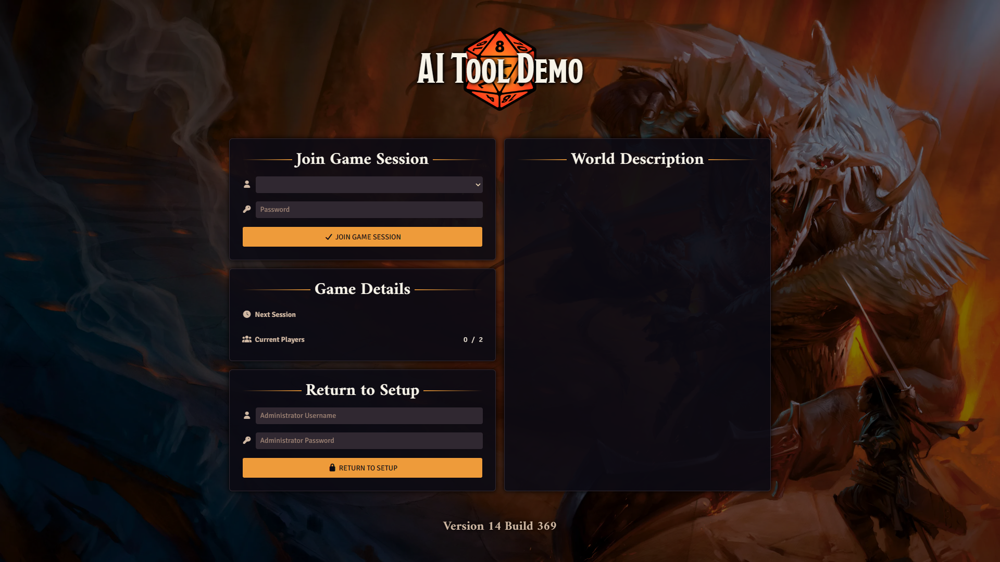
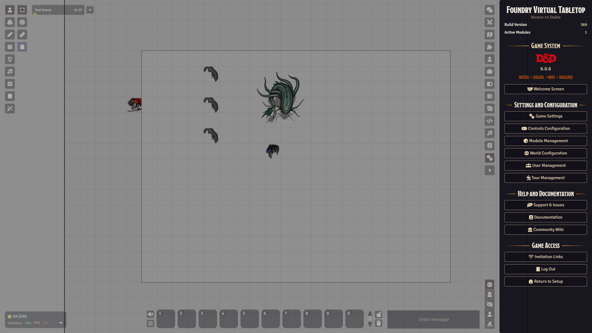

# Worlds and joining

A **world** is one campaign. It holds your scenes, actors, journals and the list of users. Foundry runs one world at a time. When no world is running, you see the **setup screen** instead.

## The setup screen

The setup screen is where you manage what is installed: worlds, game systems and add-on modules. It has three tabs: **Game Worlds**, **Game Systems** and **Add-on Modules**. Only the person who runs the server uses it. If an administrator password is set, you log in with that first.

Players never see this screen. They only see the join page once a world is running.

## Start a world

1. On the setup screen, open the **Game Worlds** tab.
2. Find your world in the list.
3. Click the play icon on the world, or right-click the world and choose **Launch World**.
4. Wait. When it is done, Foundry opens the game screen.

If the world was last saved with an older version of Foundry or of the system, Foundry first shows a **World Data Migration** warning and offers to make a backup. Say yes to the backup. The step called **Begin Migration** cannot be undone without one.

You can create a new world with the **Create World** button on the same tab. It needs a game system installed first.

## Let players in

Players join through the world's address in their browser. To get it:

1. Open the **Settings** tab in the sidebar (GM only for this part).
2. Click **Invitation Links**. The window **Game Invitation Links** opens.
3. Click a link to copy it. **Local Network** works for people on the same network. **Internet** is the address for people elsewhere. It is hidden like a password. Click the eye icon to show it, or the arrows icon to check that the connection is open.

A player then:

1. Opens the address.
2. Picks their user name in the **Join Game Session** box. In some Foundry 14 builds this is a
   drop-down list, in others a text field that suggests names as you type.
3. Types their password, or leaves it empty if the user has none.
4. Clicks **Join Game Session**.

Below that, a **Game Details** box shows **Next Session** and **Current Players**, for example 3 / 5. The GM sets the next session date in **World Configuration**. Users who are already online appear greyed out in the list.

If the name or password is wrong, a message pops up and nothing else happens.

The join page also has a **Return to Setup** box. It needs the administrator login, so players can ignore it.

## Log out, or shut the world down

Both buttons are in the **Settings** tab, in the **Game Access** section at the bottom. You may need to scroll.

- **Log Out** takes you straight back to the join page. Nothing is lost. Join again whenever you like. Everyone has this button.
- **Return to Setup** shuts the world down for everyone and returns to the setup screen. Only a full Gamemaster has it. If other people are connected, Foundry asks you to confirm first.

The Escape menu has the same two choices, as **Log Out** and **Return to Setup**.

To start the world again, go back to the setup screen and use **Launch World**.

## Watch out

:::caution
**Return to Setup** disconnects every player at once. Tell them first.
:::

- Opening the join page logs your browser out of the world. If you only meant to look, you will have to join again.
- Passwords are set per user on the **User Management** page. See [Users and permissions](users-and-permissions.md).
- One browser session holds one user. To test a player view while you are GM, log out and join as the player, use a different browser, or use **Login as User** on the User Management page.
- Do not share the **Internet** link in public. It contains your public address.

Next: [A tour of the Foundry screen](screen-tour.md).
