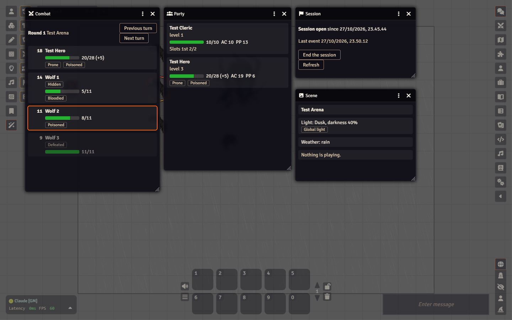
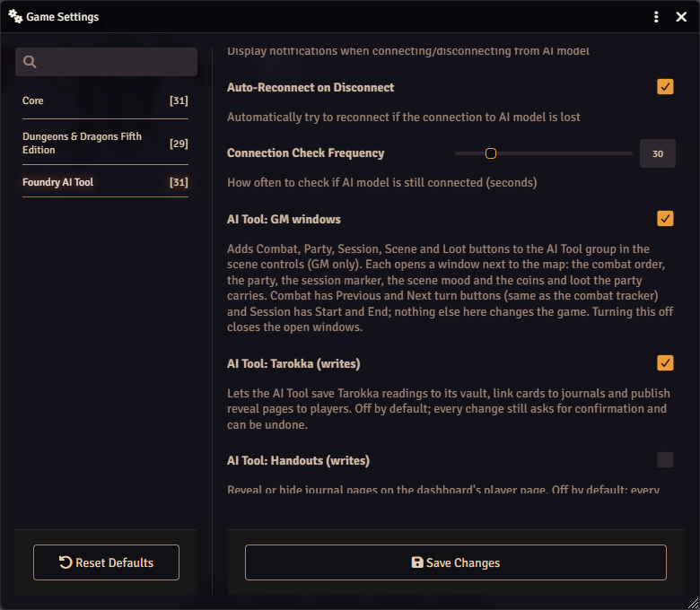
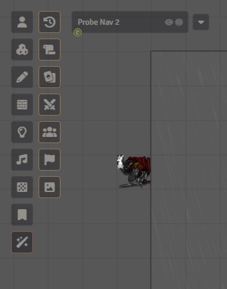
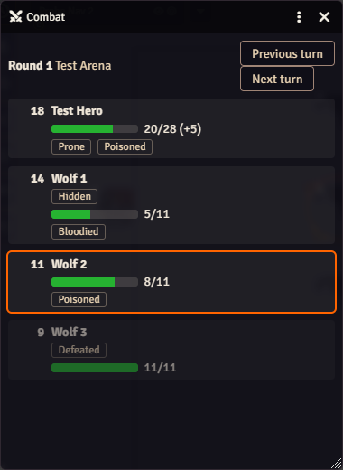
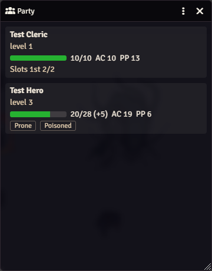
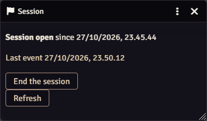
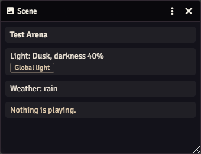

# The GM windows

During play you keep glancing at the same few things: whose turn it is, how hurt the party is,
whether the session is marked as running, what the light and weather are. The co-GM dashboard shows
all of that, but it lives in another browser tab. The **GM windows** put the same things in small
windows inside Foundry, right next to the map, so you can run a whole scene from one screen.

They are **only for you**. Players never see them, and nothing is sent to players when you open one.

## Turn them on

The windows are off until you switch them on, so a new world never shows buttons you did not ask for.

1. Click the gear icon in the sidebar (**Game Settings**), then **Configure Settings**.
2. Pick the category **Foundry AI Tool**.
3. Tick **AI Tool: GM windows (Combat, Party, Session, Scene)** and press **Save Changes**.

The buttons appear at once, without reloading. Unticking the switch closes every open window.

## Where the buttons are

On the left edge of the map, the scene controls have a group called **AI Tool** (the wand icon at the
bottom). Click it and a second column opens with one button for each window, in this order: Changes,
Handouts and Tarokka (these three are always there), then **Combat**, **Party**, **Session** and
**Scene**. Hold the mouse over a button to see its name.

Click a button to open the window (clicking it again brings an open window to the front); the cross
in the window closes it. Each window opens in its own spot so they do not cover each other. You can
drag and resize them like any Foundry window.

## Combat

The turn order of the running combat: the round, the initiative, and for each creature the hit
points (a green bar, with temporary hit points in brackets), conditions, and marks for **Defeated**
and **Hidden** (a hidden creature is hidden from the players, you still see it here).
The creature whose turn it is has an orange frame.

The **Previous turn** and **Next turn** buttons do exactly what the arrows in Foundry's combat
tracker do. They show only once the combat has started. With no combat running, the window says so.

When to use it: when the table is waiting on you, so the order and who is bloodied are one glance away.

## Party

One card per player character: hit points, armor class (AC), passive Perception (PP), level, current
conditions and the spell slots left. It only lists characters that a player owns, so a monster or an
unowned test character never shows up. It updates by itself when hit points or conditions change.

When to use it: when you plan a fight or an ambush and want to know what the party can take, and when
somebody asks "what is my passive Perception again".

## Session

Whether a play session is **open** or not, since when, and when anything last happened. The button
starts or ends the session marker, the same one as in the dashboard. The marker only writes a line
into the session log (that is what Claude's recap is built from); it changes nothing in the game, and
you can start or end it again whenever you like.

The window needs the AI Tool to be connected (you see "MCP Bridge connected" when you join). If it is
not, the window says "The AI Tool is not connected right now" instead of staying empty. **Refresh** asks again at once; it also
checks for itself every fifteen seconds.

When to use it: start the session when play begins and end it when you stop, so the log and the
recap cover the right stretch.

## Scene

The scene the table is looking at: its name, how dark it is (daylight, dusk, dark or pitch dark, with
the darkness percentage), whether the scene has global light, the weather, and which sounds are
playing from your playlists. It only shows; to change the mood, ask Claude ("make it dusk and start the
rain") or use the dashboard.

When to use it: to check what the players are seeing and hearing without opening the scene
configuration.

## If something looks wrong

- **No AI Tool group at all:** the switch is off, or you are not logged in as the GM. Players never
  get the group.
- **A message at the bottom says the GM windows are off:** the switch is off. Turn it on again in
  the settings.
- **Combat or Party is empty:** no combat is running, or no character is owned by a player yet. The
  window tells you which.
- **Session shows an error:** the AI Tool is not connected. See [Troubleshooting](troubleshooting.md).
- **Nothing changes in a window:** close it and open it again; the numbers come from Foundry's own data,
  so they are never older than what Foundry knows.

More on the other parts of the tool: [the dashboard](dashboard.md) and
[features and when to turn them on](features.md#gm-windows).
