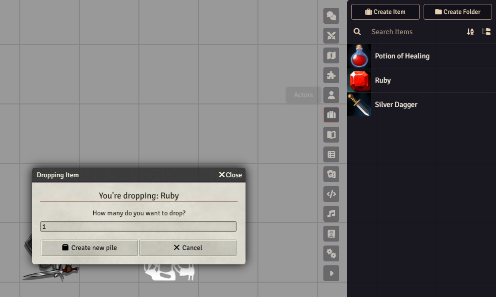
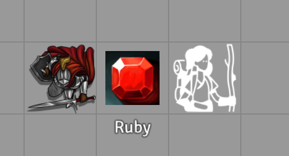
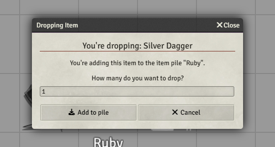
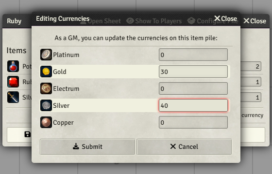
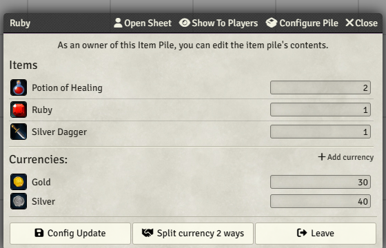
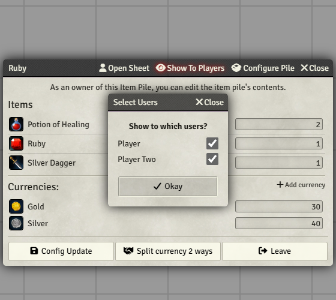
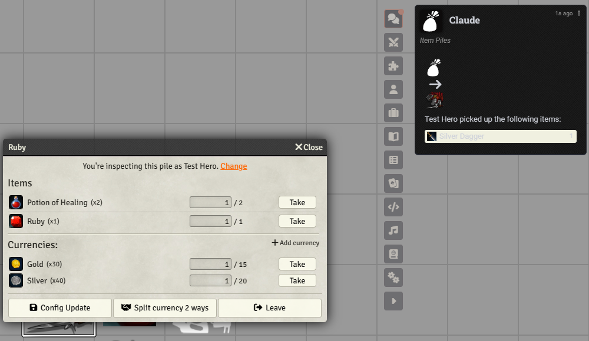
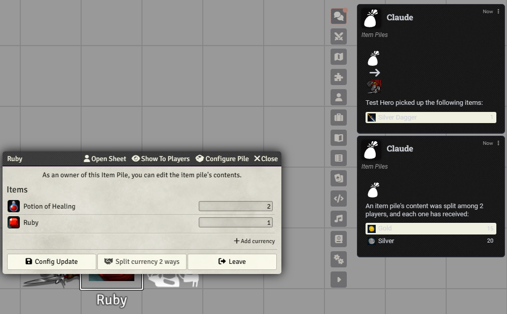
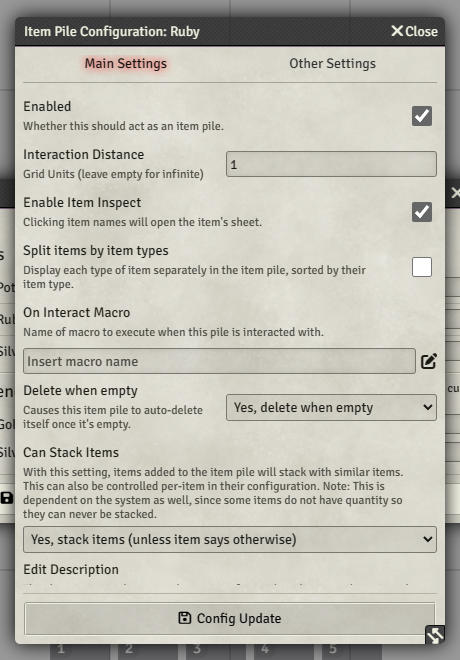

# Giving out loot with Item Piles

Loot at the table goes through **Item Piles**, a Foundry module that is already switched on in the
Curse of Strahd world (with its small helper module for D&D 5e). A pile is a bag on the map. You
put items and coins in it, and the players take what they want, one click each.

The dashboard's **Loot** window does not hand anything out. It only shows what the party is
carrying (see [The Loot window](#the-loot-window-and-asking-claude) at the end of this page).

The pictures were taken on a test world with plain made-up items (a ruby, a dagger, a potion). Your
screen looks the same, with your own items.

## Before you start

- Players need their **own token on the scene**, and Foundry needs to know which character each
  player plays. A player has to stand **next to the pile** to open it (see
  [If a player cannot open the pile](#if-a-player-cannot-open-the-pile)).
- Open the **Items** tab in the sidebar (the briefcase icon). Anything you want to hand out has to
  be an item there, or you make it: **Create Item**, give it a name and a picture.

## 1. Make the pile

Drag an item from the **Items** tab onto the map, where the loot lies. A small window called
**Dropping Item** asks how many. Click **Create new pile**.

**Done when it looks like this:** the item's picture sits on the map as a token, with the item's
name under it. That token is the pile. A pile with one item looks like that item; it keeps that
picture and name when you add more, so rename the token if you want it to read "Chest".

**If it fails:** no **Dropping Item** window opens when you let go of the item. Make sure you let go
over the map, not over the sidebar or another window, and that you are on the scene the players are
on.

## 2. Add more items

Drag the next item from the **Items** tab and drop it **on the pile token**. The window now says
"You're adding this item to the item pile" and the button reads **Add to pile**. Change the number
if there is more than one (two potions, say) and click **Add to pile**.

**Done when it looks like this:** you can double-click the pile and see every item in its list.

**If it fails:** the window says **Create new pile** again instead of **Add to pile**. You dropped
beside the pile, not on it. Cancel and drop it on the token itself.

## 3. Add coins

Double-click the pile to open it. Click **Add currency**, type the coins in the boxes (Gold,
Silver and so on) and click **Submit**.

**Done when it looks like this:** the pile window has a **Currencies** list with your amounts.

**If it fails:** an amount shows 0 or the wrong coin has it. Click **Add currency** again, check you typed in
the right box (Gold, not Platinum) and click **Submit**.

The numbers next to the items are how many are in the pile, and you can change them right there.
The pile is yours to edit. The players see a version with **Take** buttons.

## 4. Tell the players (optional)

A player opens a pile by double-clicking it on the map. To save them the hunt, click **Show To
Players** in the pile window. Foundry asks which players, then **Okay**.

**Done when it looks like this:** the pile window opens by itself on those players' screens.

**If it fails:** a player sees nothing. The window only opens for players who are logged in and ticked
in the list. Ask them to double-click the pile on the map instead.

## 5. What the players do

The player sees the items and coins with a **Take** button on each. For several of one thing, the
small box says how many to take. Click **Take**. The item lands on their character sheet, and a
card in the chat says who took what, for everyone to see. The window also has **Config Update** and
**Leave** buttons at the bottom; a player only needs **Leave**, which closes the window.

When the pile has players with a character online, the limit next to the coins is each player's
**share**: with two players, 30 gold shows as "1 / 15", so nobody can empty the purse alone. Items
are first come, first served.

**Done when it looks like this:** the item is on the player's character sheet and a chat card names who
took it.

**If it fails:** the player cannot get the window open at all. See [If a player cannot open the pile](#if-a-player-cannot-open-the-pile).

## 6. Split the coins

At the bottom of the pile window is **Split currency 2 ways** (the number is how many players are
online with a character). You press it; the players' window shows the same button, so agree who
does. Every coin is divided equally, and a chat card says so.

**Done when it looks like this:** the coins are gone from the pile and each character sheet has
its share. Items stay in the pile for the players to take.

**If it fails:** the button says **Split currency 0 ways**. Nobody is online with a character, so
there is nobody to split with. Players have to be logged in, each with a character assigned.

## 7. When the pile is empty

A pile deletes itself when the last item and coin are taken. If you want to keep it (a chest the
party comes back to), open **Configure Pile**, change **Delete when empty** to **No, don't delete when empty**, then
**Config Update**. The settings window is shown under
[If a player cannot open the pile](#if-a-player-cannot-open-the-pile).

**Done when it looks like this:** after **Config Update**, **Delete when empty** reads **No, don't
delete when empty**. The token then stays on the map after the last item and coin are taken.

**If it fails:** the pile vanished and you wanted it to stay. It deleted itself when it was empty. Make a
new pile (step 1) and set **Delete when empty** before the players start taking.

## If a player cannot open the pile

- **"You're too far away to interact with this pile."** The player's token is not next to the
  pile. A pile opens, by default, only for a token one grid unit away (**Interaction Distance** is 1). Move the token next to it, or make the
  reach longer: open the pile, click **Configure Pile**, change **Interaction Distance** (empty means
  from anywhere) and click **Config Update**.
- **They cannot find it.** Use **Show To Players** (step 4); the window opens on their screen.
- **The window is for the wrong character.** It says "You're inspecting this pile as ...". The
  player clicks **Change** and picks their own character.
- **Nothing happens on a double-click.** Check **Enabled** in **Configure Pile**. If it is off, the
  token is just a picture and not a pile.

## The Loot window and asking Claude

The **Loot** window in the [GM windows](gm-windows.md#loot) shows what each character carries and
the coins, and it updates by itself when coins or treasure change hands. Only coins and items marked
as treasure count (set **Loot Type** on the item), so a dagger or a potion taken from a pile does not
show there. It is **read-only**: it has no button that
gives anything away. That job is the pile's.

You can also ask Claude to put loot straight on a character ("give Thorin 50 gold and a ruby").
That is a normal guarded change: Claude shows a **plan**, you **confirm** it, and it can be
**undone** in Recent Changes (see [How Claude's changes are approved](asking-claude.md#how-claudes-changes-are-approved)).
It needs the switch **AI Tool: Live play (writes)** on ([features](features.md)). Claude does not
open or fill piles; for a pile, use the steps above.

## Good to know

- Item Piles may post a welcome card in the chat the first time it loads, and the players can see
  it. If you see one, delete it before the players join.
- Coins and items in a pile are not in the Loot window until somebody takes them: the window shows
  player characters, not piles.
