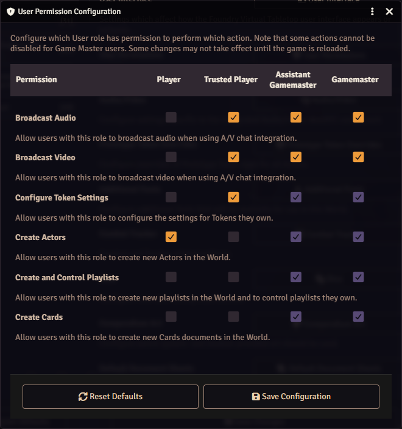
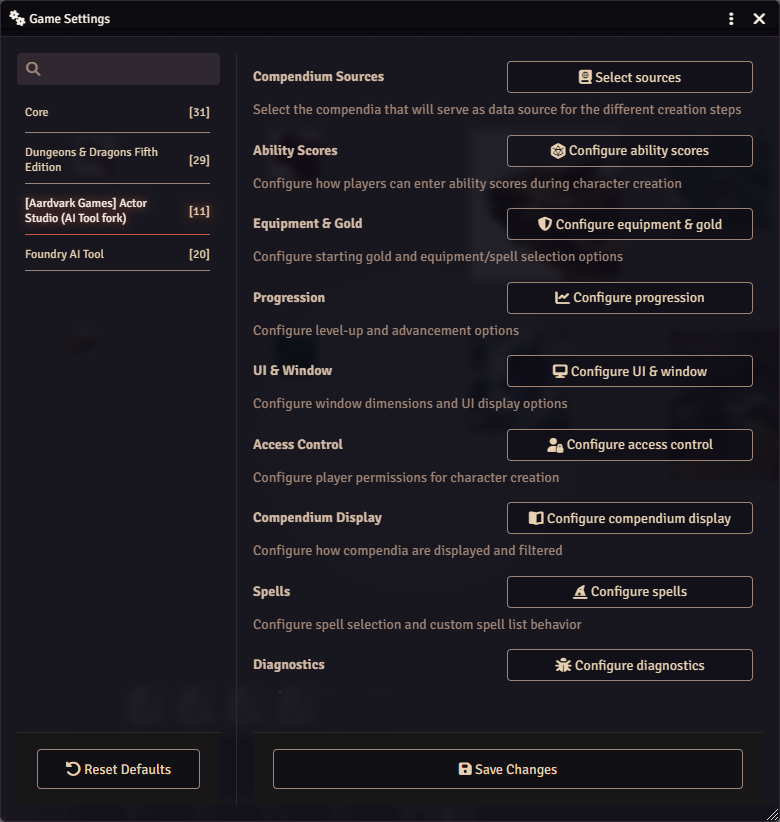
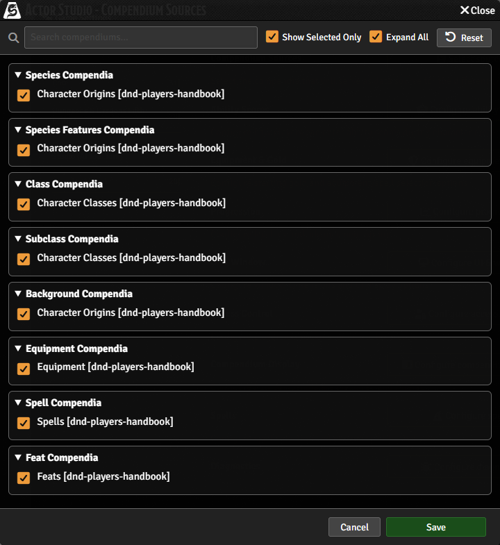

# Prepare session 0

At session 0 each player makes a level-3 character in Foundry from home, with the builder
**Actor Studio** (the player side is in [Make your character](../player/make-a-character.md)).
The builder always makes a level-1 character, so the players build it and then level it up twice,
and they pick their subclass at the second level-up.
Out of the box players can't do that: they may not create characters, Actor Studio reads the
older free rules instead of the 2024 Player's Handbook, and the **Level Up** button does not show
until a character has the experience points for it. This page sets all three up, once, a week or so
before session 0. It takes about 30 minutes.

**On our server part of it is done already.** The admin's setup script sets three things for characters:
players may create characters, Actor Studio gives starting equipment, and the equipment comes from
the Player's Handbook. So step 2 is a check, and so is the equipment row in step 3.
**Everything else in step 3 is yours**: the other Compendium Sources rows, Enable Spell Selection
and the ability score method. The script does not touch them, and until you set them a player may see
the older free species list and no Spells step (look at what the world shows). Compare each window with the picture and the
table, and set what differs. Steps 1 and 4 are yours too.

All of it is normal Foundry settings, done as Gamemaster in your browser. Nothing here needs the
command line or Claude. What session 0 itself holds is yours to plan; [Prep and
expectations](prep-and-expectations.md) has an agenda you can change.

## 0. Collect the players' emails

Before anything else, ask each player in Discord for the email address they will use, and send the
list to the tool admin. Only addresses on the admin's Cloudflare list get a login code. An address
that is not on it never gets an error, just no code, so this is the likeliest thing to go wrong on
the first night. Tell the players to use exactly the address they gave you.

## 1. One user per player

1. Press **Esc** and choose **User Management** (or Settings tab, **User Management**).
2. For each player, click **Create Additional User**, type their name in **User Name**, leave
   **Password** empty (Cloudflare Access and its emailed code are the lock), and keep the role **Player**.
3. Click **Save and Return**.

Send each player their user name privately (a Discord direct message), with the link
to [Join the game](../player/join.md).

## 2. Let players create characters (a check on our server)

1. Settings tab, **Game Settings**, category **Core**, the **User Permissions** button.
2. In the row **Create Actors**, tick the **Player** column.
3. Click **Save Configuration** (only if you changed something).

Without this, Actor Studio tells a player "User requires the 'Create New Actors' permission".

## 3. Point Actor Studio at the 2024 Player's Handbook (partly done on our server)

Settings tab, **Game Settings**, the category **[Aardvark Games] Actor Studio (AI Tool fork)**.

1. **Compendium Sources**, **Select sources**. The window opens with **Show Selected Only**
   ticked, so it lists only the packs already in use: untick it to see them all. Tick only the
   packs of the Player's Handbook module (their names end in `[dnd-players-handbook]`):

   | Row                                           | Tick              | Done on our server?   |
   | --------------------------------------------- | ----------------- | --------------------- |
   | Species Compendia, Species Features Compendia | Character Origins | Not set by the script |
   | Background Compendia                          | Character Origins | Not set by the script |
   | Class Compendia, Subclass Compendia           | Character Classes | Not set by the script |
   | Spell Compendia                               | Spells            | Not set by the script |
   | Feat Compendia                                | Feats             | Not set by the script |
   | Equipment Compendia                           | Equipment         | Yes, check it         |

   Untick the D&D 5e system's own packs (the older free rules), or every list shows each choice
   twice. Click **Save**, then **Yes** when Foundry asks to reload.

   

2. **Configure ability scores**: tick the method you and the players agreed on (**Allow standard
   array**, **Allow point buy**, **Allow rolling**, **Allow manual input**), so the builder offers
   only that one. If you haven't had the talk yet ([The ability score
   talk](prep-and-expectations.md#the-ability-score-talk)), you can change this on the night before
   the players open the builder. Manual input lets a player type any number; leave it off unless
   you want that.
3. **Configure equipment & gold**: **Enable Equipment Selection** is ticked.
4. **Configure spells**: tick **Enable Spell Selection**. The admin's script does not set this, so
   it may be off until you tick it. With it off, a spellcaster may get no **Spells** tab and has to add
   cantrips and spells by hand on the finished sheet, which is easy to get wrong. With it on, the
   builder asks for them and shows how many are allowed.

   The Spell Compendia row (item 1) decides which spells that Spells tab offers, so tick only the
   Player's Handbook there. Feats such as Magic Initiate are different: they open Foundry's own
   spell browser, which lists every edition whatever you ticked. The player guide tells players to
   pick the "PHB 2024" copy.

5. **Configure progression**, under **Leveling Options**: tick **Enable Level Up** and **Milestone
   Levelling**. **Without Milestone Levelling a player sees no gold Level Up button on their
   sheet until the character has 300 XP (for level 2) and then 900 XP (for level 3).** With it on,
   the button is always there and players can level up without any XP, which is what we want at
   session 0. (The alternative is to give each character 900 XP yourself.) After session 0 you can
   untick it if you would rather hand out levels by XP.

After setting it all, a quick sign that the packs are right: the species list shows only the 2024
species, a Cleric gets a **Spells** tab, and a new character's sheet has a **Level Up** button.
Step 5 is the full test.

Leave usage tracking off: our copy of Actor Studio has it off for everyone.

Actor Studio reads these settings when the page loads. If you change one while players have the
game open, ask them to reload (F5) before they open the builder.

Our table keeps to the 2024 Player's Handbook. If you ever allow more (for example older species
in our own content module), tick those packs too and tell the players.

## 4. Give the join page the campaign look (optional)

The join page is the first screen your players see when they open the game link. One click gives
it The Veil: the castle in the mist as the background picture and a lamplit line above your world
description.

1. Settings tab, **Game Settings**, category **Foundry AI Tool**, the **Choose join page look**
   button.
2. Keep or change **The lamplit line** (one short line).
3. Leave **Use The Veil picture as the world background** ticked, or untick it to keep your own
   picture.
4. Click **Apply The Veil**.

Your description text stays as it is. **Back to Foundry's look** in the same window removes the
line and the picture again. If you later save the description in **Edit World** and the line
disappears or loses its colours, open the window again and apply it.

## 5. Try it as a player

Make one character yourself as a player, so you know what they see and it works before the night.

1. In User Management, make a user called **Test Player** (role Player).
2. Open the game in a private browser window and log in as Test Player.
3. Follow [Make your character](../player/make-a-character.md) to the end.
4. As GM, look at the character's sheet with the checklist in step 10 of that page, then delete
   the character and the Test Player user.

## On the night

An agenda for the whole night, from the tech check to the wrap up: [Prep and
expectations](prep-and-expectations.md#a-session-0-agenda-you-can-change).

- Post the link to [Make your character](../player/make-a-character.md) in Discord, plus your
  answers: which ability score method, which options are allowed, anything about the campaign.
- Players build at the same time; it takes them about an hour, the level-ups included. Stay in voice for questions.
- When a player says they are done, open their sheet and go through the checklist in step 10 with
  them. The most common miss: a choice skipped with **Next** (a missing skill or spell). Fix it by
  hand, or delete the character and let them redo it.
- **Wizards:** the Player's Handbook module's wizard starting equipment has no spellbook. Open the
  wizard's sheet and its **Inventory** tab. In the **Compendium Packs** tab of the sidebar, click
  **Open Compendium Browser**, open its **Items** tab, search for "Spellbook" and drag it onto the
  sheet.
- Check each player picked their character in **User Configuration** (the Players list shows
  `Name [Character]`).
- Add portraits: players can't upload pictures, so they send them to you. Open the sheet, click
  the portrait and pick the image.

## Afterwards

You can untick **Create Actors** for players again; nobody needs it until a character dies. When
one does, see [When a character dies](death-and-new-characters.md).
