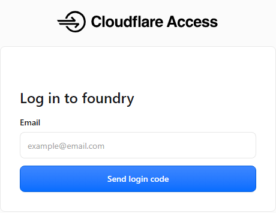
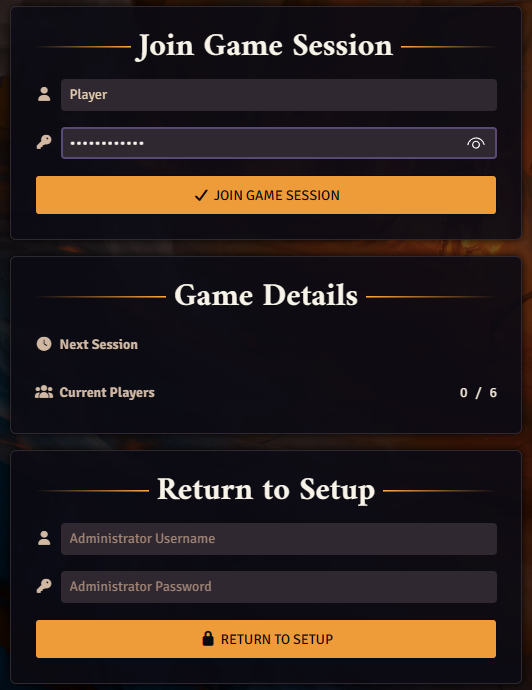
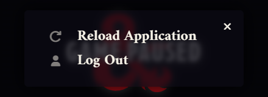

# Join the game

**Phones are for reading, not playing.** Use a laptop or desktop computer to play. And **give Danni
your email first**: until he adds it to the list, no login code ever arrives and Cloudflare shows
no error.

We play in two places at once: **Foundry** in your web browser (the map, your character sheet,
the dice) and **Discord** (voice). This page gets you into both. Do it once before session 0, so
any problem shows up before the game.

It takes about ten minutes the first time. After that, joining is the address and your name.

## What you need

- **A laptop or desktop computer.** Foundry needs a screen of at least 1366 by 768 pixels. Phones
  and tablets are fine for reading your sheet, not for playing.
- **A recent Chrome, Edge or Firefox.** Chrome or Edge works best. Keep "hardware acceleration" on
  in the browser's settings (it is on unless you turned it off).
- **A headset or earbuds with a microphone**, so the others don't hear themselves through your
  speakers.
- **Discord**, the app or in the browser, and an invite to our server.
- **From the GM:** the game's web address and your Foundry user name (your first name). Your user has no
  password: the emailed login code is the lock.
- **An email address you can open right now.** Give it to Danni before session 0. Only
  addresses on the list can get in, so a different address than the one you gave
  will not work.

## 1. Open the game's address

Open the address the GM sends you. It starts with `https://` and ends in the game's own name. We
don't print it here, because this page is public. Paste it from the GM's message into your
browser's address bar.

The first time, and about once a month after that, a plain white page from **Cloudflare Access**
opens instead of the game. It is the lock on the front door. You don't need a Cloudflare account.

1. Type the email address you gave the GM into the **Email** box.
2. Click **Send login code**. The page now asks for a code.
3. Open your email. A message from Cloudflare has a code of six digits. If it isn't there after a
   minute, look in spam.
4. Type the code into the page and confirm.

<!-- Pictures still to add (vault Waiting.md W25): the page that asks for the code, and the code email with the digits blurred. -->

The page now takes you on to Foundry. If you typed an address that isn't on the GM's list, Cloudflare
does not say so: it just never sends a code. That is the first thing to check if nothing arrives.

## 2. Log in to Foundry

Foundry's join page opens. It shows the game's name at the top and three panels on the left.

1. In the first box, pick your **user name** from the list, exactly as the GM wrote it.
2. Leave the password box empty. Your user has no password.
3. Click **Join Game Session**.

Ignore the **Return to Setup** box at the bottom. It is for the person who runs the server, and
it does nothing for you.

The game loads. The first time, two windows open by themselves: the Actor Studio welcome window
and Foundry's **User Configuration**. Close both for now. User Configuration comes back every time
you join until you have a character and have picked it there (see
[Make your character](make-a-character.md)).

<!-- Picture still to add (W25): the two first-join windows on the real world. -->

If the screen says **Game Paused**, the GM has paused the game. Nothing is wrong. It goes away when
the GM starts again.

### Leaving, or switching user

To leave, close the browser tab. To switch user on the same computer, press **Esc** (press it again if
a window closed first) and choose **Log Out**.

**Reload Application** in the same menu is the first thing to try if the game looks stuck.

## 3. Join Discord voice

Join the game's voice channel on our Discord server. Use push-to-talk or keep background noise
down, and mute when you step away.

Sessions may be recorded for notes. Your voice is only kept if you said yes in writing, and the bot
always posts a notice when it starts. What is recorded and what happens with it: [player guide](README.md).

## The read-only player page

The GM may also send you a second address: the **player page**. It is a read-only web page for
phone or laptop with the combat order, the session feed and the handouts the GM has shown you. It
is live now. It asks for an email code too, the same kind as in step 1 but a separate login, so the first visit
works the same way. You don't need it to play. More in the [player guide](README.md).

## If it doesn't work

| What you see                                  | What to do                                                                                                              |
| --------------------------------------------- | ----------------------------------------------------------------------------------------------------------------------- |
| No email code arrives                         | Wait a minute and check spam. Check you typed the address you gave the GM, with no extra spaces. Otherwise tell the GM. |
| The Cloudflare page asks for your email again | Normal about once a month, or in a new browser. Get a new code.                                                         |
| The code is refused                           | Codes run out after a short while. Reload the address, click **Send login code** again and use the newest email.        |
| "The requested User ... does not exist"       | The user name is spelled differently. Copy it from the GM's message.                                                    |
| Foundry asks for a password                   | You picked the wrong user, or the GM's. Pick your own name; yours has no password. Still asked? Tell the GM.            |
| A warning about screen resolution             | Make the browser window bigger, or use a computer with a bigger screen.                                                 |
| The page loads but stays black or very slow   | Close other tabs, check hardware acceleration is on, reload the page (F5).                                              |
| The page can't be reached at all              | The server may be down. Tell the GM on Discord; the GM has a plan B.                                                    |
