# Make your character

This page walks you through making a **level-3 character** in Foundry, the way we do it at session 0:
our campaign starts at level 3. The builder always makes a level-1 character, so you build it first
(steps 1 to 9) and then level it up twice to level 3, which is also where you pick your subclass
(step 10). It takes about an hour the first time. You need to be logged in first: see
[Join the game](join.md).

We use **Actor Studio**, a character builder inside Foundry. It asks the same questions as the
2024 Player's Handbook, in the same order, and fills in your character sheet for you. You can't
break anything: if it goes wrong, the GM deletes the character and you start again.

Checked on Foundry 14, D&D 5e system 6, Actor Studio 2.10.5 and the 2024 Player's Handbook module
2.2.0 (October 2026).

## Before you start

Ask your GM, or read the session 0 message, for:

- **How you get your ability scores.** The standard array (15, 14, 13, 12, 10, 8), point buy, or
  rolling. The GM may ask the table first: the standard array gives balanced characters, rolling
  can give very strong or very weak ones. The builder only offers the methods the GM switched on.
- **Which options are allowed.** Usually everything in the 2024 Player's Handbook; our table keeps
  to it. Some tables add or remove species, backgrounds or classes.
- **Anything special about the campaign.** Some campaigns suggest backgrounds or character ideas.
- **That levelling up is switched on for you.** The GM sets this (see step 10). If you can't find
  the **Level Up** button when you get there, ask the GM.

Have a rough idea of your class, species and background. You don't need to know the rules by
heart: each choice in the builder shows its description.

Two small things that save trouble:

- **Reload the page (F5) if the GM changed the builder's settings while you had it open.** The
  builder only reads them when the page loads.
- **A step can show a blank panel for about 5 seconds** after you click **Complete**. Nothing is
  wrong. Wait for the next step to appear and don't click again.

## 1. Open Actor Studio

1. In the sidebar on the right, click the **Actors** tab (the person icon).
2. At the top of that tab, click the **Actor Studio** button (its logo, under **Create Actor**).

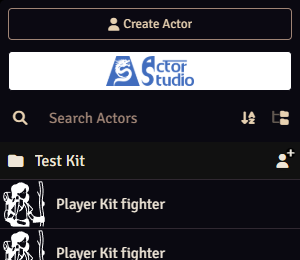

The first time you log in, two windows open by themselves: the Actor Studio welcome window and
Foundry's **User Configuration**. Tick **Don't show this message again** in the welcome window and
close it. Close User Configuration too: you pick your character there in
[step 11](#11-make-it-your-character), and until you do, it opens again every time you join.

The builder window has the tabs **Abilities**, **Species**, **Background** and **Class**, a
**Character Name** box at the bottom and a bar that says how far you are.

> If you get the message "User requires the 'Create New Actors' permission", tell the GM. Players
> can't make characters until the GM ticks **Create Actors** for the Player role (see the GM's [Prepare session 0](../gm/prepare-session-0.md)).

## 2. Abilities

1. If you see an **Ability Generation Method** list, open it and pick the method your GM chose.
   If the GM switched on only one method, there is no list: the tab just shows that method.
2. Put your best scores where your class needs them. With the standard array, use the small arrows
   next to each score to swap it with its neighbour. For example, a wizard wants the highest score in
   Intelligence, a fighter in Strength or Dexterity.

Don't add anything for your background yet: the builder asks for that later.

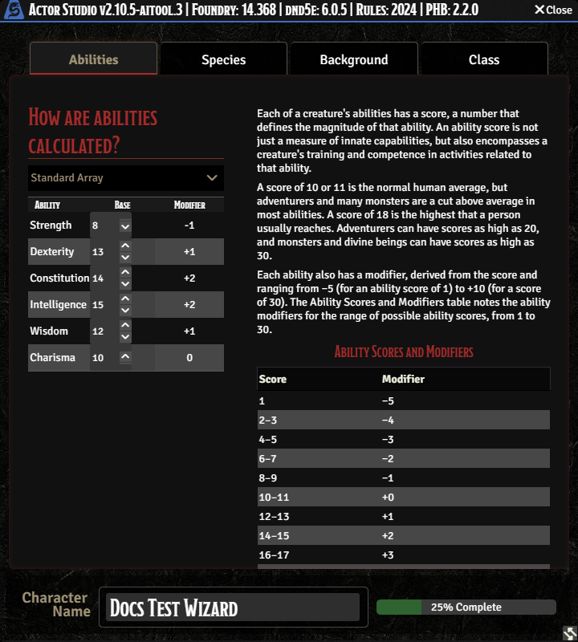

## 3. Species

Open the **Species** list and pick one. Its description and traits show below.

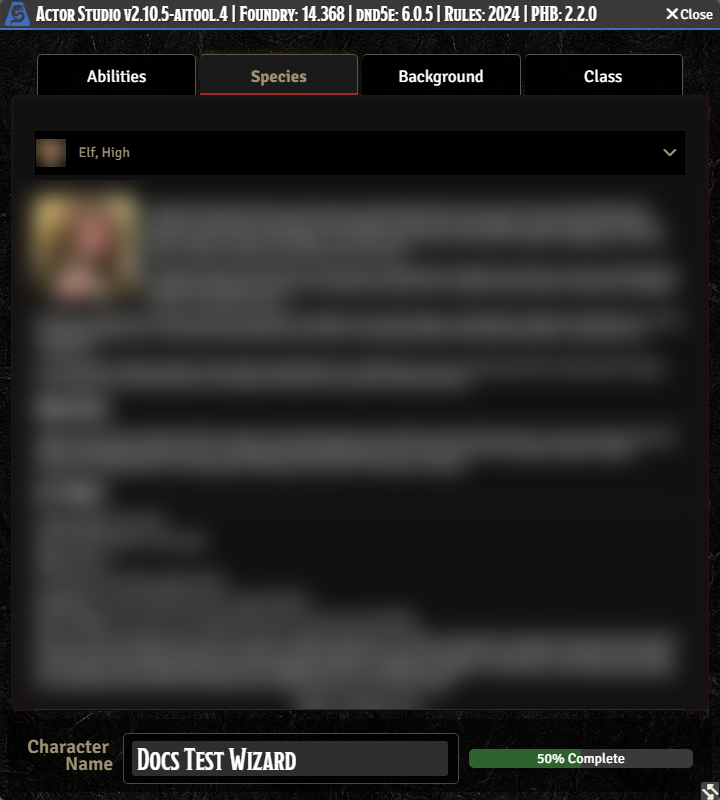

Some species appear more than once, one entry per lineage: Elf (Drow, High, Wood), Gnome (Forest,
Rock) and Tiefling (Abyssal, Chthonic, Infernal). The list shows the lineage after the name, for
example "Elf, High". Pick the one you want.

## 4. Background

Open the **Background** list and pick one. The box shows what it gives you: which ability scores it
can raise, a feat, two skills, a tool and starting equipment.

**Note the two skills your background gives.** Your species may let you pick a skill later (an elf
does), and picking one you already have costs you a proficiency, see
[step 7](#7-advancements-answer-each-step).

## 5. Class

Open the **Class** list and pick one. The page shows the class's main ability, hit points, saving
throws, skills to choose from, and starting equipment. In the 2024 rules you pick a subclass at
level 3, so not now: you pick it when you level up in
[step 10](#10-level-up-to-level-3-then-check-your-sheet).

## 6. Name and create

1. **Replace the name in Character Name** at the bottom. It starts out as your own player name, and
   the bar already says 100% before you type anything, so it is easy to click straight through.
   If you forget, your character ends up named after you.
2. Click **Create Character**.

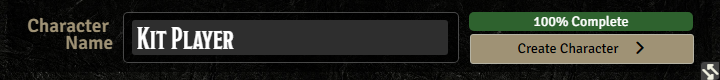

Your character now exists (you can see it in the Actors tab), and the builder moves on to the
**Advancements** tab. Up to here you could change anything freely. From here, if you made a wrong
choice, finish anyway and tell the GM.

## 7. Advancements: answer each step

The builder walks through what your species, background and class give you, one step at a time
("Step 2 of 3"; the number of steps depends on your choices). Some steps only tell you what you
get; click **Next**. Others ask you to choose. After **Complete** a step may show a blank panel for
about 5 seconds: wait for the next one.

**Pick everything a step asks for before you click Next.** The Next button works even when you have
picked nothing, and then your character simply misses that choice. Look for text like "Select 1
more Skill Proficiency": it must be gone before you click Next. **Previous** goes back a step.

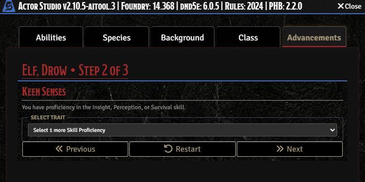

The steps you will see, roughly in this order:

- **Species traits:** for example a skill to choose (an elf picks Insight, Perception or Survival),
  and a spellcasting ability for species magic. **Pick a skill your background does not already
  give you.** The species steps come first, and the background's fixed skills are not offered
  again afterwards, so a skill you pick twice is silently lost and you end up with one skill too
  few.
- **Size:** the step may be set to **Small** even for a species that is Medium (a human, for
  example). Open the list and choose **Medium** unless your species really is small.
- **Choices with a counter**, like Divine Order for a cleric: the step shows **Chosen 0 of 1**.
  Next lets you through at 0, so wait until it reads **Chosen 1 of 1** (or whatever the second
  number is). If you clicked past one, press **Previous** to go back and choose.
- **Background ability scores:** raise the three listed scores: one by 2 and another by 1, or all
  three by 1. Click **+** next to the scores until it says **0 Points Remaining**.

  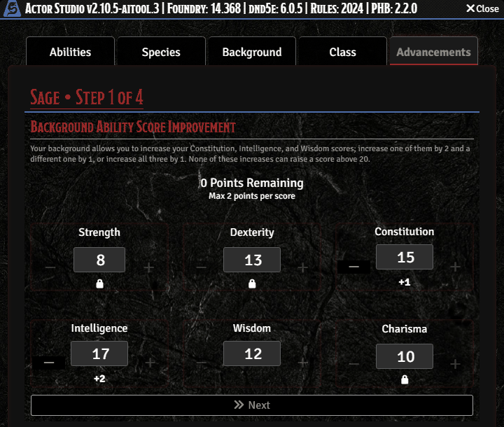

- **Languages, skills and tools** from your background.
- **The background's feat.** Some feats ask for more choices. Magic Initiate, for example, asks for
  two cantrips and a level-1 spell: pick them all, using **Select Spell** for each. The picker is
  Foundry's compendium browser, and it needs care:
  - **Pick the copy labelled "PHB 2024".** Most spells are listed once per book (SRD 5.1, SRD 5.2,
    PHB, PHB 2024), so you see the same name up to four times.
  - **Pick only spells of the class named after Magic Initiate**, for example Wizard spells for
    Magic Initiate (Wizard). The class filters are locked on for Cleric, Druid and Wizard together,
    so you are also shown spells from the other two lists, and nothing stops you picking one.
  - The search box in that browser needs **Enter** before it filters.
  - **A feat that asks for a spellcasting ability, and then asks again** (a second Magic Initiate
    step): the second step puts the ability back to **Intelligence**, although it should match the
    first. Set it again to the same ability as your cantrips, for example Wisdom for a cleric's
    list.
  - A spell card may linger at the bottom right of the screen after the browser closes. Ignore it.

  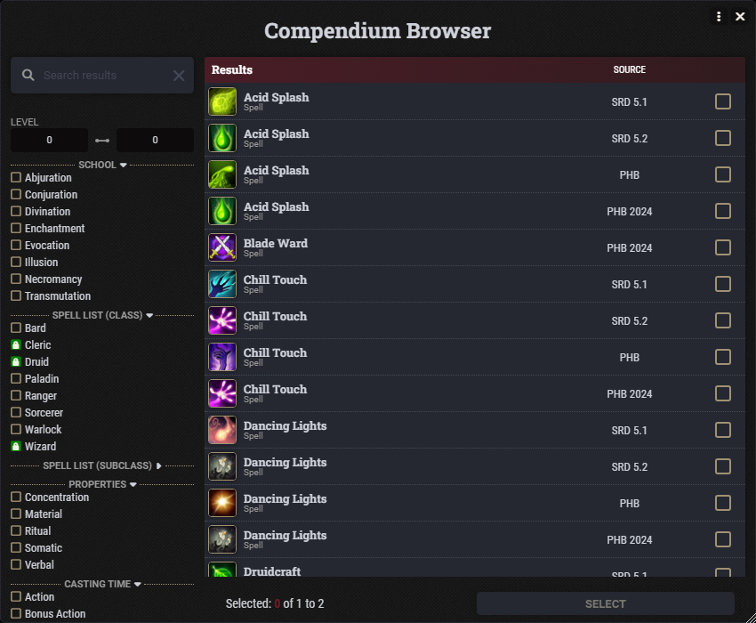

- **Class:** hit points, saving throws, **skills to choose** (most classes pick two), weapon and
  armour training, and your level-1 class features. The steps are headed "Level 1 -> 2" even though
  you are building a level-1 character first; that is a labelling quirk. Do the steps as they come.

## 8. Equipment

Next comes the **Equipment** tab.

1. Under **Starting Gold**, pick one option for your background and one for your class: the
   equipment plus a little gold, or only gold.
2. The **Planned Inventory** on the right shows what you get.
3. Scroll down in the left column. The items turn green by themselves, but **the gold amounts
   (for example 5 GP and 8 GP) stay black until you click them**, and that is one thing that holds the bar at
   75%. Click each gold amount until it is green and the bar at the bottom reaches
   **100% Complete**.
4. **If a row offers "any holy focus"** (a cleric's class row and the Acolyte background do),
   it opens a **Select focus** list on the right, and the bar stays at 75% until you have chosen
   from every such row. The list has no plain "Holy Symbol": pick **Amulet**, **Emblem** or
   **Reliquary**, whichever suits your character.
5. Click **Confirm**.

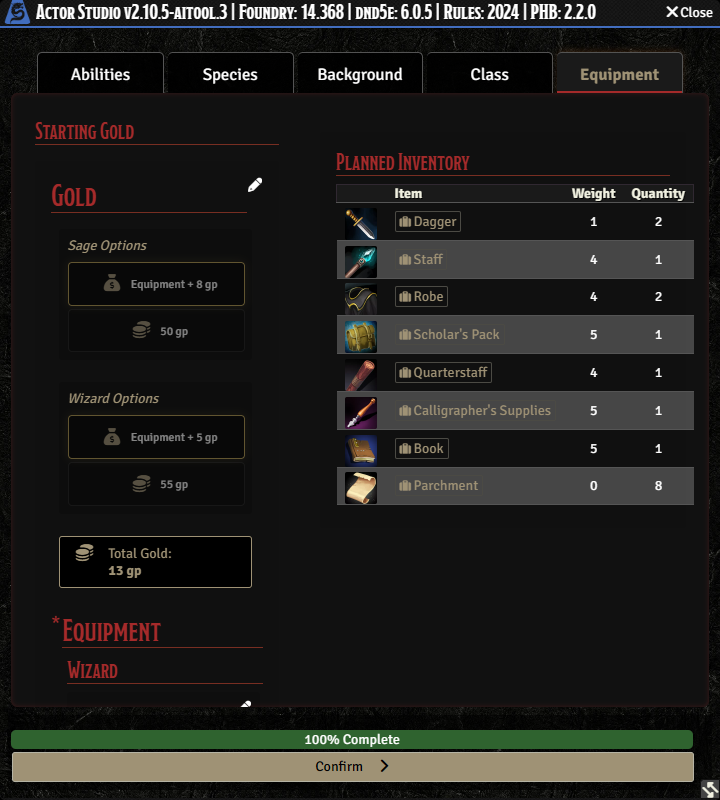

## 9. Spells (spellcasters only)

If your class casts spells at level 1, the **Spells** tab opens. At the top it says how many you
may pick, for example "Cantrips: 0/3, Spells: 0/6".

1. Click **[+] Cantrips** to open the list, then the **+** at the right of each cantrip you want.
   **Skip cantrips you already got from a feat** such as Magic Initiate: the list still offers
   them, and a double wastes a pick.
2. Do the same under **[+] Level 1**.
3. When both counters are full, click **Finalize Spells**.

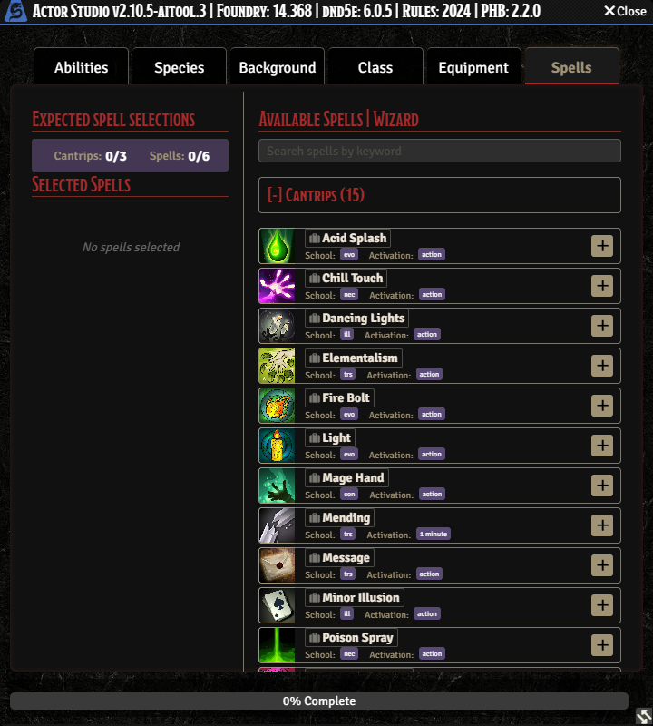

Your character sheet opens.

## 10. Level up to level 3, then check your sheet

Your sheet is open and shows level 1. Our campaign starts at level 3, so you level up twice, one
level at a time, with the same builder.

### Level up to level 3

1. A gold **Level Up** button appears at the top of your sheet. **It only shows when the GM has
   switched on Milestone Levelling, or has given you enough experience points (XP).** If there is
   no button, ask the GM.
2. Click it. The window **Level Up Existing Class** opens. Click the **+** at the right end of your
   class's row (the row itself does nothing).
3. **Going from level 2 to 3, you also choose your subclass.** A **Choose Subclass** list appears
   under the class row. Click it (if it does not open, click it again), pick one, and read its
   description. The bar at the bottom reaches 100% when you have picked.
4. Click **Add Character Level**. The steps run like in [step 7](#7-advancements-answer-each-step):
   - **Hit Points:** tick **Take Average** (or roll). Next does nothing until you have chosen.
   - **Choices with a counter** (for example a wizard's level-2 **Scholar** skill for Expertise,
     or an elf's spellcasting ability at level 3): choose before you click Next.
   - **Information steps** (new class features, **Max Prepared Spells**, the **Subclass** step):
     click **Next**.
5. Click **Complete** on the last step. **At level 3 a second window then opens with your
   subclass's features (for example "Champion • Level 2 -> 3, Step 1 of 1"). Click Complete in it
   too.** If you skip it, the sheet shows the new level but no subclass and no subclass features.
6. Do this twice: level 1 to 2 first (no subclass then, so go straight to **Add Character
   Level**), then level 2 to 3.

A caster's level-up raises how many spells you may **prepare**, but it does **not** ask which new
spells you learn (a wizard's two new spellbook spells, for example). Open the **Spells** tab
afterwards and ask the GM or your D&D helper which to add.

### Check your sheet

Look over the sheet before you call it done. Ask the GM if anything looks wrong.

- [ ] The level is 3, and the class, subclass, species and background are right.
- [ ] Hit points: your class's hit die at its highest at level 1, plus the average (or your roll)
      for levels 2 and 3, plus your Constitution modifier for each of the three levels (a fighter
      with Constitution 14 who took the average has 12 + 8 + 8 = 28).
- [ ] Proficiency bonus is +2 (it stays +2 until level 5).
- [ ] Skills: the ones from your background (two), your class (usually two) and your species, if it
      gives one (and a wizard's Scholar skill). Count them: one too few means a step was skipped,
      or you picked a skill you already had.
- [ ] Spells: every cantrip and spell you picked, including those from a feat such as Magic
      Initiate.
- [ ] Armour class (AC). **Actor Studio puts your armour, shield and weapons on the sheet but
      does not equip them**, so AC reads as if you wore nothing (a cleric with a chain shirt and a
      shield shows 11 instead of 16). Open the **Inventory** tab and click the small icon at the
      right end of the row of each piece of armour, your shield and your weapons (hover over it:
      it says "Not Equipped", and "Equipped" after you click). The AC updates at once.
- [ ] Equipment and gold are on the **Inventory** tab. **Wizards:** the starting kit has no
      spellbook. Ask the GM to add one.

**Prepare your spells.** Classes that prepare spells (for example wizard, cleric, druid) start with
none prepared. On the **Spells** tab the card at the top says how many you may prepare. Click the
small button at the right end of a spell's row to prepare it; hover over it to see whether a spell
is prepared ("Prepared" or "Not Prepared").

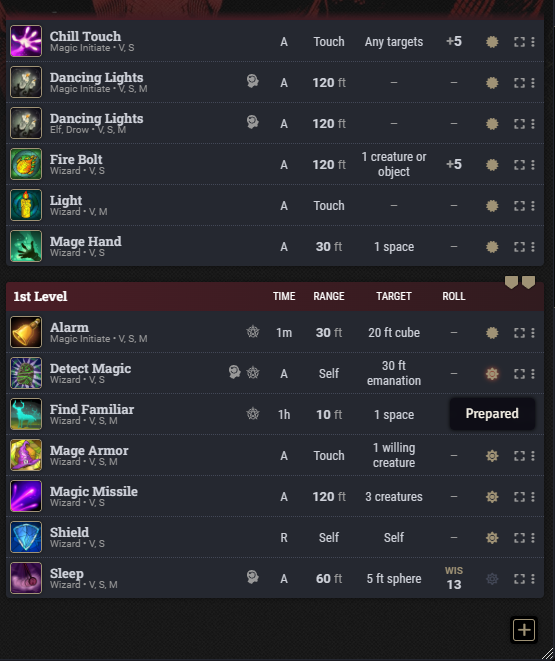

A few cosmetic oddities are normal. For example, the Spells tab may show a raw label such as
`GAS.Spells.Cantrip` under your chosen cantrips. It changes nothing.

**Know your character.** Before the first session, read through your features and spells once.
Knowing what your character can do is your job, so the game doesn't stop to look things up.

## 11. Make it your character

Foundry needs to know which character is yours, so it uses it for your rolls and tokens.

1. In the **Players** list at the bottom left, right-click your own name and choose **User
   Configuration**.
2. Under **Player Character**, pick your new character.
3. Click **Save Player Configuration**.

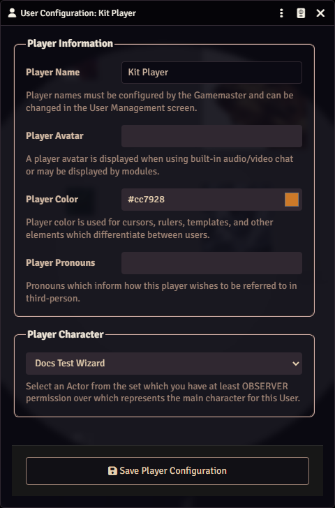

The Players list now shows your name with the character's name in brackets.

## 12. A portrait (optional)

Players can't upload pictures to Foundry. Send your picture to the GM on Discord, and the GM adds it
as your portrait and token.

## If something goes wrong

| What happened                                      | What to do                                                                                                                                |
| -------------------------------------------------- | ----------------------------------------------------------------------------------------------------------------------------------------- |
| "User requires the 'Create New Actors' permission" | The GM has to allow players to make characters. Tell them.                                                                                |
| A list is empty, or shows only a few choices       | The builder is not set to the right books. Tell the GM.                                                                                   |
| You closed the builder halfway                     | Your character may exist half-made in the Actors tab. Ask the GM to delete it, then start again.                                          |
| Actor Studio says it is "already open and busy"    | The half-made character is blocking it. Reload the page (F5). Players can't delete characters, so ask the GM to delete the half-made one. |
| AC is lower than it should be                      | Equip your armour and shield on the **Inventory** tab of your sheet.                                                                      |
| Next lets you through a step with nothing chosen   | Press **Previous** and choose. Check the **Chosen x of y** counter before every Next.                                                     |
| There is no **Level Up** button on your sheet      | The GM has to switch on Milestone Levelling, or give you XP. Tell them.                                                                   |
| Level 3 shows, but no subclass on the sheet        | You skipped the second **Complete** (the subclass's features window). Tell the GM, who can add the subclass.                              |
| You skipped a choice with Next                     | Finish, then tell the GM what is missing. The GM can add it, or delete the character so you can redo it.                                  |
| Equipment stays below 100%                         | Click the gold amounts, and pick from every **Select focus** list, until everything is green.                                             |
| The panel is blank after you click Complete        | Wait about 5 seconds. The next step appears by itself.                                                                                    |
| A list is not what the GM described                | The GM may have changed the settings after you opened the page. Reload the page (F5).                                                     |
| Your character is named after you                  | You left Character Name as it was. Tell the GM, who can rename it.                                                                        |
| You picked a wrong spell, or the same spell twice  | Tell the GM. They can swap it on your sheet.                                                                                              |

## What to ask your GM

- Which ability score method, and which books and options are allowed.
- How your character knows the others, or why they are travelling together.
- Anything about the world your character would know.

What the tool records while you play, and how to have it removed: [player guide](README.md).
